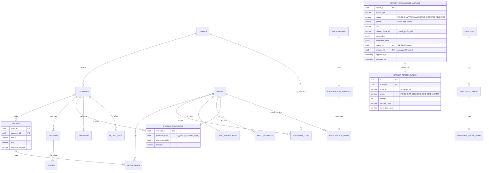

# 🗃️ ERD — مصدر Mermaid (النطاق الجوهري)
> **المرجع الكامل التفاعلي:** `ERD_v7_تفاعلي.html` (37 جدولًا · 39 جدولًا في الإنتاج)
> هذا المصدر يغطي النواة العلائقية — يُعرض بدعم Mermaid في GitHub/VS Code/Obsidian

**ملاحظات الحوكمة الظاهرة في التصميم:**
- `MARKET_INTELLIGENCE_ACTIONS` يحمل `maker_id` + `checker_id` — لا يُنفَّذ قرار CRITICAL إلا بهويتين مختلفتين
- `MARKET_ACTION_OUTBOX` يحمل `payload_hash` + `worm_line_hash` — التنفيذ مرة واحدة والربط بسجل WORM
- `EVENTS` يحمل `payload_hash` + `prev_hash` — سلسلة تدقيق جلسات المحادثة
