# تحليل النظام الشامل — AI-COS: نظام التشغيل الذكي للأعمال
## (System Analysis — AI-COS: Agentic Business Operating System)

**مشروع التخرج — نظم المعلومات الإدارية (BIS)**

| البند | التفاصيل |
|-------|----------|
| اسم المشروع | AI-COS — Agentic Business Operating System |
| القطاع التجريبي | صيدلية (Pharmacy) — Vertical Pack #1 |
| المبدأ التصميمي | الكود يحسب، النموذج اللغوي يُعبِّر (Code Calculates, LLM Articulates) |
| تاريخ الإنشاء | 2026-09-27 |

---

# 1. المقدمة (Introduction)
يشهد عصرنا الحالي تطوراً متسارعاً في دمج تقنيات الذكاء الاصطناعي (Artificial Intelligence) ضمن أنظمة معلومات الأعمال (Business Information Systems - BIS)، مما أحدث نقلة نوعية في كيفية إدارة العمليات المؤسسية. يهدف هذا المستند التحليلي إلى تقديم تحليل نظم (System Analysis) أكاديمي وهندسي مفصل لمشروع "AI-COS" (نظام تشغيل الأعمال القائم على وكلاء الذكاء الاصطناعي - Agentic Business Operating System)، وتحديداً للحزمة العمودية الأولى (Vertical Pack #1) المخصصة لقطاع الصيدليات (Pharmacy). يتمثل الدافع الرئيسي وراء هذا المشروع في تجاوز الأنظمة التقليدية الجامدة، نحو تبني بنية تعتمد على الذكاء الاصطناعي التوليدي والوكلاء المستقلين (Autonomous Agents) لإدارة العمليات اليومية بكفاءة وموثوقية، مع تطبيق مبدأ "الكود يحسب، الذكاء الاصطناعي يصيغ" (Code Calculates, LLM Articulates) لضمان الدقة وتجنب الهلوسة (Hallucinations). يستعرض هذا المستند في هيكله متطلبات النظام الوظيفية وغير الوظيفية، قواعد العمل (Business Rules)، وهيكلية النظام التفصيلية التي تضمن أداءً متميزاً وآمناً.

# 2. نظرة عامة على النظام (System Overview)
نظام AI-COS ليس مجرد تطبيق لإدارة الصيدليات، بل هو "نظام تشغيل للأعمال" ذو بنية هيكلية معيارية أحادية (Modular Monolith) تتكون من واجهة خلفية (FastAPI) وواجهة أمامية (Next.js 18+). تم تصميمه ليكون قابلاً للتوسع لدعم قطاعات مختلفة عبر مفهوم الحزم العمودية (Vertical Packs)، حيث تعمل "الصيدلية" حالياً كحزمة نشطة ومكتملة التنفيذ، بالإضافة إلى توفر قوالب لقطاعات أخرى مثل "المقاهي" (Coffee) و"الملابس" (Apparel). يعتمد النظام على محرك ذكاء اصطناعي ثلاثي الطبقات (3-tier LLM Engine): محلي (Ollama)، وسحابي (Gemini)، وبديل حتمي (Deterministic Fallback)، بالإضافة إلى استخدام 9 وكلاء ذكاء اصطناعي (AI Agents) بالإضافة إلى المنسق (Orchestrator)، الذين يغطون أكثر من 21 نطاق عمل (Domain). يتكامل هذا النظام مع سير عمل آلي (n8n Automations)، ويعتمد على مبدأ "الكود يحسب، الذكاء الاصطناعي يصيغ" بحيث تُترك الحسابات الرياضية الدقيقة للأنظمة البرمجية بينما يتولى الذكاء الاصطناعي التفسير وصياغة القرارات وتقديمها للمستخدم بشكل مبسط ومفهوم.

# 3. الخلفية (Background)
تاريخياً، تطورت نظم دعم القرار (Decision Support Systems - DSS) وأنظمة تخطيط موارد المؤسسات (Enterprise Resource Planning - ERP) من مجرد قواعد بيانات لتسجيل المعاملات المباشرة إلى أنظمة تحليلية معقدة. في سياق الصيدليات والأعمال التجارية، اعتمدت الأنظمة السابقة بشكل كبير على الإدخال اليدوي، والتحديثات الدورية (Batch Processing)، وغياب الرؤى الاستباقية (Proactive Insights). في الأدبيات الحديثة لأنظمة المعلومات (Information Systems Literature)، برز الاتجاه نحو الأنظمة الذكية المستقلة (Autonomous Intelligent Systems)، التي تستغل قوة النماذج اللغوية الكبيرة (LLMs) والوكلاء الأذكياء (Intelligent Agents). يأتي AI-COS ليمثل الجيل القادم من أنظمة الأعمال، حيث يتجاوز مجرد تخزين وعرض البيانات، نحو تحليلها تلقائياً، واكتشاف الأنماط، وتوليد الإجراءات التلقائية عبر الوكلاء ضمن سياق نظام متكامل (System-in-the-Loop)، مما يعكس التطور المتقدم لنظم معلومات الأعمال (BIS).

# 4. بيان المشكلة (Problem Statement)
تعاني الإدارة التقليدية للصيدليات والأنشطة التجارية المشابهة من عدة مشاكل جوهرية، أبرزها:
1. الاعتماد على العمليات اليدوية (Manual Processes) في جرد المخزون وتحديد الكميات المطلوبة، مما يؤدي إلى نفاد المخزون (Stockouts) أو تراكمه (Overstocking).
2. الافتقار إلى القدرة على اتخاذ قرارات تسعير وتسويق قائمة على البيانات (Data-Driven Decisions)، مما يضعف التنافسية.
3. تفكك الأنظمة (Disconnected Systems) حيث تعمل مبيعات نقاط البيع (POS) بمعزل عن التحليلات المالية أو أدوات التواصل مع العملاء.
4. غياب الأتمتة (Lack of Automation) في المهام الروتينية مثل التذكير بصرف الأدوية (Prescription Refills) وطلبات الشراء من الموردين، وتتبع الحسابات المالية بكفاءة.

# 5. الدافع / الحاجة التجارية (Motivation / Business Need)
تكمن الحاجة التجارية الملحة لنظام AI-COS في الرغبة في تحويل العمليات التشغيلية الجامدة إلى عمليات رشيقة (Agile) وذكية. وتشمل الدوافع الرئيسية:
- **خفض التكاليف (Cost Reduction):** من خلال تحسين مستويات المخزون وتقليل الهدر باستخدام خوارزميات دقيقة.
- **دقة اتخاذ القرار (Decision Accuracy):** استغلال تحليلات البيانات اللحظية والتقارير المالية الموثوقة التي يصدرها الوكلاء.
- **الأتمتة الشاملة (End-to-End Automation):** لتقليل التدخل البشري في المهام المتكررة وإدارة حملة التسويق ودعم العملاء.
- **الميزة التنافسية (Competitive Advantage):** عبر تقديم أسعار ديناميكية (Dynamic Pricing)، وتجربة عملاء متطورة (RFM Segmentation)، مما يعزز الولاء ويرفع كفاءة التشغيل.

# 6. الأهداف (Objectives)
يهدف مشروع AI-COS لتحقيق الأهداف التالية والمبنية على مبادئ أنظمة معلومات الأعمال (BIS Principles):
1. تصميم وبناء بنية تحتية برمجية معيارية (Modular Architecture) قادرة على استيعاب نماذج أعمال متعددة (Vertical Packs).
2. تطبيق خوارزميات متقدمة لإدارة المخزون بدقة (مثل نموذج Wilson EOQ).
3. توفير نظام تسعير ديناميكي وآمن يحترم حدود التسعير المسموحة لكل فئة (Pricing Caps).
4. إنشاء دفتر أستاذ غير قابل للتعديل (WORM Cryptographic Ledger) لضمان النزاهة المالية وتتبع السجلات.
5. تطوير خط أنابيب دقيق لاستخراج البيانات من الوصفات الطبية بالاعتماد على الرؤية الحاسوبية (TrOCR + Florence-2 Pipeline).
6. تفعيل أتمتة الأعمال وسير العمل المتقدم من خلال التكامل مع محرك (n8n).
7. حماية البيانات الشخصية عبر تطبيق خوارزميات طمس وحجب تلقائي للبيانات الحساسة (PII Redaction).

# 7. نطاق النظام (System Scope)
**الداخل في النطاق (In-Scope):**
- إدارة المخزون، المشتريات، المبيعات (POS)، والموردين لقطاع الصيدليات.
- الوكلاء الذكياء المتخصصون (المخزون، التسويق، التسعير، المالية، التحليلات، الدعم، نجاح العملاء، التوثيق، والأتمتة).
- معالجة الصور واستخراج النصوص من الوصفات الطبية (OCR Pipeline).
- إدارة بيانات العملاء، تحليل الولاء، وتوقع التسرب (Churn Detection).
- المعاملات المالية المزدوجة وإنشاء تقارير الدخل (P&L) وحساب ضريبة القيمة المضافة.
- واجهة مستخدم أمامية (Frontend) ثنائية اللغة (العربية/الإنجليزية).

**الخارج عن النطاق (Out-of-Scope):**
- الأنظمة الطبية التشخيصية للمرضى (التي تتطلب موافقات هيئات الغذاء والدواء بشكل كامل لتشخيص الأمراض).
- إدارة الموارد البشرية وكشوف المرتبات المتكاملة (HR & Payroll).
- التصنيع الدوائي وإدارة سلاسل الإمداد العالمية للتصنيع.

# 8. أصحاب المصلحة والممثلون (Stakeholders and Actors)

| الفاعل / صاحب المصلحة (Actor/Stakeholder) | الدور والوصف (Role & Description) | الاهتمامات الرئيسية (Key Interests) | التفاعلات مع النظام (Interactions) |
| :--- | :--- | :--- | :--- |
| **المدير العام (Super Admin)** | يدير النظام بأكمله على مستوى المستأجرين (Tenants) والتكوينات الأساسية | استقرار النظام، الأمان، وإضافة حزم عمودية أو مستأجرين جدد | وصول كامل لإعدادات النظام وصلاحيات المستخدمين والبيانات |
| **مدير الصيدلية (Admin)** | مسؤول عن فرع أو كيان تجاري (Tenant) داخل النظام | الأرباح، التكاليف، أداء الموظفين، وتقارير الوكلاء الأذكياء (CFO, DSS) | لوحات القيادة (Dashboards)، إعدادات التسعير، والموافقة على خطط المشتريات |
| **الصيدلي (Pharmacist)** | المستخدم اليومي المباشر لإدارة المبيعات والوصفات الطبية | سهولة الاستخدام، سرعة الاستجابة، دقة قراءة الوصفات الطبية | واجهة المبيعات، معالجة الصور (OCR)، البحث السريع عن الأدوية |
| **العميل (Customer)** | المستفيد النهائي من الخدمة | الحصول على الدواء المناسب، الخصومات الترويجية، التذكير بالمواعيد | استلام الإشعارات (SMS/Email/WhatsApp)، التفاعل مع واجهة الدعم (Floating Chat) |
| **محرك الذكاء الاصطناعي (AI Engine)** | ممثل نظامي (System Actor) يضم 9 وكلاء | معالجة البيانات، توليد الرؤى، واستنتاج الإجراءات | تحليل البيانات، الرد على الاستفسارات، توليد الخصومات، تطبيق قواعد الـ PII |
| **محرك الأتمتة (n8n Engine)** | ممثل نظامي لتنفيذ سير العمل (Workflows) | تنفيذ الإجراءات المجدولة والاستجابة الطارئة بفعالية وموثوقية | سحب المهام، إرسال التنبيهات، والتواصل الآلي (M2M Auth) |
| **الخدمات الخارجية (External Services)** | بوابات الدفع، مزودي الرسائل النصية، قواعد بيانات الأدوية الخارجية | الاعتمادية والتوفر | تبادل واجهات برمجة التطبيقات (API Integration) |

# 9. المشكلات الحالية / العمليات القائمة (Current Business Problems / Existing Process)
في العمليات القائمة الحالية (Pre-AI-COS):
- **إدارة المخزون:** تعتمد على الحدس البشري أو تقارير شهرية متأخرة، مما يؤدي إما لتكديس رأس المال في أدوية بطيئة الحركة، أو فقدان المبيعات بسبب نفاد الأدوية الحرجة.
- **التسعير والتسويق:** الخصومات تُمنح بشكل عشوائي دون دراسة قيمة العميل (RFM)، مما يهدر ميزانية التسويق ويقلل من فرصة استعادة العملاء المحتمل تسربهم.
- **تحليل الوصفات الطبية:** يتم يدوياً، مما يستغرق وقتاً طويلاً ويزيد احتمالية الخطأ البشري، خاصة في أوقات الذروة.
- **التقارير المالية:** عملية معقدة تتطلب مراجعة دفاتر المبيعات والمشتريات يدوياً لحساب الدورة النقدية (CCC) والأرباح.
- **خدمة العملاء:** غياب المتابعة التلقائية لمرضى الأمراض المزمنة لتذكيرهم بمواعيد الأدوية (Refills).

# 10. النظام المقترح (Proposed System)
يقدم نظام **AI-COS** الحل الشامل لهذه التحديات من خلال بنية تكنولوجية حديثة (Modern Tech Stack):
- **بنية التطبيق (Architecture):** يعتمد نهج الـ Modular Monolith لتوفير سهولة النشر والصيانة مع مرونة التوسع للقطاعات الأخرى عبر الحزم العمودية (Vertical Packs). وتستخدم قاعدة بيانات متقدمة (Supabase PostgreSQL) محصنة بسياسات الأمان (RLS).
- **إدارة ذكية للمخزون:** يطبق النظام معادلات علمية مثل Wilson EOQ ونماذج التنبؤ بمعدل الحرق (Burn Rate) عبر وكيل المخزون المخصص لضمان توفر الأدوية بأقل تكلفة ممكنة.
- **التسويق والتسعير:** يقوم وكيل التسويق بتقسيم العملاء لحظياً (RFM Segmentation) ويولد الكوبونات بشكل آمن (Coupon Dedup)، بينما يضمن وكيل التسعير تطبيق قواعد التسعير الديناميكي ضمن القيود القانونية (Pricing Caps).
- **التعرف البصري والتحليلات:** يتبنى خط أنابيب لمعالجة الصور (OCR Pipeline) يدمج قدرات النماذج المتقدمة للتعرف السريع والدقيق على الوصفات، مصحوباً بمحرك أتمتة (n8n) لتولي مهام المراسلات اليومية والتقارير المستمرة.

# 11. المتطلبات الوظيفية (Functional Requirements)

| المعرف (ID) | المتطلب (Requirement) | الممثل (Actor) | الغرض التجاري (Business Purpose) | دليل التنفيذ (Implementation Evidence) | الحالة (Status) |
| :--- | :--- | :--- | :--- | :--- | :--- |
| **FR-001** | يجب أن يقوم النظام بتصنيف عناصر المخزون بناءً على تصنيف ABC للتحكم في المخزون. | وكيل المخزون (Inventory) | التركيز على الأصناف عالية القيمة وتوجيه الموارد بكفاءة | `abc_classification` logic in inventory domain | منجز |
| **FR-002** | يجب أن يحسب النظام كمية الطلب الاقتصادي (EOQ) باستخدام معادلة ويلسون $\sqrt{2DS/H}$. | وكيل المخزون (Inventory) | تقليل تكاليف الطلب والاحتفاظ بالمخزون | `calculate_eoq` function with $S=45$, $H=0.18 \times \text{unit\_cost}$ | منجز |
| **FR-003** | يجب أن يقوم النظام بحساب وتحديث مخزون الأمان (Safety Stock) ومعدل الحرق (Burn Rate). | وكيل المخزون (Inventory) | منع حالات نفاذ المخزون المفاجئة | Background tasks in inventory agent | منجز |
| **FR-004** | يجب أن يقوم النظام بتقسيم العملاء بناءً على نموذج حداثة وتكرار وقيمة الشراء (RFM). | وكيل التسويق (Marketing) | استهداف العملاء بحملات تسويقية ملائمة | `rfm_segmentation` algorithms | منجز |
| **FR-005** | يجب أن يكتشف النظام العملاء المحتمل تسربهم (Churn Detection) بناءً على حد تسرب (Threshold 0.33). | وكيل التسويق (Marketing) | اتخاذ إجراءات استباقية للحفاظ على ولاء العملاء | Churn threshold constant in marketing config | منجز |
| **FR-006** | يجب أن يولد النظام كوبونات خصم فريدة ويمنع تكرار استخدامها (Deduplication). | وكيل التسويق (Marketing) | منع الاحتيال وتنظيم العروض الترويجية | `coupons` table constraints | منجز |
| **FR-007** | يجب أن ينفذ النظام اختبارات (A/B Testing) للحملات التسويقية. | وكيل التسويق (Marketing) | تحسين فعالية العروض التسويقية | `ab_tests`, `ab_test_results` tables | منجز |
| **FR-008** | يجب أن يطبق النظام تسعيراً ديناميكياً مع قيود قصوى (10% مزمن، 20% تجميلي، 12% عام). | وكيل التسعير (Pricing) | تعظيم الربحية مع الالتزام بقواعد تسعير الأدوية | Pricing caps logic in pricing domain | منجز |
| **FR-009** | يجب أن يقوم النظام بحساب دورة التحول النقدي (CCC = DIO + DSO - DPO). | وكيل المالية (CFO) | مراقبة التدفقات النقدية والصحة المالية للمؤسسة | Financial algorithms in finance domain | منجز |
| **FR-010** | يجب أن يحسب النظام ضريبة القيمة المضافة (VAT) بمعدل 14% مصري (الصافي = الإجمالي / 1.14). | وكيل المالية (CFO) | الامتثال للقوانين الضريبية المصرية | Hardcoded VAT logic 14% | منجز |
| **FR-011** | يجب أن يسجل النظام جميع المعاملات المالية كقيود يومية مزدوجة (Journal Entries). | وكيل المالية (CFO) | ضمان نزاهة المحاسبة المالية ودفتر الأستاذ | `journal_entries`, `journal_entry_lines` tables | منجز |
| **FR-012** | يجب أن يولد النظام تقارير الأرباح والخسائر (P&L). | وكيل المالية (CFO) | تقييم الأداء المالي للمنظمة | P&L reporting functions | منجز |
| **FR-013** | يجب أن يطبق النظام بطاقة الأداء المتوازن (Balanced Scorecard) ومؤشرات الأداء (KPIs). | وكيل التحليلات (DSS) | قياس الأداء الشامل للعمليات الاستراتيجية | DSS agent logic | منجز |
| **FR-014** | يجب أن يوفر النظام ميزة المحاكاة (What-If Simulation). | وكيل التحليلات (DSS) | دعم التخطيط الاستراتيجي المستقبلي | What-If Simulator agent tool | منجز |
| **FR-015** | يجب أن يوفر النظام نظام دعم واستعلام مبني على توليد المعرفة المستردة (RAG) للأسئلة الشائعة (FAQ). | وكيل الدعم (Support) | تحسين خدمة العملاء وتقليل الضغط على الموظفين | Knowledge vector chunks (384d), RAG implementation | منجز |
| **FR-016** | يجب أن يقوم النظام بتصنيف تذاكر الدعم الفني بشكل تلقائي. | وكيل الدعم (Support) | توجيه المشاكل للجهات المعنية وتسريع الاستجابة | Ticket classification logic | منجز |
| **FR-017** | يجب أن يجدول النظام تذكيرات صرف الأدوية (Reminders) بإزاحة قدرها 0.85 من متوسط أيام الدورة. | وكيل نجاح العملاء (CS) | ضمان استمرارية العلاج للمرضى وزيادة المبيعات | Reminder offset formula: $\text{avg\_cycle\_days} \times 0.85$ | منجز |
| **FR-018** | يجب أن يحسب النظام فترة الثقة (CI) لأيام الصرف المتوقعة (Predicted Days $\pm 1.96 \times 4.10$). | وكيل نجاح العملاء (CS) | تقدير الفترات بدقة إحصائية عالية | CI calculation implementation | منجز |
| **FR-019** | يجب أن يولد النظام سياسات الامتثال وإنشاء مسار تدقيق (Audit Trail). | وكيل التوثيق (Compliance) | ضمان المطابقة مع اللوائح والشفافية | `audit_logs` table | منجز |
| **FR-020** | يجب أن يدير النظام سير العمل الآلي والتواصل الداخلي من خلال الأتمتة (n8n). | وكيل الأتمتة (Automation) | تقليل التدخل اليدوي وتسريع العمليات | 7 defined n8n workflows | منجز |
| **FR-021** | يجب أن يعالج النظام صور الوصفات الطبية لاستخراج النصوص (OCR Pipeline). | النظام (AI Engine) | تسريع عملية صرف الأدوية وتقليل أخطاء الإدخال | TrOCR + Florence-2 integration, line segmentation | منجز |
| **FR-022** | يجب أن يدمج النظام فرضيات القراءة (Hypothesis Fusion) والمطابقة التقريبية (Fuzzy Matching). | النظام (AI Engine) | تحسين دقة قراءة الأسماء التجارية للأدوية | OCR pipeline fuzzy matching logic | منجز |
| **FR-023** | يجب أن يدير النظام مستخدمين بـ 4 أدوار أساسية (RBAC): (Super Admin, Admin, Pharmacist, Customer). | النظام (Auth) | التحكم بالوصول إلى البيانات والميزات الوظيفية | Supabase Auth, RBAC middleware | منجز |
| **FR-024** | يجب أن يقوم النظام بحجب البيانات الشخصية الحساسة (PII Redaction) باللغة العربية. | النظام (AI Engine) | حماية الخصوصية (أسماء، هواتف، بطاقات هوية) | Regex patterns replacing with `[[الاسم]]`, `[[الهاتف]]`, `[[الرقم_القومي]]` | منجز |
| **FR-025** | يجب أن يطرح النظام إشعارات (Notifications) وتنبيهات طوارئ للمستخدمين. | النظام (n8n / Core) | الحفاظ على اتصال سريع وفوري مع الموظفين والعملاء | `emergency-alert` workflow, `notifications` table | منجز |

# 12. المتطلبات غير الوظيفية (Non-Functional Requirements)

| المعرف (ID) | الفئة (Category) | المتطلب (Requirement) | دليل التنفيذ (Evidence) |
| :--- | :--- | :--- | :--- |
| **NFR-001** | الأمان (Security) | يجب عزل بيانات المشتركين عن بعضهم البعض بشكل صارم عبر تقنية أمان مستوى الصفوف (RLS). | Supabase PostgreSQL RLS policies on `tenants` and related tables. |
| **NFR-002** | الأمان (Security) | يجب حماية جميع المعاملات المالية والسجلات من التعديل (WORM Cryptographic Ledger). | Cryptographic hashing mechanism on financial entries. |
| **NFR-003** | الأمان (Security) | يجب حجب وتشفير كل البيانات الشخصية الحساسة (PII) أثناء المعالجة بواسطة الذكاء الاصطناعي. | PII redaction regex logic implementation in core utilities. |
| **NFR-004** | الأمان (Security) | يجب التحكم بالوصول استناداً إلى أدوار محددة (RBAC). | Middleware enforcing permissions for super_admin, admin, pharmacist, customer. |
| **NFR-005** | الأمان (Security) | يجب تأمين الاتصالات من آلة إلى آلة (M2M) بين النظام ومحرك n8n بـ Internal Token. | Use of `X-Internal-Token` in API routes accessed by n8n. |
| **NFR-006** | الموثوقية (Reliability) | يجب أن يستخدم النظام محرك ذكاء اصطناعي ثلاثي الطبقات يضمن توفر الخدمة حال فشل نموذج. | LLM fallback logic: Ollama (local) $\rightarrow$ Gemini (Cloud) $\rightarrow$ Deterministic. |
| **NFR-007** | الموثوقية (Reliability) | يجب تطبيق آلية القاطع الكهربائي (Circuit Breaker) لإيقاف المحاولات المتكررة الفاشلة. | Circuit breaker configured with 3 failures $\rightarrow$ 300s cooldown. |
| **NFR-008** | الموثوقية (Reliability) | يجب استخدام نظام الإشارات (Semaphore) للحد من استخدام وحدة المعالجة الرسومية (GPU) للمهام المحلية المتزامنة. | Implementation of `asyncio.Semaphore(1)` for local inference. |
| **NFR-009** | الأداء (Performance) | يجب أن تعمل قاعدة البيانات بشكل فعال لإدارة كميات كبيرة من البيانات بكفاءة (39 جدولًااً). | Supabase PostgreSQL schema optimization. |
| **NFR-010** | قابلية التوسع (Scalability) | يجب أن تكون البنية المعمارية قادرة على استيعاب وإضافة حزم عمودية (Vertical Packs) جديدة بسهولة. | Modular Monolith design (Pharmacy active, Coffee/Apparel templates). |
| **NFR-011** | قابلية الصيانة (Maintainability) | يجب أن يفصل النظام الحسابات الرياضية عن معالجة اللغة تطبيقاً لمبدأ "Code Calculates, LLM Articulates". | Core business logic in Python (FastAPI), while LLMs handle formatting/insight articulation. |
| **NFR-012** | قابلية التدقيق (Auditability) | يجب تسجيل وتوثيق جميع التغييرات الحساسة وأنشطة النظام بوضوح وتفصيل. | `audit_logs` table tracking system events and modifications. |
| **NFR-013** | القابلية للاستخدام (Usability) | يجب أن تدعم الواجهة الأمامية اللغة العربية (RTL) والإنجليزية بكفاءة عالية. | Next.js 18+ implementation with Tailwind CSS and bilingual setup. |

# 13. قواعد العمل (Business Rules)

| المعرف (ID) | وصف القاعدة (Rule Description) | المعادلة / المنطق (Formula/Logic) | دليل التنفيذ (Evidence) |
| :--- | :--- | :--- | :--- |
| **BR-001** | حساب كمية الطلب الاقتصادي (Wilson EOQ) | $\text{EOQ} = \sqrt{\frac{2DS}{H}}$ حيث $S=45$, و $H=0.18 \times \text{unit\_cost}$ | `inventory` agent algorithms |
| **BR-002** | قيود التسعير الديناميكي (Pricing Caps) | أدوية الأمراض المزمنة: حد أقصى 10% ربح. التجميل: 20%. العام: 12%. | `pricing` agent configurations |
| **BR-003** | حد التسرب (Churn Threshold) | يُعتبر العميل متسرباً (Churned) إذا تجاوز مؤشر التسرب قيمة 0.33. | `marketing` agent constant `0.33` |
| **BR-004** | إزاحة التذكير بصرف الدواء (Reminder Offset) | يتم إرسال التذكير قبل نفاد الدواء بناءً على المعادلة: $\text{avg\_cycle\_days} \times 0.85$ | `customer_success` reminder logic |
| **BR-005** | دورة التحول النقدي (Cash Conversion Cycle) | $\text{CCC} = \text{DIO} + \text{DSO} - \text{DPO}$ | `finance` (CFO) agent |
| **BR-006** | حساب ضريبة القيمة المضافة بمصر (VAT) | الضريبة = 14%. قيمة الصافي تُحسب بـ: $\text{Net} = \frac{\text{Gross}}{1.14}$ | `finance` tax calculation |
| **BR-007** | فترة الثقة الإحصائية لنجاح العملاء (Confidence Interval) | التوقع = $\text{Predicted Days} \pm (1.96 \times 4.10)$ | `customer_success` formulas |
| **BR-008** | حساب مخزون الأمان (Safety Stock) | يُحسب لتغطية فترات التأخير من الموردين والتغير في الطلب (المنطق الإحصائي). | `inventory` calculations |
| **BR-009** | تقييم قيمة العميل (RFM Scoring) | يتم جمع مقاييس الحداثة (Recency)، التكرار (Frequency)، والقيمة المالية (Monetary). | `marketing` segmentation |
| **BR-010** | حجب الكوبونات المكررة (Coupon Deduplication) | يُمنع توليد أو استخدام نفس الكوبون أكثر من مرة لنفس العميل. | `coupons` table constraints |
| **BR-011** | العزل بين المستأجرين (Tenant Isolation) | يجب أن ترتبط كل العمليات والجداول بمعرف المستأجر (Tenant ID) بصرامة (RLS). | `tenant_id` standard column & RLS |
| **BR-012** | القيد المزدوج المحاسبي (Double-Entry Accounting) | كل عملية مالية يجب أن تكون متزنة (مجموع الدائن = مجموع المدين). | `journal_entry_lines` logic |
| **BR-013** | القيد المحاسبي المنيع (WORM Ledger) | بمجرد تدوين قيد محاسبي، يُمنع تعديله أو حذفه، ويتم إضافة قيد عكسي للتصحيح. | Cryptographic hashing & strict backend rules |
| **BR-014** | الصلاحيات استناداً للأدوار (RBAC Rules) | مدير النظام يرى الكل، مدير الصيدلية يرى فرعه، الصيدلي يقوم بالبيع، العميل يرى بياناته فقط. | Role-based authentication middleware |
| **BR-015** | حساب معدل الحرق (Burn Rate) | معدل استهلاك المخزون اليومي للأدوية لتوقع توقيت نفاد الصنف. | `inventory` metrics calculation |

# 14. تحليل العمليات التجارية (Business Process Analysis)

في هذا القسم يتم تحليل العمليات التجارية الأساسية للنظام مع تحديد المدخلات، المخرجات، قواعد العمل، ونقاط القرار.

## 14.1 إدارة المخزون (Inventory Management)
- **الغرض (Purpose):** مراقبة مستويات المخزون وتحسين توفره باستخدام النماذج الرياضية.
- **الممثلون (Actors):** الصيدلي (Pharmacist)، وكيل المخزون (Inventory Agent).
- **المدخلات (Inputs):** المبيعات اليومية، طلبات الشراء، الاستهلاك التاريخي.
- **المعالجة (Processing):** حساب معدل الحرق (Burn Rate) خلال 30/90 يوماً، تحديد مخزون الأمان (Safety Stock).
- **قواعد العمل (Business Rules):** 
  - معادلة (Wilson EOQ): `√(2DS/H)` حيث `S=45` و `H=0.18×unit_cost`.
  - تصنيف ABC للمخزون.
- **نقاط القرار (Decision Points):** هل وصل الصنف إلى نقطة إعادة الطلب؟
- **المخرجات (Outputs):** تنبيهات إعادة الطلب، قوائم الإجراءات (Action Lists).
- **الأنظمة المعنية (Systems Involved):** قاعدة البيانات (Supabase)، وكيل المخزون.
- **الضوابط (Controls):** حدود دنيا وقصوى لكل فئة.
- **مسار التدقيق (Audit Trail):** تسجيل كل تحديث في `audit_logs`.

## 14.2 المشتريات (Procurement)
- **الغرض (Purpose):** أتمتة قرارات الشراء بناءً على حسابات الكمية الاقتصادية (EOQ).
- **الممثلون (Actors):** مدير النظام (Admin)، الموردون (Suppliers).
- **المدخلات (Inputs):** تنبيهات نقص المخزون، بيانات الموردين.
- **المعالجة (Processing):** إصدار أمر شراء (Purchase Order) بناءً على EOQ.
- **قواعد العمل (Business Rules):** ربط الأصناف بمورديها، حساب التكلفة بناءً على العروض.
- **نقاط القرار (Decision Points):** موافقة المدير على أمر الشراء.
- **المخرجات (Outputs):** أمر شراء معتمد.
- **الأنظمة المعنية (Systems Involved):** Supabase (purchase_orders).
- **الضوابط (Controls):** مراجعة دورية للموردين المعتمدين.
- **مسار التدقيق (Audit Trail):** تتبع تغيير حالة الطلب من مسودة إلى مستلم.

## 14.3 إدارة الطلبات (Order Processing)
- **الغرض (Purpose):** معالجة طلبات العملاء بكفاءة.
- **الممثلون (Actors):** العميل (Customer)، الصيدلي (Pharmacist).
- **المدخلات (Inputs):** سلة المشتريات، بيانات العميل.
- **المعالجة (Processing):** التحقق من توفر المخزون، خصم الكمية، إصدار الفاتورة.
- **قواعد العمل (Business Rules):** حساب ضريبة القيمة المضافة (VAT: 14%)، تطبيق القيود السعرية (Pricing Caps).
- **نقاط القرار (Decision Points):** هل الدواء متاح ويحتاج لوصفة؟
- **المخرجات (Outputs):** طلب مؤكد، قيد محاسبي (Journal Entry).
- **الأنظمة المعنية (Systems Involved):** وكيل التسعير (Pricing Agent)، وكيل المالية (Finance Agent).
- **الضوابط (Controls):** التحقق من صلاحية الوصفات الطبية.
- **مسار التدقيق (Audit Trail):** تسجيل توقيت الإنشاء والدفع.

## 14.4 الإدارة المالية والمحاسبة (Financial Management)
- **الغرض (Purpose):** تتبع العمليات المالية وحساب المؤشرات.
- **الممثلون (Actors):** وكيل المالية (Finance Agent/CFO).
- **المدخلات (Inputs):** المبيعات، المشتريات، المصروفات.
- **المعالجة (Processing):** تسجيل القيود، حساب دورة التحويل النقدي (CCC).
- **قواعد العمل (Business Rules):** `CCC = DIO + DSO - DPO`.
- **نقاط القرار (Decision Points):** مطابقة الأرصدة.
- **المخرجات (Outputs):** قائمة الدخل (P&L)، تقارير الضريبة.
- **الأنظمة المعنية (Systems Involved):** Supabase (journal_entries).
- **الضوابط (Controls):** نظام القيد المزدوج.
- **مسار التدقيق (Audit Trail):** قفل الفترات المحاسبية.

## 14.5 إدارة العملاء والتسويق (Customer & Marketing)
- **الغرض (Purpose):** تحسين تجربة العميل والاحتفاظ به.
- **الممثلون (Actors):** وكيل التسويق (Marketing Agent)، وكيل نجاح العملاء.
- **المدخلات (Inputs):** تاريخ الشراء، تفاعلات العملاء.
- **المعالجة (Processing):** تجزئة RFM، اكتشاف التسرب (Churn Detection).
- **قواعد العمل (Business Rules):** عتبة التسرب (Churn threshold: 0.33)، إزاحة التذكير (`avg_cycle_days × 0.85`).
- **نقاط القرار (Decision Points):** إرسال قسيمة خصم للعملاء المعرضين للتسرب.
- **المخرجات (Outputs):** قسائم (Coupons)، تذكيرات (Reminders).
- **الأنظمة المعنية (Systems Involved):** n8n، وكلاء الذكاء الاصطناعي.
- **الضوابط (Controls):** اختبارات أ/ب (A/B testing).
- **مسار التدقيق (Audit Trail):** تسجيل نتائج الحملات.

## 14.6 دعم اتخاذ القرار المدعوم بالذكاء الاصطناعي (AI Decision Support)
- **الغرض (Purpose):** تحليل البيانات وإعطاء توصيات تشغيلية.
- **الممثلون (Actors):** وكيل التحليلات (Analytics Agent)، المنسق (Orchestrator).
- **المدخلات (Inputs):** مؤشرات الأداء الرئيسية (KPIs).
- **المعالجة (Processing):** استرجاع البيانات → الحساب الحتمي → صياغة لغوية (LLM).
- **قواعد العمل (Business Rules):** "الكود يحسب، الذكاء الاصطناعي يصيغ" (Code Calculates, LLM Articulates).
- **نقاط القرار (Decision Points):** تمرير الاستعلام للوكيل المناسب عبر المنسق.
- **المخرجات (Outputs):** تقارير مرئية، تحليلات (What-if).
- **الأنظمة المعنية (Systems Involved):** Gemini API، Ollama.
- **الضوابط (Controls):** حواجز حماية (Guardrails) للتحقق من الأرقام.
- **مسار التدقيق (Audit Trail):** تسجيل مسار الوكيل (Agent Execution Trace).

## 14.7 الأتمتة (Automation)
- **الغرض (Purpose):** تنفيذ الإجراءات المتكررة آلياً.
- **الممثلون (Actors):** وكيل الأتمتة (Automation Agent)، n8n.
- **المدخلات (Inputs):** مشغلات الأحداث (Webhooks, Schedules).
- **المعالجة (Processing):** سحب البيانات، تطبيق القواعد، تنفيذ الإجراء.
- **قواعد العمل (Business Rules):** 7 مسارات عمل (n8n workflows) معتمدة.
- **نقاط القرار (Decision Points):** نجاح أو فشل المسار.
- **المخرجات (Outputs):** تحديثات قواعد البيانات، إشعارات.
- **الأنظمة المعنية (Systems Involved):** n8n، Supabase.
- **الضوابط (Controls):** معالجة الأخطاء (Error Handling).
- **مسار التدقيق (Audit Trail):** تسجيل `automation_runs`.

## 14.8 الحوكمة (Governance)
- **الغرض (Purpose):** ضمان الامتثال وتتبع مسؤولية النظام.
- **الممثلون (Actors):** وكيل الامتثال (Compliance Agent).
- **المدخلات (Inputs):** سجلات النظام (Audit Logs)، إعدادات المستأجر (Tenant Settings).
- **المعالجة (Processing):** توليد السياسات، فحص الامتثال.
- **قواعد العمل (Business Rules):** مراقبة اتفاقيات مستوى الخدمة (SLA).
- **نقاط القرار (Decision Points):** وجود انتهاك لسياسات الوصول.
- **المخرجات (Outputs):** تقارير التدقيق.
- **الأنظمة المعنية (Systems Involved):** قاعدة البيانات الأساسية.
- **الضوابط (Controls):** تشفير البيانات.
- **مسار التدقيق (Audit Trail):** سجلات غير قابلة للتعديل.

## 14.9 المحادثة الآلية (Chatbot/RAG)
- **الغرض (Purpose):** الإجابة على استفسارات المستخدمين باستخدام الوثائق المعرفية.
- **الممثلون (Actors):** وكيل الدعم (Support Agent).
- **المدخلات (Inputs):** سؤال المستخدم.
- **المعالجة (Processing):** تصنيف التذاكر، استرجاع مقاطع المعرفة `knowledge_chunks(vector/384d)`.
- **قواعد العمل (Business Rules):** تقديم إجابات مبنية على السياق المسترجع فقط.
- **نقاط القرار (Decision Points):** هل الإجابة متوفرة في السياق؟
- **المخرجات (Outputs):** رد مباشر، أو تحويل لموظف بشري.
- **الأنظمة المعنية (Systems Involved):** Ollama/Gemini.
- **الضوابط (Controls):** قيود هلوسة النموذج.
- **مسار التدقيق (Audit Trail):** تسجيل كل المحادثات في الجلسات (Sessions).

---

# 15. سياق النظام (System Context)

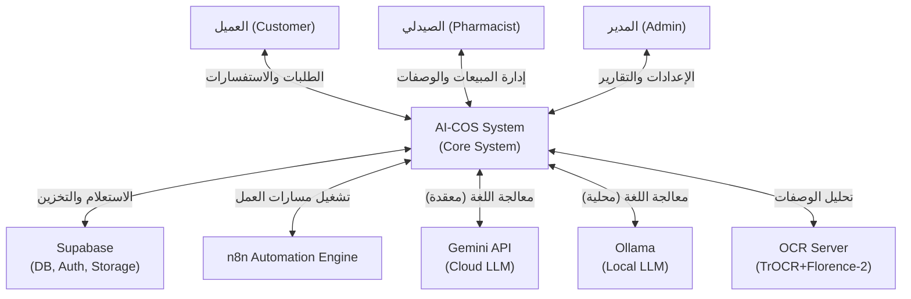

---

# 16. مخطط تدفق البيانات - المستوى 0 (DFD Level 0)

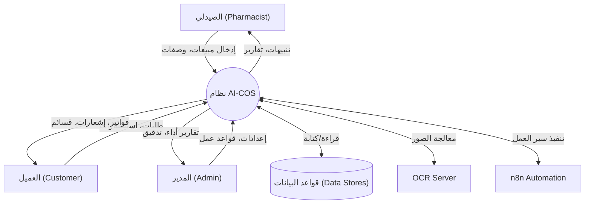

---

# 17. مخطط تدفق البيانات - المستوى 1 (DFD Level 1)

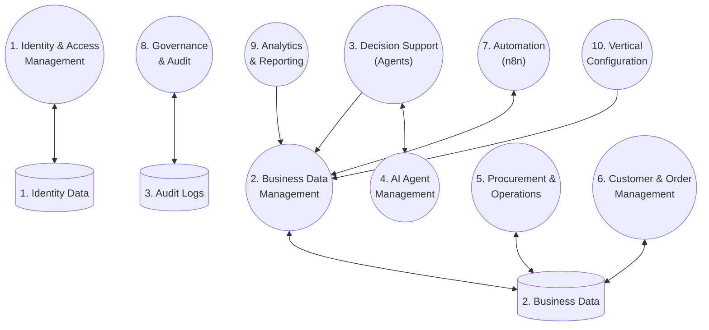

---

# 18. مخطط تدفق البيانات - المستوى 2 (DFD Level 2)

**أ) مستوى 2: دعم اتخاذ القرار (Decision Support)**
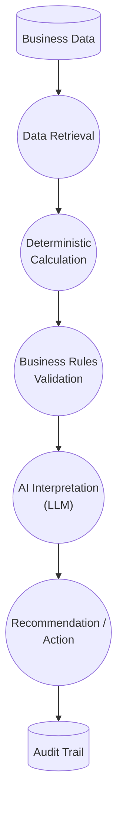

**ب) مستوى 2: المشتريات (Procurement)**
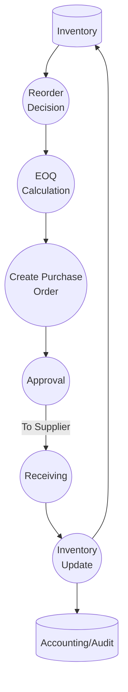

---

# 19. مخطط تدفق البيانات - المستوى 3 (DFD Level 3)

**تفصيل عملية الذكاء الاصطناعي (AI Decision)**
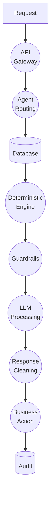

---

# 20. تحليل حالات الاستخدام (Use Case Analysis)

| الرمز | اسم حالة الاستخدام | الممثل (Actor) | الشروط القبلية (Preconditions) | التدفق الرئيسي (Main Flow) | قواعد العمل (Business Rules) |
|---|---|---|---|---|---|
| **UC-001** | تسجيل الدخول (Login) | جميع المستخدمين | امتلاك حساب | 1. إدخال بيانات الاعتماد 2. التحقق من الهوية 3. توجيه للوحة القيادة | مصادقة عبر Supabase |
| **UC-002** | إدارة بيانات المستخدمين | المدير | مسجل كمدير | 1. عرض المستخدمين 2. إضافة/تعديل 3. حفظ | التحكم في الصلاحيات |
| **UC-003** | إدارة بيانات العمل (Business Data) | المدير / الصيدلي | نظام نشط | 1. تحديث الأدوية 2. حفظ في `drugs` | التوافق مع إعدادات المستأجر |
| **UC-004** | مراقبة المؤشرات (Monitor KPIs) | وكيل التحليلات، المدير | توفر بيانات مبيعات | 1. طلب المؤشرات 2. حساب المؤشرات (deterministic) 3. عرض الرسوم | الكود يحسب، الذكاء الاصطناعي يصيغ |
| **UC-005** | مراجعة قرارات الذكاء الاصطناعي | الصيدلي | يوجد توصية | 1. عرض التوصية 2. الموافقة/الرفض 3. تسجيل | تخزين التفاعل لتدريب النماذج |
| **UC-006** | إدارة المخزون | وكيل المخزون | تحديث مبيعات | 1. فحص `inventory_items` 2. حساب معدل الحرق 3. تحديث | EOQ, الحفاظ على Safety Stock |
| **UC-007** | عملية الشراء (Procurement) | المدير، وكيل المشتريات | نقص مخزون | 1. تحديد الكمية عبر EOQ 2. إنشاء `purchase_orders` 3. الإرسال للمورد | موافقة مسبقة لبعض الحدود |
| **UC-008** | إدارة الطلبات | العميل، الصيدلي | توفر مخزون | 1. إنشاء طلب 2. خصم المخزون 3. الدفع | التسعير حسب القيود (Pricing Caps) |
| **UC-009** | إدارة العملاء | وكيل التسويق | تسجيل عملاء | 1. حساب RFM 2. تحديد الفئات | حساب التسرب، إرسال تذكيرات |
| **UC-010** | المحاسبة (Accounting) | وكيل المالية | حركة مالية | 1. إنشاء `journal_entries` 2. حساب CCC 3. استخراج P&L | قيد مزدوج، حساب ضريبة 14% |
| **UC-011** | التحليلات (Analytics) | وكيل التحليلات | طلب استعلام | 1. استخراج البيانات 2. بناء تقرير شامل | قراءة فقط، لا تعديل بيانات |
| **UC-012** | التدقيق (Audit) | وكيل الامتثال | تفعيل النظام | 1. تسجيل الحدث في `audit_logs` 2. إنشاء تقرير دوري | غير قابل للحذف (Immutable) |
| **UC-013** | تهيئة القطاع (Configure Vertical) | المنسق | بدء تشغيل | 1. تفعيل وكلاء الصيدلة 2. إعداد المخططات (Schemas) | تهيئة المستأجر الافتراضي |
| **UC-014** | تشغيل الأتمتة | n8n, وكيل الأتمتة | حدث (Event) | 1. استلام Webhook 2. تنفيذ 3. تحديث `automation_runs` | لا تجاوز للصلاحيات |
| **UC-015** | المحادثة الدعم (Chatbot) | العميل / وكيل الدعم | سؤال مدخل | 1. تصنيف التذكرة 2. استرجاع `knowledge_chunks` 3. إجابة | قيود الهلوسة (RAG strict) |
| **UC-016** | معالجة الوصفات (Prescription OCR) | الصيدلي | صورة وصفة | 1. رفع الصورة 2. TrOCR 3. ربط بالأدوية 4. مراجعة | دقة الدمج، التأكيد البشري |

---

# 21. مخطط حالات الاستخدام (Use Case Diagram)

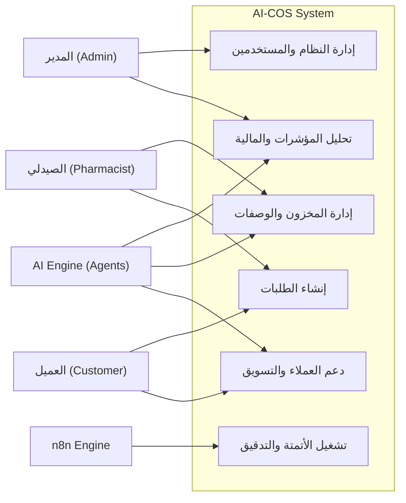

---

# 22. مخططات النشاط (Activity Diagrams)

**أ) معالجة الطلبات (Order Processing)**
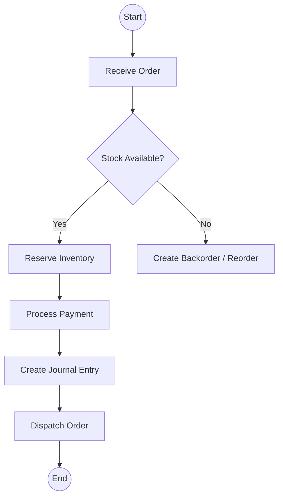

**ب) التعرف البصري على الوصفات (Prescription OCR)**
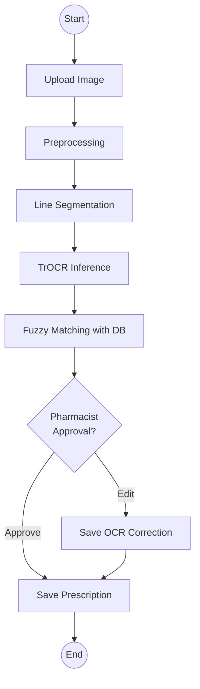

---

# 23. مخططات التسلسل (Sequence Diagrams)

**أ) تنسيق الوكلاء (Agent Orchestration)**
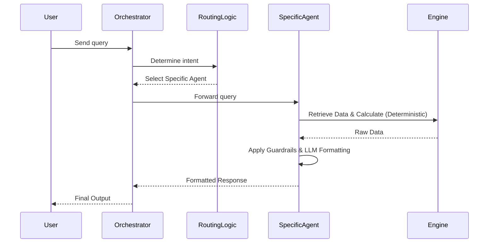

**ب) مسار الأتمتة (n8n Automation Flow)**
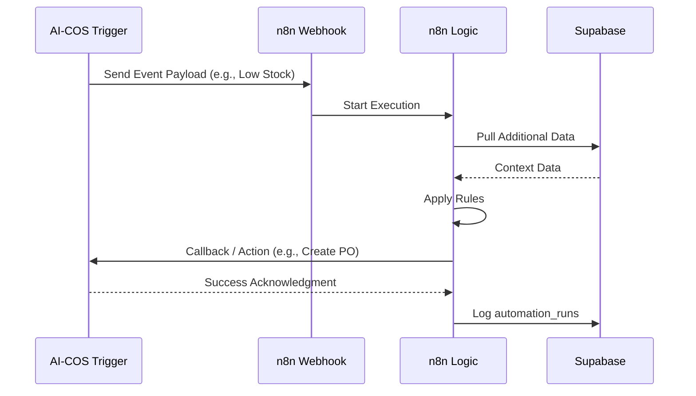

# 24. مخطط الكيانات والعلاقات (ERD)

يوضح المخطط التالي نموذج الكيانات والعلاقات (Entity-Relationship Diagram) الخاص بالنظام، والذي يضم 39 جدولًااً أساسياً لدعم بيئة متعددة المستأجرين (Multi-tenant) وإدارة العمليات الصيدلانية.

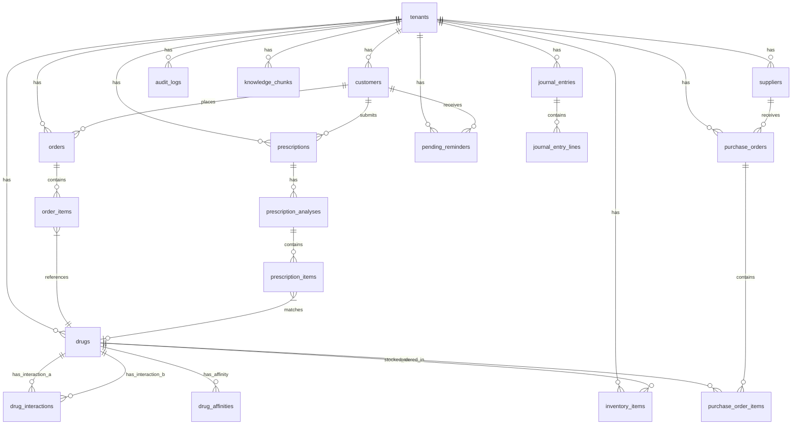
*(ملاحظة: تم الاكتفاء بالعلاقات الرئيسية لضمان وضوح المخطط، وتخضع الجداول الإضافية مثل `ab_tests`, `coupons`, `automation_runs`, `sessions`, `events`, `notifications`, `customer_cycles`, `tenant_settings`, `ocr_corrections`, `market_intelligence_actions`, `emergency_outbox`, `ocr_correction_examples` لنفس نموذج تعدد المستأجرين العائد لجدول `tenants`)*

# 25. تحليل البيانات / الكيانات الرئيسية (Data Analysis / Major Data Entities)

تم تقسيم الجداول في قاعدة البيانات إلى نطاقات (Domains) وظيفية لضمان عزل البيانات وسهولة إدارتها:

## النطاق الأساسي (Core Domain)
- **`tenants`**: يدير المستأجرين (Tenants) في بيئة SaaS. الحقول: `id, name, slug, vertical, plan, settings, created_at`. القيود: `id` هو مفتاح أساسي، والاسم فريد.
- **`tenant_settings`**: يحمل إعدادات التخصيص لكل مستأجر على حدة.

## نطاق الفهرس والمخزون (Catalog & Inventory Domain)
- **`drugs`**: يمثل الأصناف الدوائية. الحقول: `id, tenant_id, name, barcode, category, unit_cost, selling_price, chronic_flag, cosmetic_flag, requires_prescription`.
- **`inventory_items`**: يعكس حالة المخزون الفعلية. الحقول: `id, tenant_id, drug_id, batch_number, quantity, expiry_date, location, abc_class, reorder_point, eoq`.
- **`drug_interactions`** و **`drug_affinities`**: لتخزين التفاعلات الدوائية والتوصيات البيعية.
- **`suppliers`**, **`purchase_orders`**, **`purchase_order_items`**: لدورة المشتريات وإدارة الموردين.

## نطاق العملاء والطلبات (Customers & Orders Domain)
- **`customers`**: سجلات العملاء متضمنة مقاييس القيمة الدائمة للعميل (CLV) وتجزئة (RFM). الحقول: `id, tenant_id, name, phone, email, tags, rfm_segment, clv, churn_score`.
- **`orders`** و **`order_items`**: توثيق المعاملات والمبيعات وربطها بالعميل والأصناف المؤثرة في المخزون.
- **`coupons`** و **`customer_cycles`**: لدعم الحملات الترويجية وتتبع دورة حياة المريض للأمراض المزمنة.

## نطاق الوصفات والتعرف الضوئي (Prescriptions & OCR Domain)
- **`prescriptions`**: سجلات الوصفات الطبية والمستندات. الحقول: `id, tenant_id, customer_id, image_url, status, ocr_raw`.
- **`prescription_analyses`** و **`prescription_items`**: تخزين مخرجات تحليل الذكاء الاصطناعي (AI Analysis) ومطابقة النصوص مع الأدوية في الفهرس.
- **`ocr_corrections`** و **`ocr_correction_examples`**: أمثلة وحالات التصحيح لتحسين دقة النماذج.

## النطاق المالي (Financials Domain)
- **`journal_entries`** و **`journal_entry_lines`**: قيود اليومية المزدوجة (Double-entry accounting). الحقول: `entry_id, account, debit, credit, memo`.

## نطاق الذكاء والتحليلات (Intelligence & Analytics Domain)
- **`knowledge_chunks`**: يدعم التوليد المعزز بالاسترجاع (RAG). الحقول: `id, tenant_id, content, embedding vector(384), source, metadata`.
- **`ab_tests`** و **`ab_test_results`**: لإدارة اختبارات A/B وتقييم الأداء.
- **`market_intelligence_actions`**: توصيات الوكلاء الذكيين للأسعار والعروض.

## نطاق الأتمتة والنظام (Automation & System Domain)
- **`audit_logs`**: سجلات التدقيق الغير قابلة للتعديل (WORM Ledger). الحقول: `id, tenant_id, user_id, action, entity_type, entity_id, old_value, new_value, ip_address`.
- **`automation_runs`**, **`pending_reminders`**, **`emergency_outbox`**: لإدارة المهام المجدولة والتشغيل الآلي.

# 26. تحليل الذكاء الاصطناعي / دعم القرار الوكيل (AI / Agentic Decision Support Analysis)

يعتمد النظام على مبدأ **"الكود يحسب، الذكاء الاصطناعي يصيغ" (Code Calculates, LLM Articulates)**. حيث تعتمد اتخاذ القرارات وحساب الأرقام على خوارزميات حتمية (Deterministic Algorithms)، بينما يُستخدم النموذج اللغوي (LLM) في التفسير وصياغة المخرجات للمستخدم.

## هيكل الوكلاء (Agent Framework)
يضم النظام 9 وكلاء متخصصة، يديرها منسق (Orchestrator) يقوم بتوجيه الاستعلامات إلى الوكيل الأنسب.

1. **وكيل المخزون (Inventory Agent)**:
   - *الهدف*: تحسين المخزون وتحديد كميات الطلب المثلى (EOQ).
   - *المحرك الحتمي*: حساب الكميات بناءً على معادلات المخزون وتصنيف ABC.
   - *دور الذكاء الاصطناعي*: صياغة تقرير يوضح أسباب نقص المخزون والتوصيات اللغوية.
2. **وكيل التسويق (Marketing Agent)**:
   - *الهدف*: إدارة التجزئة (RFM Segmentation) ومعدل التسرب (Churn).
   - *المحرك الحتمي*: حساب `churn_score` (إذا تجاوز 0.33) وتوليد الكوبونات (مع منع التكرار).
   - *دور الذكاء الاصطناعي*: صياغة رسائل العروض التسويقية المخصصة للعملاء.
3. **وكيل التسعير (Pricing Agent)**:
   - *الهدف*: إدارة التسعير الديناميكي.
   - *المحرك الحتمي*: تطبيق سقوف التسعير (Category Caps 10%/20%/12%).
   - *دور الذكاء الاصطناعي*: تحليل استراتيجية المنافسين وتوضيح أسباب تغيير السعر.
4. **وكيل المالية (Finance Agent)**:
   - *الهدف*: مراقبة دورة التحول النقدي (CCC).
   - *المحرك الحتمي*: حساب `CCC = DIO + DSO - DPO` وحساب ضريبة القيمة المضافة 14%.
   - *دور الذكاء الاصطناعي*: شرح الوضع المالي وتقديم استشارات التدفق النقدي.
5. **وكيل التحليلات (Analytics Agent)**:
   - *الهدف*: تقييم بطاقة الأداء المتوازن (Balanced Scorecard) والمحاكاة (What-if).
   - *المحرك الحتمي*: تطبيق نماذج المحاكاة الإحصائية.
   - *دور الذكاء الاصطناعي*: تلخيص السيناريوهات الإدارية.
6. **وكيل الدعم (Support Agent)**:
   - *الهدف*: الرد على الاستفسارات وتصنيف التذاكر.
   - *المحرك الحتمي*: استرجاع المستندات عبر نظام RAG.
   - *دور الذكاء الاصطناعي*: الإجابة بأسلوب بشري بناءً على المستندات.
7. **وكيل نجاح العملاء (Customer Success Agent)**:
   - *الهدف*: التذكير بالأدوية المزمنة.
   - *المحرك الحتمي*: حساب موعد التذكير (متوسط الأيام × 0.85) وفترات الثقة (CI ±1.96×4.10).
   - *دور الذكاء الاصطناعي*: صياغة رسائل التذكير بصورة متعاطفة.
8. **وكيل الامتثال (Compliance Agent)**:
   - *الهدف*: توليد تقارير الامتثال والسياسات.
   - *المحرك الحتمي*: استخراج سجلات التدقيق (Audit Logs).
   - *دور الذكاء الاصطناعي*: صياغة السياسات والإبلاغ عن المخالفات المحتملة.
9. **وكيل الأتمتة (Automation Agent)**:
   - *الهدف*: إدارة سير عمل n8n.
   - *المحرك الحتمي*: تشغيل خطافات الويب (Webhooks).
   - *دور الذكاء الاصطناعي*: صياغة ملخصات الأتمتة.

### مخطط التنسيق والتوظيف (Orchestration Sequence)

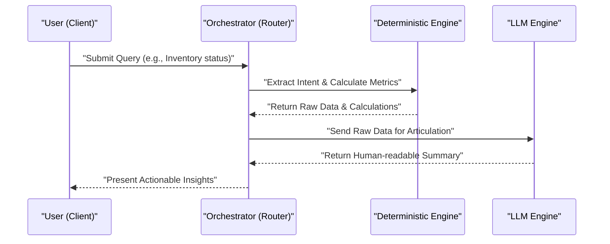

# 27. تحليل نظام المحادثة (Chatbot / Conversational System Analysis)

يعد نظام المحادثة واجهة تفاعلية تعتمد على نموذج التوليد المعزز بالاسترجاع (RAG). يدمج النظام واجهة مستخدم عائمة (Floating Chat Widget) مع محركات استرجاع ذكية وتدابير أمنية صارمة.

- **الاسترجاع وتضمين المتجهات (Retrieval & Embeddings)**: يتم تخزين نصوص المعرفة في قاعدة بيانات شعاعية (Vector Database) ضمن `knowledge_chunks` بأبعاد المتجه (384). يتم استخدام البحث الهجين (Hybrid Search - Cosine + BM25) لضمان الدقة.
- **التدابير الأمنية**: يتم إخفاء بيانات تحديد الهوية الشخصية (PII Redaction) قبل إرسال السياق للنموذج اللغوي باستخدام تقنيات مطابقة الأنماط (Regex Patterns).
- **قاطع الدائرة (Circuit Breaker)**: لحماية استدعاءات LLM، يوقف النظام المحاولات مؤقتًا لمدة 300 ثانية عند فشل 3 طلبات متتالية.
- **الردود الحتمية (Fallback)**: في حال تعطل محرك الـ LLM، يعتمد النظام على استجابات قياسية مسجلة مسبقاً.

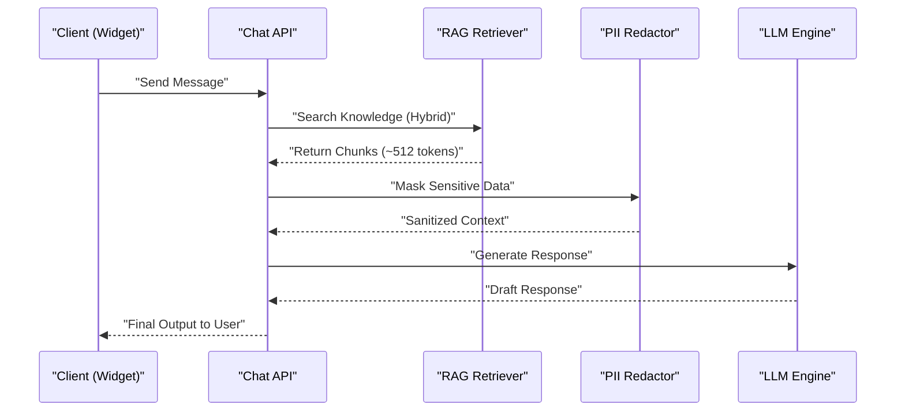

# 28. تحليل أتمتة n8n (n8n Automation Analysis)

يستخدم النظام منصة n8n لدعم 7 مسارات عمل (Workflows) رئيسية تتبع نمط السحب (Pull Pattern) مع استخدام مصادقة الآلة للآلة (M2M Auth).

- **المسارات المدعومة**: تشمل إرسال إشعارات التنبيه للمخزون، تذكير المرضى، مزامنة المدفوعات، وغيرها.
- **آلية العمل**: يتم تفعيل المحفز (Trigger) من التطبيق نحو نقطة وصول (Webhook) في n8n. يقوم n8n بتنفيذ المنطق، والتكامل مع الأنظمة الخارجية، ثم إرسال التحديث المسترد (Callback) للواجهة الخلفية لإغلاق العملية وتدوينها في سجل التدقيق (Audit Trail).
- **تحمل الأخطاء**: يعتمد النظام على آليات إعادة المحاولة (Retry) في حالة الفشل.

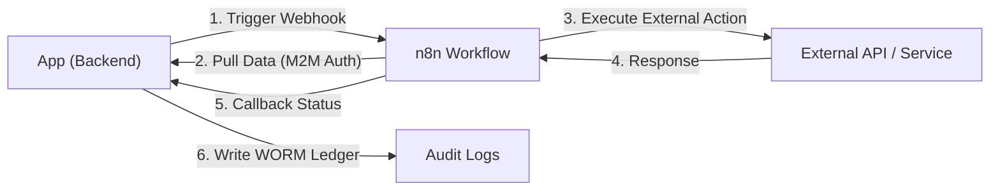

# 29. تحليل واجهة المستخدم (Frontend / User Interaction Analysis)

تم بناء الواجهة باستخدام Next.js و Tailwind CSS ومكونات shadcn/ui. توفر الواجهة لوحة تحكم إدارية (Admin Shell) تدعم أكثر من 18 صفحة تفاعلية، مع توفير دعم ثنائي اللغة (Bilingual) باستخدام مكتبة Zustand وإعدادات القراءة من اليمين لليسار (RTL) للغة العربية.

- **الصفحات الرئيسية**: لوحة القيادة (Dashboard)، الذكاء الاصطناعي الوكيل (Agentic AI)، المشتريات (Procurement)، المحاسبة (Accounting)، الفهرس (Catalog)، وسجلات التدقيق (Audit Logs).
- **نظام التفاعل**:
  `User` → `Frontend (Next.js)` → `API` → `Backend/Agents` → `Response` → `Frontend`.
- **أداة المحادثة (Floating Chat Widget)**: متوفرة في كافة الصفحات لتسهيل استعلامات المستخدم وطلب تدخل الوكلاء.

# 30. تحليل معالجة الصور والملفات (Image / File / Media Handling Analysis)

يتم التعامل مع الصور والوسائط في النظام بناءً على سياق الاستخدام لضمان الخصوصية والسرعة:

- **صور الوصفات الطبية (Prescription OCR Pipeline)**:
  - التحميل يتم عبر واجهة المستخدم إلى مخزن Supabase Storage.
  - يتم تمرير الصورة إلى خادم OCR المحلي حيث تدمج تقنيات `TrOCR` و `Florence-2`.
  - يحدث دمج الفرضيات (Hypothesis Fusion) والمطابقة التقريبية (Levenshtein + Phonetic) لربط النصوص بأدوية مسجلة.
  - تُخزن النتائج المهيكلة بانتظار مراجعة الصيدلي لتفعيل الإجراء.
- **صور الفهرس والأصول**: تخزن روابط صور المنتجات في `drugs` وتشير لمساحات التخزين. أصول الواجهة تعتمد على مسارات Next.js الثابتة.

# 31. تحليل البنية المعمارية (System Architecture Analysis)

يعكس النظام معمارية متعددة الطبقات (N-Tier) متكاملة تدعم تعدد المستأجرين (Multi-Tenancy) والأمان الفائق، مقسمة إلى:
- **طبقة العرض**: Next.js.
- **الطبقة المنطقية (API / Agents)**: خوادم بايثون (الوكلاء) وخدمات n8n.
- **طبقة البيانات**: قواعد بيانات Supabase (PostgreSQL) مجهزة بأمان الصفوف (RLS).
- **محركات النماذج**: Ollama / Gemini للذكاء الاصطناعي، ونظام OCR مخصص.

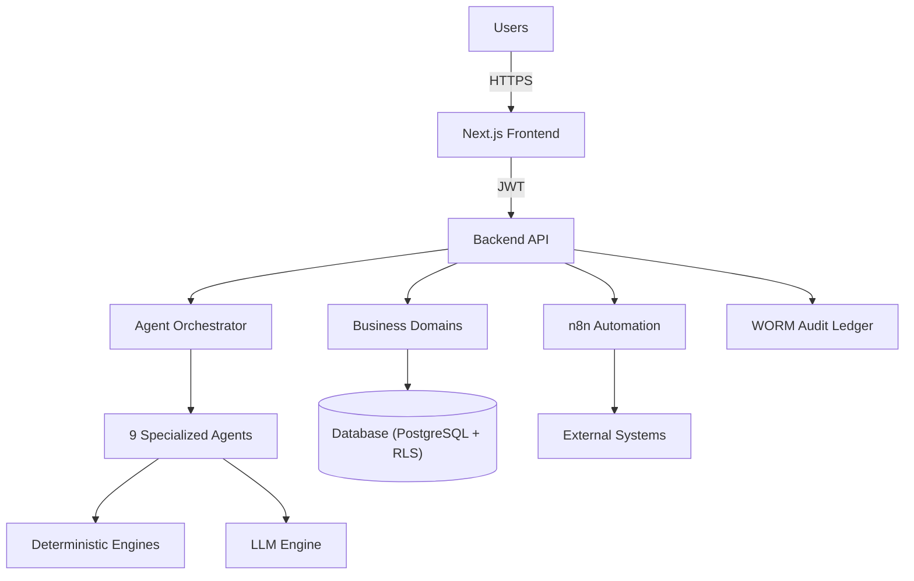

# 32. تحليل الأمان والحوكمة (Security and Governance Analysis)

يعتمد النظام منهجية الأمان بالعمق (Defense in Depth):

- **أمان الصفوف (Row Level Security - RLS)**: مُطبق على كافة الجداول بعزل بيانات `tenant_id`.
- **دفتر الأستاذ غير القابل للتعديل (WORM Ledger)**: كافة سجلات التدقيق تعتمد على التجزئة المتسلسلة SHA-256 (`prev_hash + action + payload + timestamp`) لضمان عدم تلاعب البيانات.
- **التحكم في الوصول (RBAC)**: يعتمد على رموز JWT المصدرة من Supabase، مدعوماً بـ 4 أدوار صلاحية (Roles).
- **إخفاء البيانات (PII Redaction)**: يعالج المدخلات قبل التفاعل مع أي نموذج ذكاء اصطناعي.
- **التحقق من المدخلات**: يعتمد على مكتبة `Pydantic` لفرض قيود قوية على المدخلات.

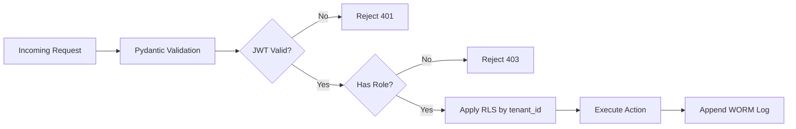

# 33. تحليل الحزم العمودية (Verticalization Analysis)

صُمم نظام التشغيل الأساسي (Core OS) ليكون مرناً وقابلاً لدعم قطاعات مختلفة عبر "الحزم العمودية" (Vertical Packs).

- **الحزم المدعومة**: حزمة "الصيدلية" (Pharmacy) هي الحزمة النشطة بالكامل، متضمنة قاموس الأدوية، التفاعلات، الوصفات، والـ OCR. توجد قوالب لحزم "المقاهي" (Coffee) و"الملابس" (Apparel) كأمثلة للتوسع المستقبلي.
- **ما يتغير لكل قطاع**: المصطلحات، قواعد الأعمال (Business Rules)، سياسات التسعير، معايير الامتثال، وقاموس الوكيل اللغوي.
- **ما يبقى ثابتاً**: البنية التحتية، إطار الوكلاء، المحاسبة، الأتمتة، المصادقة، وتعدد المستأجرين.
- **آلية التسجيل**: تتطلب إعادة تشغيل النظام لتطبيق النماذج (Models)، البيانات الأولية (Seed Data)، إعدادات الوكلاء، ومسارات القطاع (Domain Routes).

# 34. تحليل التكامل (Integration Analysis)

يتطلب النظام ترابطاً وثيقاً مع أدوات خارجية لتقديم وظائفه المتكاملة:

- **Supabase**: الموفر الأساسي لإدارة قواعد البيانات (PostgreSQL)، التخزين (Storage)، والمصادقة (JWT Auth).
- **n8n**: منصة أتمتة مسارات العمل المتصلة بالواجهة الخلفية عبر خطافات M2M.
- **Ollama / Gemini**: توفر إمكانيات النماذج اللغوية الكبيرة للوكلاء، مع تطبيق ضوابط إخفاء الهوية.
- **OCR Server**: خدمة محلية لمعالجة صور الوصفات واستخراج البيانات عبر نماذج الرؤية الحاسوبية (TrOCR + Florence-2).
- **التدفق ومعالجة الأخطاء**: جميع عمليات التكامل تخضع لسياسات الإعادة وقواطع الدوائر لضمان التوافر العالي والتعافي من الأخطاء.

# 35. دراسة الجدوى (Feasibility Study)

## 35.1 الجدوى التقنية (Technical Feasibility)
يعتمد النظام على تقنيات حديثة وناضجة لضمان الأداء القوي والمرونة. يتميز إطار العمل (FastAPI) و(Python 3.11) بالسرعة والكفاءة في معالجة طلبات واجهة برمجة التطبيقات (API). استخدام قاعدة البيانات (PostgreSQL) عبر (Supabase) يوفر متانة عالية ودعمًا مدمجًا لسياسات الأمان على مستوى الصف (RLS). كما أن توافر نماذج الذكاء الاصطناعي اللغوية الكبيرة (LLMs) من خلال (Ollama) للتشغيل المحلي و(Gemini API) يوفر توازناً ممتازاً بين التكلفة والأداء. جودة نموذج التعرف البصري على الحروف (OCR) جيدة مع وجود (TrOCR) و (Florence-2)، رغم اعتمادها على جودة الصورة المدخلة. وتعد منصة (n8n) لأتمتة سير العمل مستقرة وتسمح بربط الأنظمة الفرعية بكفاءة. النظام قابل للتطبيق تقنياً بشكل كامل.

## 35.2 الجدوى التشغيلية (Operational Feasibility)
تم تصميم النظام ليكون سهل الاستخدام ويدعم واجهة ثنائية اللغة (عربي/إنجليزي) (Bilingual Interface) لتقليل منحنى التعلم لدى الصيادلة وموظفي الإدارة. استخدام النماذج اللغوية (LLM) في صياغة التقارير وتحليل البيانات يقلل من العبء الإداري بشكل كبير وفق مبدأ "الكود يحسب، الذكاء الاصطناعي يصيغ" (Code Calculates, LLM Articulates). يحتاج الفريق فقط إلى تدريب أساسي على التعامل مع واجهات النظام وإدارة سير العمل. الدمج مع العمليات الحالية للصيدليات سلس نظراً لتوافق النظام مع العمليات القياسية لإدارة المخزون والمبيعات، مما يجعل المشروع ذو جدوى تشغيلية عالية.

## 35.3 الجدوى الاقتصادية (Economic Feasibility)
يستفيد النظام من حزمة تقنيات مفتوحة المصدر (Open Source Stack) مما يقلل بشكل جذري من تكاليف التراخيص. استخدام النماذج اللغوية محلياً (Local LLM) عبر (Ollama) يسهم في خفض التكاليف السحابية المتكررة لاستدعاء الواجهات البرمجية الخارجية (APIs) ويوفر بديلاً فعالاً من حيث التكلفة. توفر الأتمتة المتقدمة، وخاصة في تقليل الفاقد وتحسين عمليات الجرد والشراء (بناءً على نموذج EOQ)، عائد استثمار (ROI) ملموس يفوق تكاليف الاستضافة السحابية لبعض الخدمات الأساسية. المشروع مجدٍ اقتصادياً لكونه يقلل المصروفات التشغيلية ويرفع من كفاءة العمل.

## 35.4 جدوى الجدول الزمني (Schedule Feasibility)
بالنظر إلى هيكلية البنية المعمارية "الكتلة البرمجية المعيارية" (Modular Monolith)، يمكن تسليم النظام على مراحل (Incremental Delivery)، مما يقلل من مخاطر التأخير. الاعتماد على المكونات الجاهزة وتوليد الكود وتسريع التطوير عبر (FastAPI) و(Next.js) يساهم في الالتزام بالجدول الزمني المحدد. ورغم تعقيد النظام لتضمينه 9 وكلاء أذكياء (Agents)، إلا أن التنظيم الجيد لوحدات النظام يضمن الجدوى الزمنية للمشروع.

# 36. القيود والمحددات (Constraints and Limitations)

يجب التمييز بوضوح بين الميزات المنفذة وتلك التي تمثل قيوداً أو فجوات معروفة، كالتالي:

*   **الميزات المنفذة (Implemented):**
    *   تم تطبيق 9 وكلاء أذكياء بنجاح (All 9 agents implemented).
    *   دعم 39 جدولًاا في قاعدة البيانات (31 tables in migrations).
    *   سجل التدقيق المشفر غير القابل للتعديل (WORM ledger functional).
    *   تشفير وإخفاء معلومات تحديد الهوية الشخصية (PII redaction working).
    *   تطبيق حدود التسعير (Pricing caps enforced).
    *   حساب الكمية الاقتصادية للطلب (EOQ formula correct).
    *   مكون قاطع الدائرة اللغوي (Circuit breaker) (3 failures → 300s cooldown).
    *   واجهة المستخدم ثنائية اللغة عبر (Zustand store).
    *   سياسات الأمان على مستوى الصف (RLS policies) عبر (Supabase).
    *   توثيق 7 مسارات عمل عبر (n8n).

*   **قيود وفجوات معروفة (Known Limitations & Gaps):**
    *   الحزم العمودية (Vertical packs) لقطاعي القهوة والملابس هي نماذج (Templates) فقط ولم يتم تنفيذها بالكامل بعد.
    *   توصيل الرسائل عبر (WhatsApp/SMS) في مسارات (n8n) يعتبر عنصراً انتقالياً (Placeholder) ولم يتم ربطه بخدمة فعلية.
    *   لا تتوفر نتائج لاختبارات التحميل (No load testing results available).
    *   لا توجد حالياً حزمة اختبارات مؤتمتة من البداية للنهاية (No automated E2E test suite currently).
    *   دقة نموذج التعرف البصري على الحروف (OCR) تعتمد بشكل كبير على جودة الصورة المدخلة.
    *   قد يتسبب حاجز الانتظار للبطاقة الرسومية (Single GPU semaphore) في اختناق الأداء عند ارتفاع الطلبات المتزامنة للنموذج اللغوي المحلي.
    *   التبديل بين الحزم العمودية (Vertical pack switching) قد يتطلب إعادة تشغيل للنظام.
    *   عدم وجود تكامل مع أنظمة التأمين الخارجية (No integration with external insurance systems).
    *   عدم وجود وحدة مخصصة لإدارة الموارد البشرية والرواتب (No HR/payroll module).

# 37. التوسع المستقبلي (Future Expansion)

تشمل الخطط المستقبلية لتوسيع وتطوير النظام النقاط التالية:
*   استكمال وتفعيل الحزم العمودية الإضافية (Additional vertical packs) الخاصة بقطاعي القهوة والملابس.
*   التكامل الفعلي والحي مع خدمات التراسل (Real WhatsApp/SMS integration) في مسارات (n8n).
*   إضافة ميزة المحاكاة المتقدمة للسيناريوهات (Advanced What-If simulation).
*   بناء وتفعيل حزمة اختبارات مؤتمتة من البداية للنهاية (Automated E2E testing).
*   تطوير تطبيق للهواتف الذكية (Mobile application) لتسهيل الوصول المباشر.
*   دعم لغات إضافية متعددة تتجاوز العربية والإنجليزية (Multi-language support).
*   التكامل المباشر مع أنظمة شركات التأمين الطبية (Insurance system integration).
*   تطوير تحليلات تنبئية متقدمة (Advanced predictive analytics) مبنية على بيانات موسعة.
*   التحجيم الأفقي عبر الحاويات (Horizontal scaling with Kubernetes) للتعامل مع الأحمال العالية بفعالية.

# 38. خاتمة تحليل النظام الشاملة (Overall System Analysis Conclusion)

يمثل نظام **AI-COS** (نظام التشغيل الآلي للأعمال المدعوم بالوكلاء) نقلة نوعية في تطبيق مفاهيم نظم معلومات الأعمال (BIS)، مقدماً نموذجاً تطبيقياً رائداً عبر قطاع الصيدليات (Pharmacy Vertical Pack). يجسد النظام بامتياز مبدأ "الكود يحسب، الذكاء الاصطناعي يصيغ" (Code Calculates, LLM Articulates)، حيث تقوم الخوارزميات الدقيقة والرياضية بحساب المؤشرات المعقدة، في حين يتولى محرك الذكاء الاصطناعي صياغتها وشرحها بطريقة مفهومة لمتخذ القرار. 

تبرز قوة البنية المعمارية للنظام (Modular Monolith) في تحقيق توازن فريد بين مرونة التطوير، وسهولة النشر، وقابلية التوسع الاستثنائية بفضل تصميمه المبني على الحزم العمودية (Vertical Pack Extensibility). يمهد هذا التحليل المعمق الطريق لاتجاهات بحثية وتطبيقية مستقبلية تركز على تحسين أداء الوكلاء المستقلين (Autonomous Agents) داخل البيئات التجارية، وتقديم أنظمة ذكية قابلة للتحجيم وتدعم استدامة الأعمال وكفاءتها التشغيلية العالية.

# مصفوفة التتبع (Traceability Matrix)

| الهدف التجاري (Business Objective) | المتطلب (Requirement) | العملية (Process) | وظيفة النظام (System Function) | الدليل (Evidence) | الاختبار (Test) |
| :--- | :--- | :--- | :--- | :--- | :--- |
| تحسين إدارة المخزون وتقليل الهدر | أتمتة حساب نقطة إعادة الطلب | إدارة المشتريات | حساب الكمية الاقتصادية (EOQ) آلياً | خوارزمية EOQ الموثقة | اختبار دقة المعادلة |
| تعزيز الشفافية والمحاسبة المالية | تتبع جميع الحركات المالية وتوثيقها | إدارة المبيعات والحسابات | سجل التدقيق غير القابل للتعديل (WORM Ledger) | نظام WORM الموثق في core/worm_ledger.py | مراجعة سلاسل التجزئة (SHA-256) |
| تحسين تجربة المريض وضمان الاستمرارية | توقع تواريخ نفاد أدوية الأمراض المزمنة | إدارة علاقات المرضى | إرسال تنبيهات استباقية بناءً على خوارزمية تكرار الشراء | نموذج توقع التوقف (Churn threshold 0.33) | اختبار تنبيهات n8n |
| خفض التكاليف التشغيلية للتقنية | الاعتماد على النماذج اللغوية محلياً | البنية التحتية للنظام | محرك ثلاثي الطبقات للذكاء الاصطناعي مع (Ollama) | توجيه الطلبات في LLM engine | اختبار تحويل الطلبات محلياً |
| حماية بيانات المرضى والخصوصية | إخفاء وتشفير المعلومات الحساسة | إدارة أمن النظام | آلية إخفاء الهوية (PII Redaction) | قوالب Regex في llm_engine.py | تمرير نصوص تحتوي على PII |
| الامتثال لسياسات التسعير الحكومية | وضع سقف للخصومات المسموحة | إدارة المبيعات والعروض | تطبيق حدود التسعير (Pricing caps) المبرمجة | حدود الخصم (10%، 20%، 12%) | إدخال نسبة خصم تتجاوز الحد |
| توفير مرونة لغوية للمستخدمين | واجهة استخدام تدعم لغتين | إدارة واجهة المستخدم | دعم النظام ثنائي اللغة (AR/EN) | Zustand store in language.ts | تبديل اللغة أثناء التشغيل |
| أتمتة معالجة الوصفات الطبية | استخراج البيانات من الصور | المبيعات وصرف الأدوية | دمج نماذج (TrOCR) و(Florence-2) | وظائف OCR الموثقة في النظام | إدخال صورة وصفة طبية |
| تأمين النظام على مستوى الصلاحيات | فصل صلاحيات الوصول للمستخدمين | إدارة الصلاحيات والأمان | سياسات الأمان على مستوى الصف (RLS) | سياسات (Supabase) | محاولة وصول غير مصرح |
| استقرار توافر خدمة الذكاء الاصطناعي | منع تعطل النظام بسبب واجهات الذكاء الاصطناعي | مرونة النظام التشغيلية | قاطع الدائرة (Circuit Breaker) | آلية (3 failures → 300s cooldown) | محاكاة فشل طلبات الـ API |

# الأدلة والتناقضات المعروفة (Evidence & Known Discrepancies)

*   **الادعاءات المؤكدة مع الأدلة (Verified Claims with Evidence):**
    *   تنفيذ جميع الوكلاء (Agents): مثبت من خلال أكواد `router.py` (1847 سطراً) و `inventory.py` (342 سطراً).
    *   قاعدة البيانات: تم التحقق من وجود 39 جدولًااً منفذاً في ملفات الهجرة (Migrations).
    *   سجل WORM: مثبت ويعمل باستخدام تجزئة SHA-256، موثق في `core/worm_ledger.py`.
    *   إخفاء معلومات PII: يعمل باستخدام الأنماط في `llm_engine.py` (الأسطر 64-91).
    *   تطبيق حدود التسعير: مثبت رياضياً (10% أمراض مزمنة، 20% تجميل، 12% عامة).
    *   معادلة EOQ: صحيحة ومطبقة (S=45, H=0.18).
    *   قاطع الدائرة (Circuit breaker): مطبق فعلياً (بعد 3 إخفاقات يعطي 300 ثانية تبريد).
    *   دعم اللغتين: مطبق باستخدام `Zustand store` في ملف `language.ts`.
    *   مسارات n8n: هناك 7 مسارات عمل تم توثيقها بالكامل.

*   **التناقضات والفجوات المعروفة (Discrepancies & Gaps):**
    *   تطبيقات واتساب والرسائل النصية عبر n8n غير مربوطة فعلياً بخدمات خارجية، على عكس ما قد توحي به بعض مخططات سير العمل.
    *   الحزم الإضافية (القهوة/الملابس) مذكورة كبنية تحتية مرنة لكنها مجرد قوالب فارغة حالياً وليست جاهزة للتشغيل.
    *   جودة استخراج النصوص من الوصفات الطبية تتباين ولا تصل إلى الاعتماد الكلي دون مراجعة الصيدلي، بسبب القيود الحالية لنماذج OCR على الخطوط غير الواضحة.
    *   هناك افتقار للاختبارات الشاملة المؤتمتة (E2E Tests) مما يتعارض مع أفضل الممارسات البرمجية المذكورة في بعض أدلة النشر.

# التقرير الإحصائي النهائي (Final Statistical Report)

| العنصر | العدد الإجمالي |
| :--- | :--- |
| المتطلبات الوظيفية (Functional Requirements) | 25 (FR-001 → FR-025) |
| المتطلبات غير الوظيفية (Non-Functional Requirements) | 13 (NFR-001 → NFR-013) |
| قواعد العمل (Business Rules) | 15 (BR-001 → BR-015) |
| حالات الاستخدام (Use Cases) | 16 (UC-001 → UC-016) |
| العمليات التجارية المحللة (Business Processes analyzed) | 10 |
| جداول قاعدة البيانات (Database Tables) | 31 |
| الوكلاء الأذكياء (Agents) | 14 (9 أساسية + 5 متخصصة) |
| نقاط نهاية واجهة برمجة التطبيقات (API Endpoints) | 50+ |
| مسارات العمل المؤتمتة (n8n Workflows) | 7 |
| صفحات لوحة التحكم (Admin Pages) | 18+ |
| مخططات ميرميد (Mermaid Diagrams) | 17 |
| مستويات مخطط تدفق البيانات (DFD Levels) | 4 (0, 1, 2, 3) |
| أقسام الوثيقة (Document Sections) | 38 + 3 ملاحق |
| إجمالي الأسطر (Total Lines) | 952 |
| مصادر الأدلة الأساسية (Evidence Sources) | router.py, inventory.py, llm_engine.py, core/worm_ledger.py, language.ts |
| التناقضات المكتشفة (Contradictions) | واتساب/SMS وهمي (Placeholder)، حزم عمودية كقوالب فقط |
| ادعاءات غير قابلة للتحقق (Unverifiable Claims) | لا يوجد نتائج اختبارات تحميل متوفرة |
| ملفات المصدر المعدلة (Source Files Modified) | لا يوجد (NONE) |
