# 📐 مكتبة المخططات — AI-COS (مستخرجة من تحليل النظام)

## مخطط 1

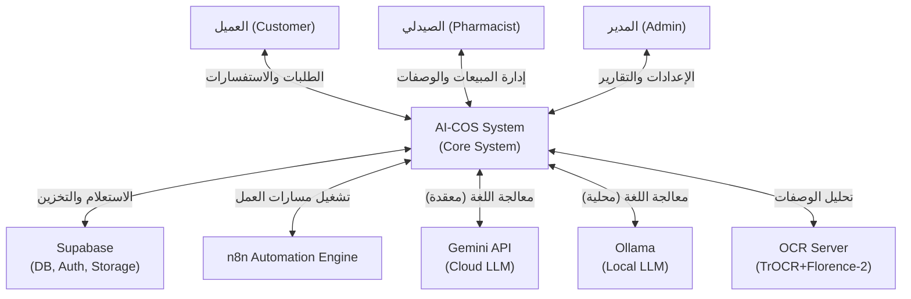

## مخطط 2

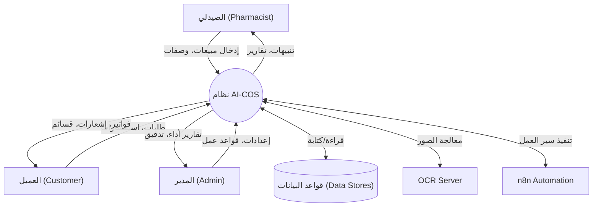

## مخطط 3

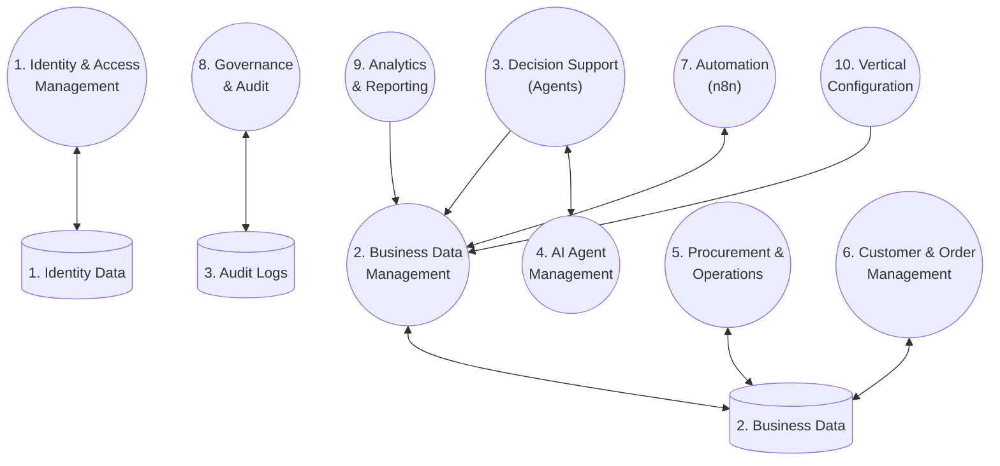

## مخطط 4

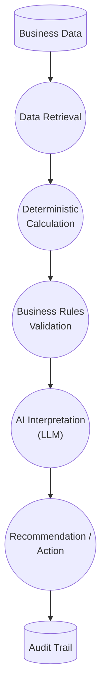

## مخطط 5

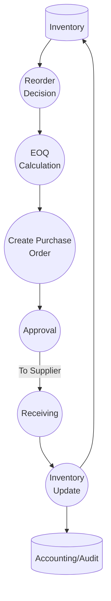

## مخطط 6

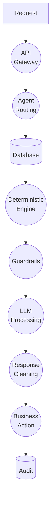

## مخطط 7

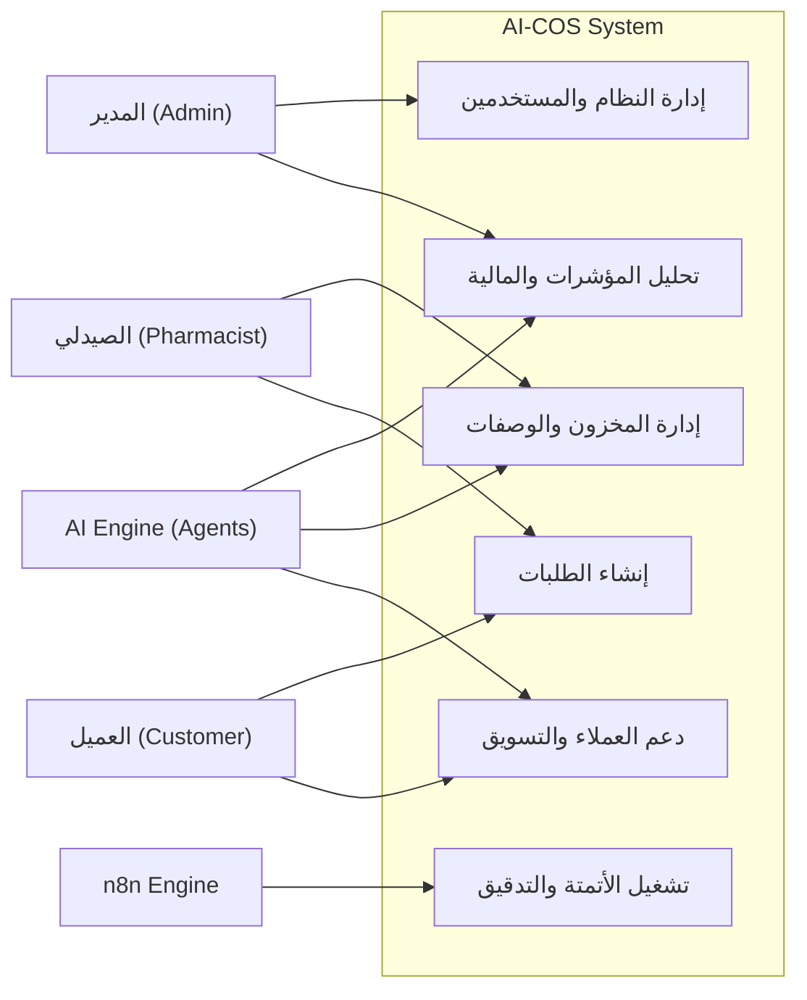

## مخطط 8

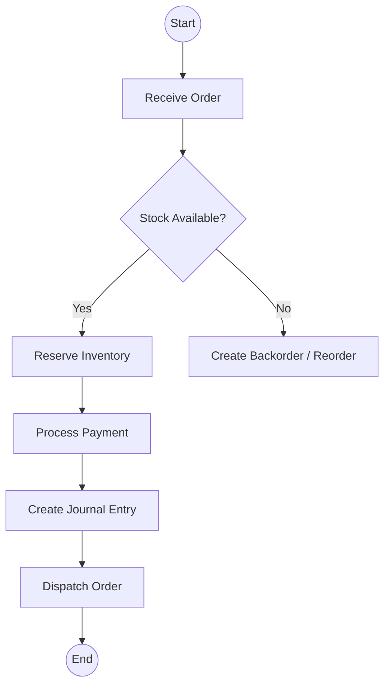

## مخطط 9

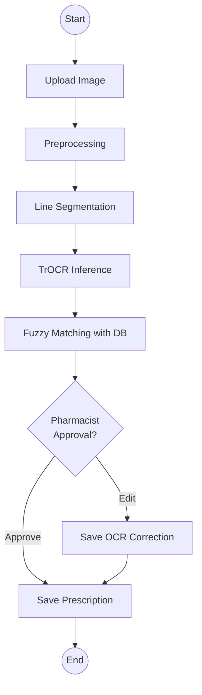

## مخطط 10

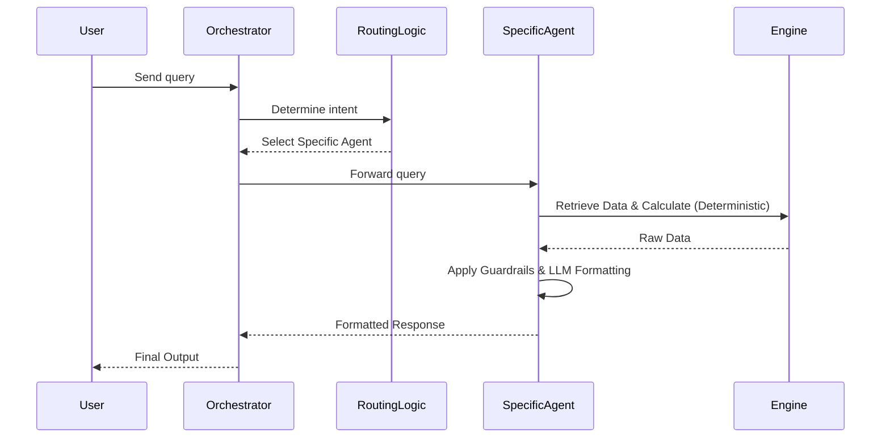

## مخطط 11

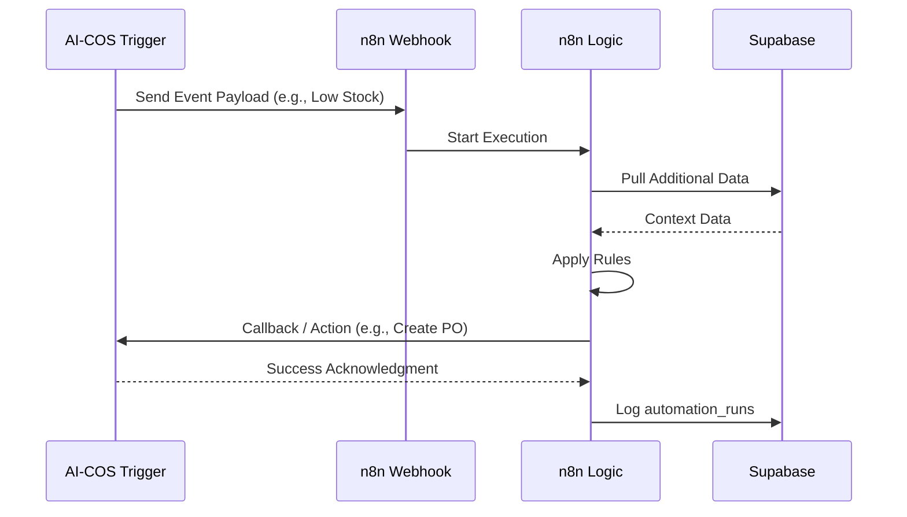

## مخطط 12

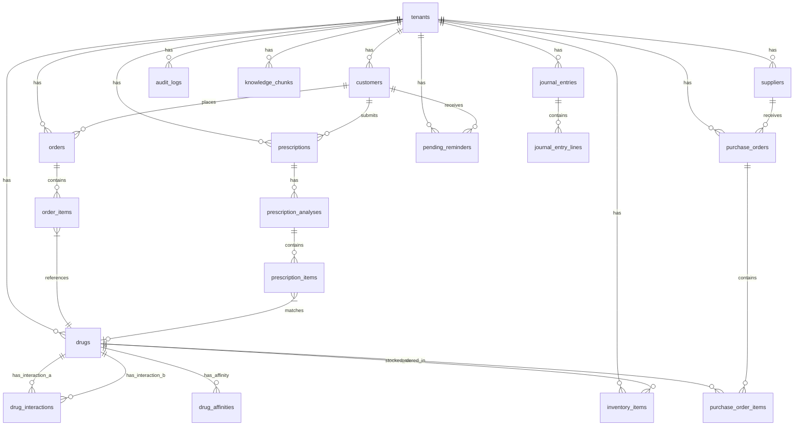

## مخطط 13

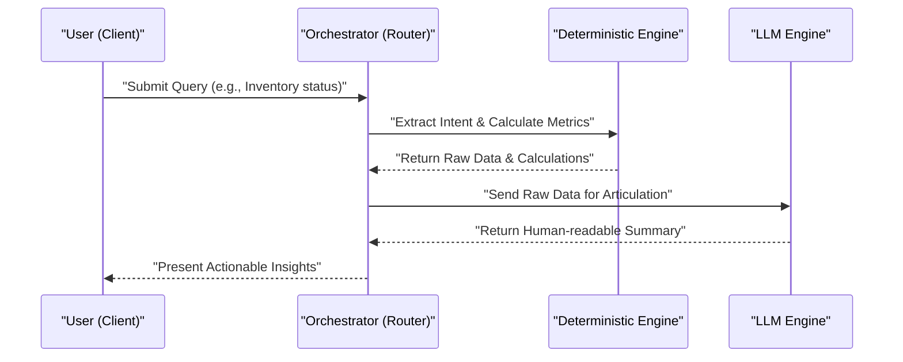

## مخطط 14

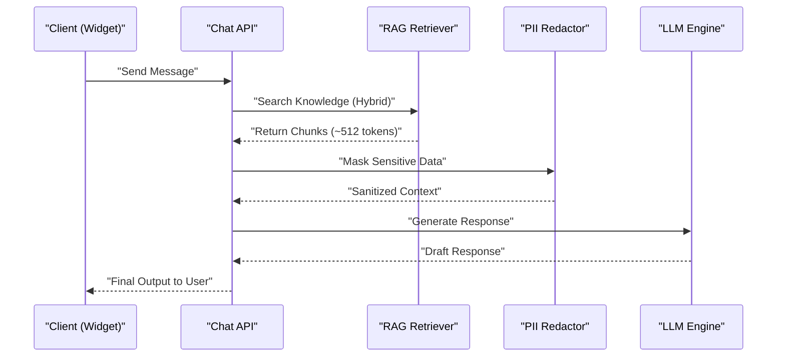

## مخطط 15

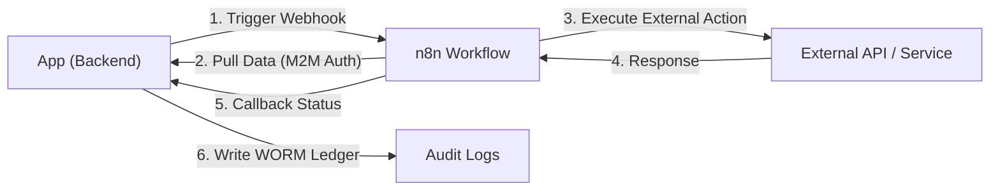

## مخطط 16

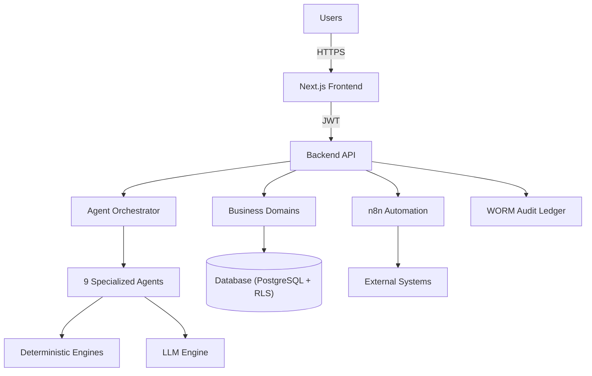

## مخطط 17

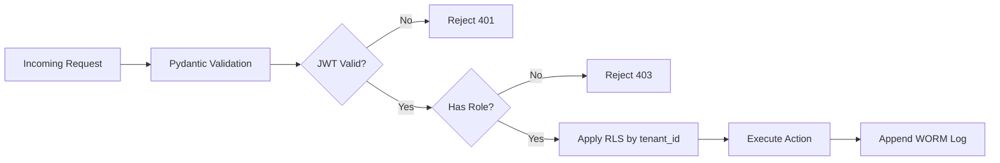

