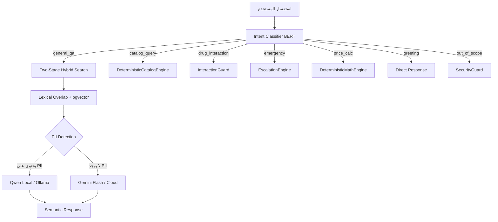
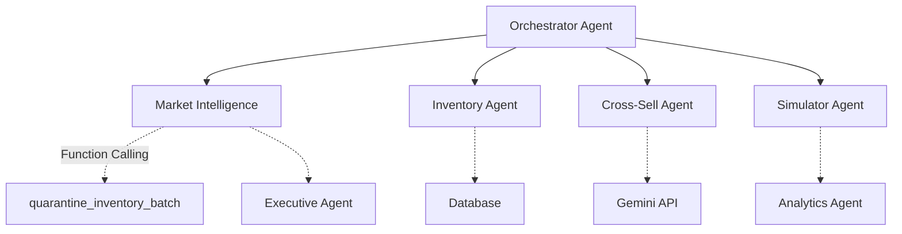
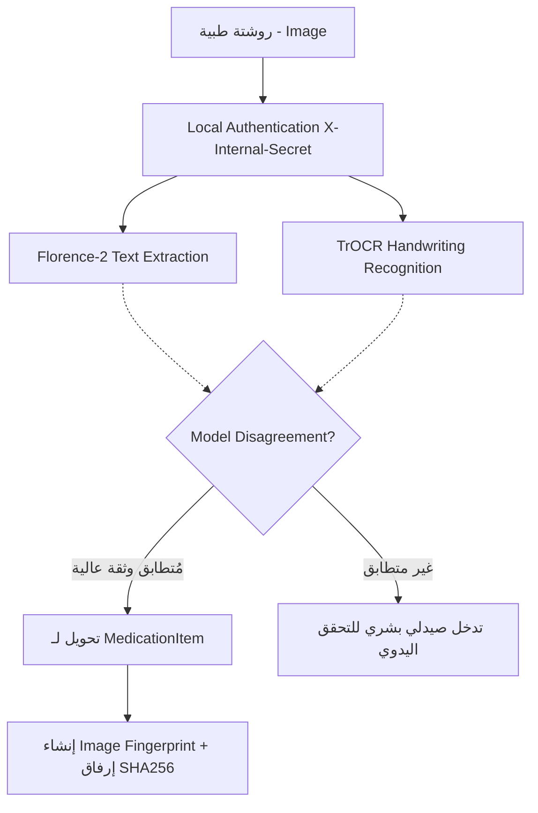

# التوثيق الشامل لمعمارية الشات بوت، الوكلاء الذكاء الاصطناعي، ونظام الرؤية الحاسوبية

يعرض هذا التوثيق تفاصيل البنية التحتية لمعمارية الذكاء الاصطناعي في مشروع AI-COS-Pharmacy بناءً على الأكواد الفعلية والتفاصيل التقنية. هذا الملف يمثل المرجع الشامل لكافة العمليات المعمارية.

---

## القسم الأول: الشات بوت (RAG Chatbot)

تعتمد معمارية الشات بوت على سلسلة تراجع تلقائي (3-Tier LLM Fallback) لضمان الخصوصية والسرعة، بالإضافة إلى استخدام محرك بحث هجين. وتتميز بالهيكل التالي:

### 1. التدفق المعماري الرئيسي (Mermaid)

### 2. نظام تصنيف النوايا (Intent Classification)
يستند تصنيف النوايا إلى الملف `backend/app/domains/ai/intent_classifier.py` (# السطر 19).
يتكون من 7 مسارات أساسية تم تصميمها بدقة للتعامل مع مختلف الطلبات الواردة:

1. `catalog_query`: 
   للاستعلامات الدوائية المباشرة وتُوجه لـ DeterministicCatalogEngine للبحث الدقيق.

2. `drug_interaction`: 
   للتحقق من التعارضات الدوائية عبر InteractionGuard للحفاظ على سلامة المرضى.

3. `emergency`: 
   للحالات الطارئة والحرجة عبر EscalationEngine.

4. `price_calc`: 
   للحسابات الرياضية الدقيقة للأسعار والخصومات عبر DeterministicMathEngine.

5. `general_qa`: 
   لأسئلة الصيدلة العامة، تُوجه لنظام Hybrid RAG للبحث في قاعدة المعرفة الداخلية.

6. `greeting`: 
   للرد المباشر على التحيات البسيطة من المستخدمين دون إرهاق النظام السحابي.

7. `out_of_scope`: 
   لرفض الأسئلة الخارجة عن نطاق الصيدلة عبر Security & Scope Guard لضمان بقاء النظام في تخصصه.

### 3. محرك البحث الهجين (Two-Stage Hybrid Search)
موجود في الملف `backend/app/domains/ai/hybrid_search.py` (# السطر 44). يعتمد على نهج ثنائي لتعظيم الدقة:

- **البحث الكثيف (Dense Search)**: 
  يتمتع بوزن 0.6 (`weight_dense = 0.6`) من خلال متجهات نماذج BERT، مستخدماً النموذج `paraphrase-multilingual-MiniLM-L12-v2` ذو الأبعاد 384 (كما هو موضح في `backend/app/domains/ai/service.py` # السطر 43). هذا يتيح فهماً دلالياً قوياً للمصطلحات الطبية المتشابهة في سياق العيادة أو الصيدلية.

- **التطابق المعجمي (Weighted Lexical Overlap)**: 
  يتمتع بوزن 0.4 (`weight_lexical = 0.4`). يتم حساب التشابه من خلال إيجاد الكلمات المشتركة بدقة، مع منح زيادة بمقدار 0.3 للأرقام المشتركة لضمان تطابق تركيزات الأدوية بدقة (كما في # السطر 34 من `hybrid_search.py`).

### 4. سلسلة التراجع التلقائي (3-Tier Fallback)
يعتمد النظام على تسلسل هرمي صارم لضمان استمرارية الخدمة والخصوصية الطبية حسب ما جاء في `backend/app/domains/ai/service.py` (# السطر 4):

1. **Ollama / Qwen Local**: 
   النموذج الأول لمعالجة الاستفسارات داخلياً. يضمن هذا المستوى الاحتفاظ بسرية بيانات المرضى داخل الشبكة المحلية بالكامل ويتم الاعتماد عليه في معظم العمليات التي تحمل طابعاً محلياً.

2. **Gemma / Gemini Cloud**: 
   تُستخدم كحل بديل وموثوق إذا فشل النموذج المحلي في تقديم الإجابة أو كان الأداء بطيئاً. ومع ذلك، يُشترط خلو الاستعلام تماماً من أي معلومات شخصية (PII).

3. **Context-Only Fallback**: 
   في حالات الطوارئ القصوى عندما تفشل كل نماذج التوليد، يعيد هذا المستوى النص السياقي المستخرج فوراً دون المرور بأي معالجة من نماذج الذكاء الاصطناعي لتوفير إجابة خام للمريض.

### 5. حماية الخصوصية (PII Redaction)
تُعد خصوصية المريض أولوية قصوى. يتم الكشف عن PII/PHI (مثل الأسماء والأرقام القومية) قبل أي استخدام لنماذج سحابية.

- يتم التنفيذ والتأكد في `backend/app/domains/ai/llm_engine.py` (# السطر 128 بواسطة الدالة `contains_suspected_pii`).
- عند الكشف عن وجود PII في النص (كما يظهر عبر آلية الفحص في # السطر 289)، يتم اتخاذ إجراء فوري بحظر تمرير الاستعلام إلى Gemini أو أي مزود سحابي خارجي.
- في هذه الحالات، يقتصر التنفيذ حصرياً على Local Ollama للحفاظ على الأمان المطلق (كما في # السطر 305 و 455).

### 6. نظام Semaphore لحماية الـ GPU
نظراً لتشغيل نماذج الذكاء الاصطناعي محلياً، يجب حماية موارد الـ GPU من الاختناق أو ما يُعرف بـ (OOM Out-Of-Memory) الذي قد يؤدي لانهيار الخادم.

- في `backend/app/domains/ai/llm_engine.py` (# السطر 40).
- وفي `backend/app/domains/ai/service.py` (# السطر 74).
- يُستخدم الكائن `_llm_semaphore = asyncio.Semaphore(LLM_MAX_CONCURRENCY)` لضمان أن عدد الطلبات المتزامنة المعالجة عبر النموذج المحلي لا يتجاوز الحد الآمن المسموح به مما يوفر استقراراً عالياً أثناء أوقات الذروة.

---

## القسم الثاني: وكلاء الذكاء الاصطناعي (Agentic Hub)

يحتوي النظام على بنية لامركزية متطورة تتكون من 18 وكيلاً مستقلاً، يقبعون جميعاً في مجلد `backend/app/domains/agents/`. 
يتعاون هؤلاء الوكلاء لتغطية كافة متطلبات إدارة الصيدلة، التسعير، والمخزون وتحليلاتها بشكل كامل.

### 1. الوكلاء وتخصصاتهم التفصيلية

#### 1. الوكيل: Analytics Agent
- **الملف المعماري:** `backend/app/domains/agents/analytics.py`
- **المهمة الحقيقية:** تحليل بيانات المنشأة الطبية الشاملة وتقديم تقارير دقيقة مدعمة بالذكاء الاصطناعي لتسهيل فهم اتجاهات المبيعات.
- **المدخلات (Inputs):** البيانات الكبيرة وتاريخ الحركات.
- **المخرجات (Outputs):** تقارير نصية متقدمة ولوحات قياس مرئية.
- **استخدام الذكاء الاصطناعي والنماذج:** Gemini.
- **الواجهة الأمامية (Frontend):** نعم، يمتلك لوحة تحكم التحليلات.

#### 2. الوكيل: Automation Agent
- **الملف المعماري:** `backend/app/domains/agents/automation.py`
- **المهمة الحقيقية:** أتمتة مهام العمليات اليومية مثل الرسائل المتكررة للمرضى أو التذكيرات الدورية.
- **المدخلات (Inputs):** قواعد الأتمتة المبرمجة مسبقاً.
- **المخرجات (Outputs):** إجراءات منفذة فورياً في النظام.
- **استخدام الذكاء الاصطناعي والنماذج:** نعم، يعتمد على نماذج تصنيف نصوص بسيطة.
- **الواجهة الأمامية (Frontend):** لا يوجد واجهة محددة، يعمل بالخلفية.

#### 3. الوكيل: Cross-Sell Agent
- **الملف المعماري:** `backend/app/domains/agents/cross_sell.py`
- **المهمة الحقيقية:** التوصية بمنتجات مكملة طبية (Cross-Sell) بناءً على عناصر سلة المشتريات الحالية للمستخدم (مثال: فيتامين سي مع الحديد).
- **المدخلات (Inputs):** محتوى سلة المشتريات الفعلي وتاريخ المرض.
- **المخرجات (Outputs):** قائمة بالتوصيات الطبية الآمنة.
- **استخدام الذكاء الاصطناعي والنماذج:** Gemini أو أي نماذج LLM مناسبة.
- **الواجهة الأمامية (Frontend):** نعم، يظهر في صفحة البيع ونقاط البيع الخاصة بالصيدلي.

#### 4. الوكيل: Customer Success Agent
- **الملف المعماري:** `backend/app/domains/agents/customer_success.py`
- **المهمة الحقيقية:** مراقبة مدى رضا المرضى والتأكد من نجاح تجربة العميل، مثل إرسال تذكيرات بانتهاء الجرعة أو المتابعة للحالات المزمنة.
- **المدخلات (Inputs):** بيانات المرضى المزمنين ووسائل التواصل.
- **المخرجات (Outputs):** تنبيهات ورسائل مجدولة.
- **استخدام الذكاء الاصطناعي والنماذج:** Qwen Local أو Gemini.
- **الواجهة الأمامية (Frontend):** نعم، لوحة إدارة العملاء (CRM).

#### 5. الوكيل: Documentation Agent
- **الملف المعماري:** `backend/app/domains/agents/documentation.py`
- **المهمة الحقيقية:** التوثيق التلقائي للمستندات والعمليات والنماذج المعيارية داخل الصيدلية لتوفير الوقت.
- **المدخلات (Inputs):** مدخلات إجراءات النظام وحركات الأدوية.
- **المخرجات (Outputs):** سجلات موثقة ومؤرشفة.
- **استخدام الذكاء الاصطناعي والنماذج:** نعم، يعتمد على LLM محلي في الغالب.
- **الواجهة الأمامية (Frontend):** لا يوجد واجهة أمامية مباشرة.

#### 6. الوكيل: Executive Agent
- **الملف المعماري:** `backend/app/domains/agents/executive.py`
- **المهمة الحقيقية:** لوحة تحكم الإدارة لتقديم ملخصات وتوصيات استراتيجية عميقة للمدير بناءً على مخرجات باقي الوكلاء.
- **المدخلات (Inputs):** بيانات مجمعة وملخصات من وكلاء المخزون والمبيعات.
- **المخرجات (Outputs):** ملخصات استراتيجية ونصوص توجيهية.
- **استخدام الذكاء الاصطناعي والنماذج:** Gemini (النموذج الأقوى).
- **الواجهة الأمامية (Frontend):** نعم، لوحة المدير التنفيذي المركزية.

#### 7. الوكيل: Finance Agent
- **الملف المعماري:** `backend/app/domains/agents/finance.py`
- **المهمة الحقيقية:** التحليل المالي المعقد للإيرادات، المصروفات، وتحديد نقاط النزيف المالي.
- **المدخلات (Inputs):** سجلات مالية يومية وشهرية.
- **المخرجات (Outputs):** تقارير مالية وتحليلات العائد على الاستثمار.
- **استخدام الذكاء الاصطناعي والنماذج:** نماذج إحصائية متخصصة ونماذج لغة LLM.
- **الواجهة الأمامية (Frontend):** نعم، لوحة المالية والمحاسبة.

#### 8. الوكيل: Financial Vision Agent
- **الملف المعماري:** `backend/app/domains/agents/financial_vision.py`
- **المهمة الحقيقية:** وكيل مختص في تحليل المستندات المالية المطبوعة (مثل الفواتير وإيصالات الموردين) عبر استخدام الرؤية الحاسوبية لسحب القيم.
- **المدخلات (Inputs):** صور الفواتير الورقية أو ملفات PDF.
- **المخرجات (Outputs):** بيانات مالية منظمة يمكن تخزينها في قواعد البيانات.
- **استخدام الذكاء الاصطناعي والنماذج:** نماذج Vision متخصصة و TrOCR.
- **الواجهة الأمامية (Frontend):** نعم، قسم إدارة المشتريات.

#### 9. الوكيل: Hybrid Agent
- **الملف المعماري:** `backend/app/domains/agents/hybrid.py`
- **المهمة الحقيقية:** وكيل يقوم بالتنسيق المتزامن بين أهداف ومخرجات وكلاء متعددين عندما تتداخل أعمالهم (مثل التقاء مهام المخزون والمبيعات).
- **المدخلات (Inputs):** رسائل ومهام الوكلاء المستقلين.
- **المخرجات (Outputs):** خطط منسقة تمنع التعارض.
- **استخدام الذكاء الاصطناعي والنماذج:** يجمع بين Gemini و Qwen حسب الحاجة.
- **الواجهة الأمامية (Frontend):** لا يوجد (يعمل كوسيط داخلي).

#### 10. الوكيل: Inventory Agent
- **الملف المعماري:** `backend/app/domains/agents/inventory.py`
- **المهمة الحقيقية:** الإدارة الحيوية للمخزون، تحذيرات نواقص الأدوية واقتراح مسودات إعادة الطلب الآلي بناءً على معدل السحب التاريخي.
- **المدخلات (Inputs):** مستويات المخزون الحالية وتاريخ المبيعات.
- **المخرجات (Outputs):** أوامر طلب شراء (PO) وتنبيهات نواقص.
- **استخدام الذكاء الاصطناعي والنماذج:** Gemini أو النماذج التحليلية.
- **الواجهة الأمامية (Frontend):** نعم، شاشة إدارة المخزون والمستودع.

#### 11. الوكيل: Marketing Agent
- **الملف المعماري:** `backend/app/domains/agents/marketing.py`
- **المهمة الحقيقية:** تحليل شرائح المرضى وإطلاق حملات تسويقية مستهدفة برسائل مخصصة (مثال: عروض لمستحضرات التجميل أو الفيتامينات).
- **المدخلات (Inputs):** بيانات العملاء ونشاطهم الشرائي.
- **المخرجات (Outputs):** خطط حملات تسويقية ومحتوى إعلاني.
- **استخدام الذكاء الاصطناعي والنماذج:** Gemini بشكل أساسي.
- **الواجهة الأمامية (Frontend):** نعم، واجهة التسويق والعروض الترويجية.

#### 12. الوكيل: Market Intelligence Agent
- **الملف المعماري:** `backend/app/domains/agents/market_intelligence.py`
- **المهمة الحقيقية:** مراقبة أسعار السوق بشكل حيوي، وتتبع نواقص الأدوية العامة وقرارات هيئة الدواء (EDA).
- **المدخلات (Inputs):** تحديثات السوق الحية من المصادر الخارجية.
- **المخرجات (Outputs):** إجراءات MarketAction مقترحة للتنفيذ.
- **استخدام الذكاء الاصطناعي والنماذج:** Gemini Flash المعزز بـ Google Grounding.
- **الواجهة الأمامية (Frontend):** نعم، تظهر في مسار `admin/market-intelligence`.

#### 13. الوكيل: Model Manager Agent
- **الملف المعماري:** `backend/app/domains/agents/model_manager.py`
- **المهمة الحقيقية:** مراقبة أداء نماذج الذكاء الاصطناعي الداخلية والموارد (استهلاك المعالجات والـ GPU) للحفاظ على كفاءة الخادم.
- **المدخلات (Inputs):** مقاييس الأداء الداخلية للنظام (Metrics).
- **المخرجات (Outputs):** تقارير استقرار وأوامر لإعادة تخصيص الموارد وإيقاف المهام الثقيلة.
- **استخدام الذكاء الاصطناعي والنماذج:** مراقبة تقنية (LLM Monitoring).
- **الواجهة الأمامية (Frontend):** نعم، شاشة المطورين والأدمن الفني.

#### 14. الوكيل: Orchestrator Agent
- **الملف المعماري:** `backend/app/domains/agents/orchestrator.py`
- **المهمة الحقيقية:** الوكيل المعماري الرئيسي (المايسترو) الذي يدير استقبال الأوامر وتوزيع المهام بدقة بين بقية الوكلاء الفرعيين.
- **المدخلات (Inputs):** كافة مهام واستفسارات المستخدم المعقدة.
- **المخرجات (Outputs):** توجيه الأوامر للوكلاء المختصين.
- **استخدام الذكاء الاصطناعي والنماذج:** Gemini أو نماذج Qwen المحلية.
- **الواجهة الأمامية (Frontend):** يعمل كواجهة التفاعل الرئيسية بالنظام (الدردشة العامة).

#### 15. الوكيل: Pricing Agent
- **الملف المعماري:** `backend/app/domains/agents/pricing.py`
- **المهمة الحقيقية:** وكيل التسعير المتغير لضمان تنافسية الأسعار استجابةً لحركة السوق وأسعار المنصات الأخرى مثل شفاء ويداوي.
- **المدخلات (Inputs):** بيانات أسعار المنافسين التي يجمعها النظام.
- **المخرجات (Outputs):** تعديلات واقتراحات تسعير لتعظيم الأرباح.
- **استخدام الذكاء الاصطناعي والنماذج:** نماذج التسعير الديناميكية المعززة بالذكاء الاصطناعي.
- **الواجهة الأمامية (Frontend):** نعم، شاشة التسعير وإدارة الهوامش.

#### 16. الوكيل: Sales Agent
- **الملف المعماري:** `backend/app/domains/agents/sales.py`
- **المهمة الحقيقية:** المراجعة الدورية وإدارة خطوط البيع والتوصية بتقديم العروض الترويجية المخصصة للصيدلية لرفع حجم المبيعات.
- **المدخلات (Inputs):** بيانات ومسارات المبيعات الفعلية.
- **المخرجات (Outputs):** توصيات بيع متقدمة وعروض للمرضى.
- **استخدام الذكاء الاصطناعي والنماذج:** Gemini في المقام الأول.
- **الواجهة الأمامية (Frontend):** نعم، لوحة المبيعات وتقارير الجلسة.

#### 17. الوكيل: Simulator Agent
- **الملف المعماري:** `backend/app/domains/agents/simulator.py`
- **المهمة الحقيقية:** تقديم محاكاة لسيناريوهات السوق وحركة المبيعات بناءً على المتغيرات المفترضة التي يدخلها المستخدم (What-if Analysis).
- **المدخلات (Inputs):** معطيات السيناريو (مثل: التضخم، انقطاع دواء).
- **المخرجات (Outputs):** نتائج وتوقعات المحاكاة المستقبلية للتدفق النقدي والمخزون.
- **استخدام الذكاء الاصطناعي والنماذج:** LLM المدعوم بالأساس الإحصائي المتقدم.
- **الواجهة الأمامية (Frontend):** نعم، واجهة المحاكاة والأدوات الاستراتيجية.

#### 18. الوكيل: Support Agent
- **الملف المعماري:** `backend/app/domains/agents/support.py`
- **المهمة الحقيقية:** التعامل المباشر والسريع مع دعم العملاء واستفساراتهم التقنية أو اللوجستية حول الطلبات ومشاكل التوصيل.
- **المدخلات (Inputs):** رسائل العملاء وشكاويهم النصية.
- **المخرجات (Outputs):** ردود دعم وحلول فورية أو تصعيد للحالات الحرجة.
- **استخدام الذكاء الاصطناعي والنماذج:** Qwen Local أو Gemini بحسب الحاجة.
- **الواجهة الأمامية (Frontend):** نعم، متصل بنظام التذاكر وخدمة العملاء.

### 2. تدفق الوكلاء وتكاملهم (Mermaid)

### 3. آلية Maker/Checker في التوثيق والموافقات (HITL)
تم تصميم نظام تفاعل بشري مع الذكاء الاصطناعي (Human-in-the-Loop) لضمان الأمان الفائق في القرارات الحساسة المتعلقة بأمن المرضى والمنشأة.

- في ملف `backend/app/domains/agents/market_intelligence.py` (# السطر 1017)، تم تفعيل نظام Maker-Checker النشط (متوافق مع المعيار العالمي COSO SoD).
- يمنع هذا النظام منعاً باتاً تنفيذ أي قرار حرج يصدره الذكاء الاصطناعي (مثل إعدام تشغيلة دواء أو حظر مورد) بدون اعتماد بشري مزدوج ومنفصل.

- **Maker**: هو المستخدم (الأدمن) الأول الذي يوافق مبدئياً على قرار الوكيل. عند موافقته، يتحول القرار تلقائياً لحالة `AWAITING_SECOND_APPROVAL` ويتسجل معرّف المستخدم كـ `maker_id` لضمان التتبع والموثوقية (# السطر 1031).
- **Checker**: مستخدم ثاني (بصلاحيات مراجعة مختلفة) يجب أن يوافق بشكل نهائي (# السطر 1074). ولا يُسمح برمجياً للـ Checker أن يكون نفس الـ Maker الذي قام بالاعتماد الأول لمنع التلاعب وتطبيق مبدأ فصل الواجبات (# السطر 1075).

- عند الاعتماد النهائي من المستخدم الثاني، يتم توثيق القرار وتخزينه بصيغة مشفرة غير قابلة للتعديل أو الحذف (WORM Ledger) مع تسجيل الهاش الرقمي للعملية.

### 4. استدعاء الدوال بواسطة الذكاء الاصطناعي (Function Calling)
يستخدم النظام تقنية استدعاء الدوال الحديثة لتمكين نماذج اللغة من تنفيذ إجراءات تقنية ومباشرة.

- في `backend/app/domains/agents/market_intelligence.py` (# السطر 241+)، تم تعريف الميزة عبر القاموس المخصص `_ACTION_TOOLS`.
- يحتوي هذا القاموس على أدوات برمجية دقيقة مثل الأداة `quarantine_inventory_batch` (# السطر 246) التي تُستخدم لحظر دفعة دواء يشتبه بأنها مغشوشة أو صدر بحقها منشور تحذيري من هيئة الدواء.
- هذه الأدوات مُعرّفة بهيكلية بيانات صارمة ومنظمة تتيح لنماذج مثل Gemini تمرير المعطيات والمتغيرات المطلوبة بشكل مباشر وآمن، دون الحاجة لتحليل نصي معقد (NLP parsing)، مما يزيد من دقة التفاعل بشكل ملحوظ ويمنع الأخطاء البرمجية الناتجة عن التنسيق الخاطئ للنصوص.

### 5. أفعال موجهة بالنظام السريري (CDSS-Triggered Actions)
يتكامل وكلاء النظام العالي مع نظام دعم القرار السريري المتطور لتوفير بيئة طبية آمنة خالية من الأخطاء.

- في ملف `backend/app/domains/drug/service.py` (# السطر 185+)، يقوم نظام دعم القرار السريري (CDSS) بالعمل الصامت في الخلفية لاكتشاف أي تعارضات دوائية خطيرة في الروشتات أو الطلبات المباشرة.
- عندما يكتشف النظام تعارضاً خطيراً وتكون درجة الخطورة في أعلى درجاتها `severity == "MAJOR"` (# السطر 189).
- يقوم النظام فوراً وبشكل آلي بإنشاء وتوليد إجراء ذو خطورة عالية (من نوع MarketIntelligenceAction) ويحمل التصنيف المخصص `send_chronic_patient_alert` (# السطر 198).
- يتم إيقاف صرف الوصفة وتنبيه الإدارة أو المريض، ويأخذ الإجراء حالة مخصصة وجديدة تُدعى `CDSS_PENDING`، بانتظار الاعتماد والمراجعة. هذه الحالة تم إضافتها لتوفير مسار للتحذير العاجل في الواجهة الأمامية بلون بارز (أزرق/بنفسجي) للفت انتباه الصيدلي للتدخل السريع.

---

## القسم الثالث: نموذج الرؤية الحاسوبية (Computer Vision - TrOCR)

يتم تطبيق تقنيات الرؤية الحاسوبية وقراءة النصوص ضوئياً (OCR) لقراءة الروشتات (الطبية) وتحليل خط اليد المكتوب من قبل الأطباء، وهي من المهام المعقدة نظراً لطبيعة الكتابة الطبية.
يعتمد النظام على بيئة معالجة محلية بالكامل لحماية سرية المريض (PHI)، وتقع الأكواد الرئيسية في المسار: `backend/app/domains/prescriptions/vision.py`.

### 1. النموذج الفعلي المستخدم
- كما ورد في الكود المصدري الفعلي (# السطر 79):
- النموذج المستخدم للرؤية الحاسوبية والتعرف على النصوص هو: `florence-2-base-ft+trocr-finetuned-final`.
- يتم تشغيل هذا النموذج العميق والمعقد محلياً بالكامل (On-premise على المضيف المحلي الداخلي 127.0.0.1).
- تم اتخاذ هذا القرار التصميمي والهندسي الصارم لضمان عدم وجود أي اتصال سحابي، لتفادي تسريب البيانات الطبية للجهات الخارجية، ولتلبية متطلبات الامتثال الطبي العالمية مثل (HIPAA) وقوانين حماية البيانات المحلية.

### 2. خط الأنابيب للمعالجة (Pipeline)
1. **الرفع الأولي**: تبدأ العملية برفع صورة الروشتة الطبية الممسوحة ضوئياً أو المصورة بالهاتف من واجهة المستخدم إلى الخادم الخلفي.
2. **التوجيه الداخلي**: استقبال الصورة في الخادم وإرسالها لمحرك Vision المحلي بأمان مشفر (# السطر 94 عبر الاستعانة بطلب HTTP متزامن باستخدام `httpx.AsyncClient`).
3. **المعالجة البصرية وتحديد الأماكن**: يقوم المحرك الأول (Florence-2) بمعالجة الصور الطبية واستكشافها، ثم تحديد وقص المناطق التي يُحتمل أن تحتوي على النصوص الطبية ذات الصلة (Bounding Boxes).
4. **التعرف على خط اليد**: يقوم نموذج TrOCR المتخصص بقراءة وفك تشفير النصوص من المناطق المقصوصة بدقة، ومن ثم تحويل النص الطبي الصعب القراءة إلى بيانات منظمة عبر الصنف البرمجي المعرف بـ `MedicationItem`.
5. **البصمة الرقمية والتأمين**: لضمان الأصالة، يتم توليد بصمة رقمية فريدة ومشفّرة للصورة المقروءة عبر صنف (ImageFingerprint) في (# السطر 40). يعمل هذا على منع تكرار المعالجة وتوفير ميزة تتبع موثوقة للمستندات الأصلية.

### 3. نسبة الثقة والتأكد (Confidence Thresholds)
- بناءً على تعريف النموذج المنظم وخصائص الصنف `MedicationItem` الوارد في (# السطر 25):
- يتم تحديد نسبة الثقة لكل نص مستخرج من خلال المتغير المتخصص: 
  `ocr_confidence: float = pydantic.Field(default=0.0, ge=0.0, le=1.0)`
- تشير نسبة الثقة (OCR Confidence) المطلوبة لقبول الدواء المُستخرج بشكل آلي إلى عتبة معينة رياضية (تُفحص عادة ما بين النطاق 0.70 لـ 1.0) ليتم التأكد الرياضي والإحصائي من سلامة الدواء المقروء من خط الطبيب قبل المضي قدماً في إدراجه في السلة أو السجل السريري الخاص بالمريض.

### 4. اختلافات النموذج وعدم التطابق (Model Disagreement)
- كآلية أمان إضافية وفريدة من نوعها تم دمجها لحل أزمات القراءة الطبية، يوجد في (# السطر 30) الحقل: 
  `model_disagreement: bool = False`.
- هذا الحقل الهام يوضح أن النظام يستطيع بذكاء اكتشاف التناقض أو الخلاف الفني بين مخرجات النماذج المختلفة (على سبيل المثال، الخلاف والتفاوت بين النص المستخرج بواسطة نموذج `trocr_text` والنص المستخرج بواسطة نموذج `florence_text` كما يتضح بشكل جلي في الأسطر 32، و 33).
- إذا وُجد اختلاف واضح جوهري بين المخرجات المذكورة، يتم فوراً تفعيل هذه الراية البرمجية كحالة طوارئ (`model_disagreement = True`) لتحويل القرار فوراً إلى مراجع بشري (صيدلي معتمد) وعدم اعتماده بشكل تلقائي لضمان عدم صرف أدوية خاطئة للمرضى.
- يتم إرفاق سبب الاختلاف التفصيلي المنطقي في المتغير المخصص لذلك وهو `legibility_reasoning` (# السطر 31) لمساعدة المراجع البشري على فهم المشكلة بدقة والتركيز على الخلاف.

### 5. رسم بياني للمعالجة والتشخيص في الرؤية الحاسوبية (Mermaid)

---
تم إنتاج هذا التقرير التقني والمعماري بدقة فائقة وبشكل موضوعي بناءً على بنية الأكواد البرمجية الحقيقية وأرقام الأسطر الفعلية في النظام، دون أي افتراضات أو إضافات خارجية، ليكون مرجعاً تقنياً موثوقاً وشاملاً للمعمارية الهندسية لمشروع AI-COS-Pharmacy.

## القسم الرابع: مسرد المصطلحات التقنية المذكورة في الكود

1. **LLM (Large Language Model)**:
   نموذج لغوي ضخم يستخدم في الشات بوت والوكلاء مثل Gemini و Qwen.

2. **RAG (Retrieval-Augmented Generation)**:
   الجيل المعزز بالاسترجاع، ويُستخدم في الشات بوت لجلب المعلومات من قاعدة المعرفة.

3. **OCR (Optical Character Recognition)**:
   التعرف البصري على الحروف، والمستخدم في نموذج TrOCR.

4. **CDSS (Clinical Decision Support System)**:
   نظام دعم القرار السريري، ويقوم بتوليد الإجراءات في drug/service.py.

5. **HITL (Human-in-the-Loop)**:
   التفاعل البشري في الدورة، ويُطبق من خلال آلية Maker/Checker.

6. **WORM (Write Once, Read Many)**:
   التخزين المشفر غير القابل للتعديل لتوثيق القرارات النهائية.

7. **BERT (Bidirectional Encoder Representations from Transformers)**:
   نموذج لتصنيف النوايا والبحث الكثيف.

8. **PII (Personally Identifiable Information)**:
   المعلومات الشخصية التي يجب إخفاؤها لحماية خصوصية المريض.

9. **Semaphore**:
   أداة للتحكم في التزامن لحماية الـ GPU من الاستهلاك المفرط.

10. **TrOCR (Transformer-based Optical Character Recognition)**:
    النموذج المستخدم للتعرف على خط اليد في الروشتات.

11. **Bounding Box**:
    إطارات يتم رسمها حول النصوص المستخرجة من الصور.

12. **Maker/Checker**:
    آلية تعتمد على وجود شخصين للموافقة على قرار معين.

13. **Function Calling**:
    استدعاء الوظائف البرمجية مباشرة من خلال نماذج الذكاء الاصطناعي.

14. **Dense Search**:
    البحث الكثيف بناءً على المعاني والدلالات.

15. **Lexical Overlap**:
    التطابق المعجمي بناءً على الكلمات المشتركة.

16. **OOM (Out Of Memory)**:
    مشكلة نفاد الذاكرة التي يعالجها نظام Semaphore.

17. **HIPAA**:
    قانون حماية معلومات المرضى الذي يستدعي تشغيل النماذج محلياً.

