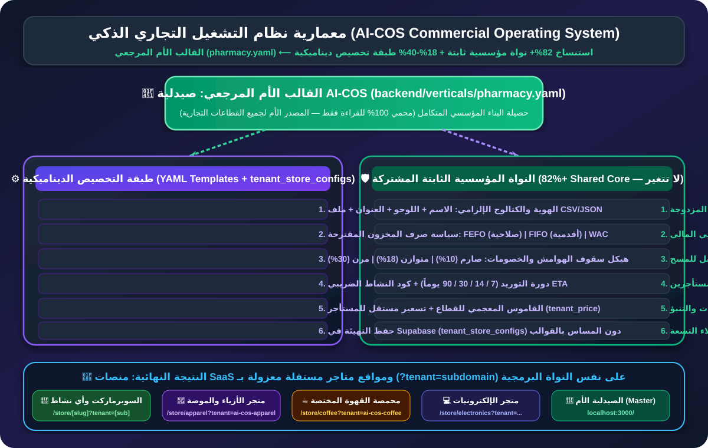
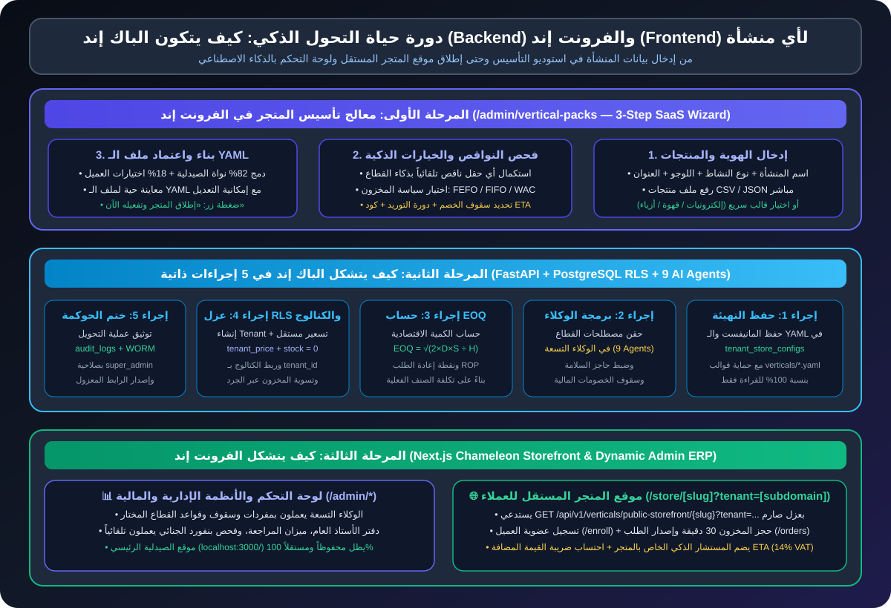
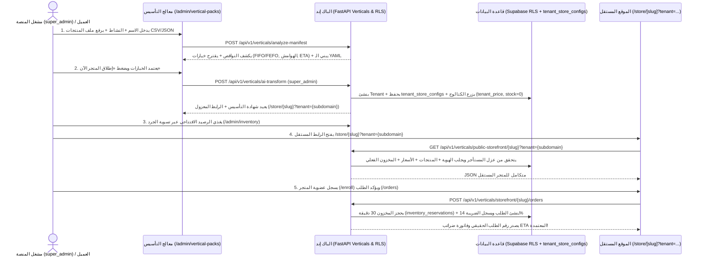
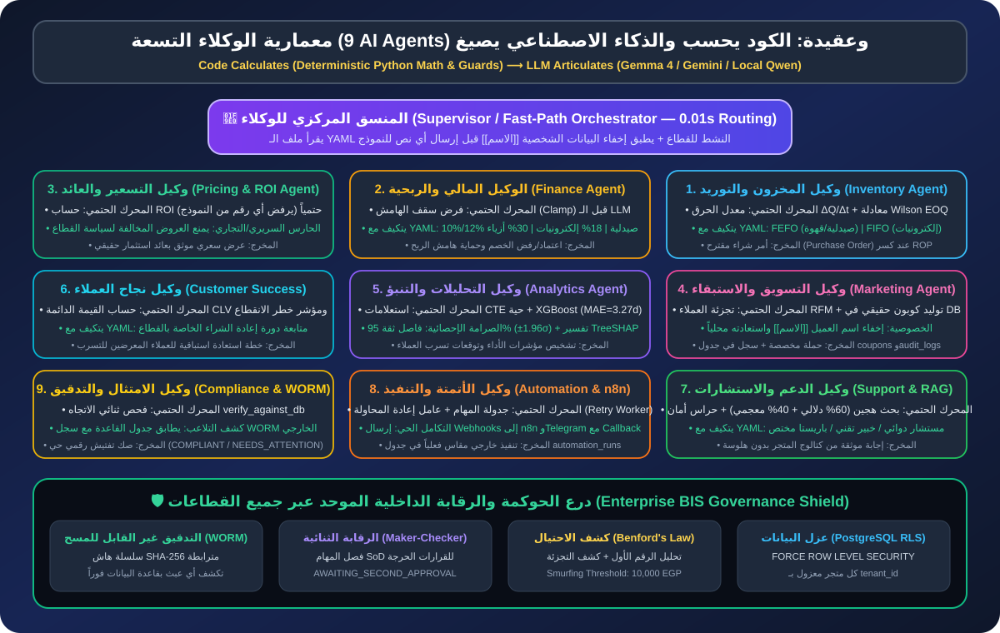

# 🏛️ ملف 11 — الشرح الشامل لمشروع AI-COS ومعمارية التحول الذكي إلى SaaS

**اسم المشروع:** نظام التشغيل التجاري بالذكاء الاصطناعي (`AI-COS — Artificial Intelligence Commercial Operating System`)  
**القسم الأكاديمي:** نظم معلومات الأعمال (`Business Information Systems — BIS`) — كلية تكنولوجيا الإدارة ونظم المعلومات، جامعة بورسعيد  
**الأطروحة المعمارية:** **قالب الصيدلية كقالب أم مرجعي (`Master Blueprint — Shared Enterprise Core`) + محرك تخصيص ديناميكي معزول (`YAML Templates + Supabase tenant_store_configs`) يحول أي مشروع تجاري إلى منصة ذكية وموقع مستقل محكوم بضوابط محاسبية وأمنية صارمة.**

---

## 📌 1. الفكرة الجوهرية للمشروع (Executive Summary)

يعاني قطاع الأعمال والتجارة من مشكلة جوهرية عند التحول الرقمي: **إما شراء أنظمة تقليدية جامدة لا تفهم خصوصية النشاط التجاري، أو بناء نظام مخصص من الصفر لكل شركة بتكلفة باهظة وشهور طويلة من البرمجة.**

يقدم مشروع **AI-COS** حلاً جذرياً قائماً على هندسة **نظم التشغيل التجارية السحابية متعددة المستأجرين (`Multi-Tenant Vertical SaaS`)**:
1. **البناء المرجعي العميق (القالب الأم — الصيدلية الذكية `pharmacy.yaml`):**
   * تم اختيار **قطاع الصيدليات** لبناء القالب الأم المرجعي (`Flagship Master Blueprint`) لأنه **أصعب وأعقد قطاع تجاري وتشغيلي على الإطلاق**؛ فهو يجمع بين:
     * الرقابة الصارمة على تواريخ الصلاحية وأرقام التشغيلات (`FEFO`).
     * التسعير الجبري وسقوف الهوامش المحدودة (`Regulated Margin Caps`).
     * الفوترة الضريبية الإلكترونية (`ETA 14% VAT`) والمحاسبة المالية المزدوجة (`Double-Entry AIS`).
     * الحوكمة السريرية وحراس الأمان (`Safety Guards`) ومسح المستندات (`Vision OCR 9202`).
2. **إعادة استخدام النواة المؤسسية المشتركة (`Shared Enterprise Core`):**
   * بما أن النظام نجح في حل أعقد قطاع (الصيدلية)، فإن **المحركات البرمجية والمحاسبية والأمنية والرياضية والذكاء الاصطناعي** أصبحت جاهزة وصالحة للعمل فوراً في أي نشاط تجاري آخر (إلكترونيات، محمصة قهوة، متجر أزياء، سوبرماركت، عطور وتجميل، قطع غيار، إلخ) **دون إعادة كتابة الكود المصدري**، ودون المساس بملفات الصيدلية الأم (`backend/verticals/pharmacy.yaml` محمي للقراءة فقط `100%`).
3. **التخصيص الديناميكي المحكوم وعزل المستأجرين (`YAML + tenant_store_configs + Tenant Isolation`):**
   * عندما يدخل مشغّل المنصة (`super_admin`) لتأسيس متجر جديد، يقوم بإدخال بيانات المنشأة (الاسم، النشاط، اللوجو، العنوان، ورفع ملف المنتجات الحقيقي `CSV/JSON`)، فيقوم النظام تلقائياً **باكتشاف أي إعدادات تشغيلية ناقصة (`Missing-Info Detector`)**، ويقترح **الخيارات المثالية للقطاع** (`FEFO` أو `FIFO` أو `WAC`، سقوف الخصومات، دورة التوريد، كود الضرائب، والوحدات المفعلة)، ثم يحفظ تهيئة المتجر في قاعدة البيانات (`tenant_store_configs`) ويُطلق له **موقع متجر مستقل تماماً ومعزول برابط خاص (`http://localhost:3000/store/[slug]?tenant=[subdomain]`)**!

---

## 🖼️ 2. المخطط المعماري الأول: القالب الأم والنواة المشتركة مقابل طبقة التخصيص

### ماذا يوضح هذا المخطط؟
| الطبقة المعمارية | الدور المعماري | المكونات الفعلية في الكود | هل تتغير بتغير النشاط؟ |
| :--- | :---: | :--- | :---: |
| **1. القالب الأم المرجعي (`pharmacy.yaml`)** | **المصدر المرجعي** | ملف `backend/verticals/pharmacy.yaml` وموقع الصيدلية الرئيسي (`localhost:3000/`). | 🔒 **محمي 100% للقراءة فقط على القرص** |
| **2. النواة المؤسسية المشتركة (`Shared Core`)** | **المحركات الثابتة** | • المحاسبة المزدوجة (`Double-Entry AIS`) • التحقيق الجنائي بقانون بنفورد (`Benford's Law`) • سجل التدقيق المشفر (`WORM SHA-256`) • العزل السيادي للمستأجرين (`PostgreSQL FORCE RLS`) • معادلة الكمية الاقتصادية (`Wilson EOQ & ROP`) • التنبؤ بعودة العملاء (`XGBoost + 95% CI + TreeSHAP`) • هيكل الوكلاء التسعة (`9-Agent Orchestrator`) | ⚡ **ثابتة في الكود وتخدم كل مستأجر بمعاملاته الخاصة** |
| **3. طبقة التخصيص (`tenant_store_configs`)** | **التهيئة الديناميكية** | • الهوية والكتالوج الإلزامي (الاسم، اللوجو، العنوان، ملف المنتجات `CSV/JSON`) • سياسة المخزون (`FEFO` / `FIFO` / `WAC`) • سقوف الخصومات والهوامش (`Margin Caps`) • دورة التوريد (`Cycle Days`: 7 / 14 / 30 / 90) • كود النشاط الضريبي (`ETA Activity Code`) • القاموس اللفظي (`Terminology`) والتسعير المستقل (`tenant_price`) | 🎨 **تُحفظ لكل متجر في جدول `tenant_store_configs` بقاعدة البيانات** |

---

## ⚙️ 3. كيف يتكون الباك إند (`Backend`) والفرونت إند (`Frontend`) بشكل صحيح؟

في أنظمة الـ **SaaS** الحقيقية، النظام لا ينسخ مجلدات الكود يدوياً لكل عميل، ولا يكتب ملفات عشوائية على القرص الصلب للسيرفر، بل يعتمد على **معمارية المحرك المتشكل بالبيانات (`Metadata-Driven Chameleon Architecture`)** المحكومة بـ **6 ضوابط هندسية صارمة**:

---

### أولاً: كيف يتكون الباك إند (`FastAPI + PostgreSQL RLS + AI Agents`)؟

عندما يضغط مشغّل المنصة (`super_admin`) على زر **«🚀 إطلاق المتجر وتفعيله الآن»**، يقوم الباك إند (`backend/app/domains/verticals/router.py`) بتنفيذ **5 إجراءات ذاتية متسلسلة** داخل معاملة قاعدة بيانات محكومة (`ACID Transaction`):

#### 1. تحليل المدخلات وكشف النواقص وحفظ التهيئة في `tenant_store_configs` (`_compile_business_manifest`)
* يتحقق الباك إند أولاً من صلاحية المشغّل عبر `require_role("super_admin")` ودالة قاعدة البيانات `public.is_platform_operator()`.
* يعمل **كاشف النواقص (`Missing-Info Detector`)**:
  * إذا لم يرفع العميل لوجو $\leftarrow$ يولّد له شعاراً تلقائياً.
  * إذا لم يحدد سياسة المخزون $\leftarrow$ يفحص نوع النشاط؛ فإذا كان (صيدلية، سوبرماركت، قهوة، تجميل) يقترح **`FEFO`** (الأقرب انتهاءً يصرف أولاً)، وإذا كان (إلكترونيات، أزياء، مكتبة، قطع غيار) يقترح **`FIFO`** (الأقدم وروداً يصرف أولاً).
  * إذا لم يحدد سقف الخصم $\leftarrow$ يقترح البروفايل المناسب (`regulated_tight` للسلع المسعرة، `balanced_retail` للإلكترونيات، `seasonal_flexible` للأزياء).
* **الأمان المعماري (`Read-Only Disk Templates`):** تظل ملفات `backend/verticals/*.yaml` للقراءة فقط بنسبة `100%`، بينما تُحفظ تهيئة المتجر الجديد (`manifest_json` و`yaml_text`) في جدول `public.tenant_store_configs` بقاعدة البيانات معزولاً بـ `tenant_id` وسياسات `FORCE ROW LEVEL SECURITY`.

#### 2. إعادة تشكيل الوكلاء التسعة في الذاكرة (`Dynamic Agent Re-Indexing`)
* الوكلاء التسعة في الباك إند (`backend/app/domains/agents/*.py`) يستدعون `load_vertical(slug)` لقراءة:
  * **القاموس المعجمي (`terminology`):** فيتحدث الوكيل عن `جهاز إلكتروني` و`عميل تقني` في متجر الإلكترونيات، أو `محصول بن` و`ذوّاق قهوة` في المحمصة، أو `دواء` و`مريض` في الصيدلية.
  * **حاجز السلامة (`safety_guard`):** يتحول من فحص التفاعلات الدوائية في الصيدلية إلى فحص شهادة الضمان والرقم التسلسلي في الإلكترونيات، أو تاريخ التحميص في القهوة.

#### 3. الحساب الاقتصادي التلقائي (`Wilson EOQ & Reorder Point`)
* يشترط الباك إند تزويد كتالوج منتجات حقيقي (`catalog_items` عبر ملف `CSV/JSON` أو محرر الكتالوج) ويرفض إنشاء متجر ببيانات وهمية (`422 Unprocessable Entity` إذا كان الكتالوج فارغاً).
* لكل منتج في كتالوج المنشأة الجديدة، يحسب الباك إند حتمياً:
  $$\text{EOQ} = \sqrt{\frac{2 \times D \times S}{H}}$$
  حيث $D$ الطلب السنوي المشتق من دورة التوريد (`cycle_days`)، و$S = 45\text{ EGP}$ تكلفة إصدار أمر الشراء، و$H = 18\%$ من تكلفة الوحدة الفعلية للصنف (`unit_cost`)، كما يحدد نقطة إعادة الطلب (`Reorder Point = 10`).

#### 4. تأسيس المستأجر (`Tenant`) وعزل التسعير والمخزون (`tenant_price + Zero Opening Stock`)
* ينشئ الباك إند سجلاً جديداً في جدول `tenants` بمعرّف فريد `tenant_id (UUID)` ونطاق فرعي `subdomain` (مثل `techzone-a1b2`).
* يفعّل سياق العزل السيادي `SELECT set_config('app.current_tenant_id', :tid, true)`:
  * يزرع أصناف المتجر في الكتالوج ويربطها في جدول `inventory_items` بـ **`tenant_price`** (بحيث يكون لكل متجر سعره المستقل تماماً دون التأثير على أسعار أي متجر آخر).
  * **الضابط المحاسبي للمخزون (`Zero Unaudited Opening Stock`):** يبدأ المخزون الفعلي للمتجر الجديد برصيد افتتاحي **`stock_level = 0`** (يُحفظ الرصيد المقترح في `suggested_opening_stock` داخل تهيئة المتجر للمرجعية فقط)، ولا يدخل أي رصيد قابل للبيع إلا عبر **عملية جرد وتسوية مخزنية موثقة** في صفحة الجرد (`/admin/inventory` $\leftarrow$ `POST /api/v1/inventory/{drug_id}/adjust`).

#### 5. التوثيق في سجل الحوكمة المشفر (`Governance & WORM Audit Seal`)
* يسجل العملية في جدول `audit_logs` وسلسلة `WORM SHA-256` باسم `ai_autonomous_business_transform`، ويُصدر شهادة التأسيس الموثقة والرابط المعزول.

---

### ثانياً: كيف يتكون الفرونت إند (`Next.js App Router`)؟

يتكون الفرونت إند من **ثلاث منظومات متكاملة** تعمل على نفس الكود المصدري:

1. **موقع الصيدلية الرئيسي (`http://localhost:3000/`):**
   * يظل مخصصاً بالكامل للصيدلية الأم (بواجهة الصيدلية، ورفع الروشتة الطبية، وفحص التفاعلات الدوائية، والدكتورة ليدي).
2. **معالج تأسيس المتاجر الذكي (`http://localhost:3000/admin/vertical-packs`):**
   * واجهة تفاعلية نظيفة من **3 خطوات (`Wizard`)**:
     * **الخطوة 1:** إدخال هوية المتجر ورفع ملف المنتجات الإلزامي (`CSV / JSON`).
     * **الخطوة 2:** استعراض ما استكمله الذكاء الاصطناعي تلقائياً واختيار سياسات المخزون والربحية والضرائب والوحدات.
     * **الخطوة 3:** معاينة أو تعديل ملف الـ `YAML` وإطلاق المتجر بنقرة واحدة، مع أزرار فورية لفتح المتجر المستقل (`?tenant=subdomain`) أو الانتقال لصفحة الجرد (`/admin/inventory`) لتسوية الرصيد الافتتاحي.
3. **الموقع المستقل لكل متجر جديد (`http://localhost:3000/store/[slug]?tenant=[subdomain]`):**
   * ملف `frontend/src/app/store/[slug]/page.tsx` هو **واجهة متجر ديناميكية ذكية (`Chameleon Storefront`)** محمية بضوابط عزل المستأجرين:
     * إذا لم يوجد متجر مؤسس لهذا القطاع $\leftarrow$ يعرض حالة `404` صادقة بدلاً من اختلاق متجر وهمي.
     * إذا وُجد أكثر من متجر لنفس القطاع دون تحديد `?tenant=subdomain` $\leftarrow$ يطلب تحديد النطاق الفرعي (`409 Conflict`) لمنع اختلاط بيانات المتاجر.
     * المتاجر المؤسسة حالياً والجاهزة للعرض الفوري بأرصدة مخزون حقيقية:
       * **محمصة القهوة المختصة:** `http://localhost:3000/store/coffee?tenant=ai-cos-coffee` (`12` منتجاً، رصيد مخزون `1900` وحدة).
       * **متجر الأزياء والموضة:** `http://localhost:3000/store/apparel?tenant=ai-cos-apparel` (`12` منتجاً، رصيد مخزون `384` وحدة).
   * يحتوي كل موقع مستقل على:
     * **شريط النطاق السحابي المستقل** (`https://{subdomain}.aicos.cloud`) مع كود الضرائب وسياسة المخزون.
     * **هيدر وبنر خاص بالمتجر** يعرض اسم المتجر، شعاره، عنوانه، وشريط بحث مخصص بلغة المتجر.
     * **كتالوج المنتجات والفئات الحقيقية** المزروعة لهذا المتجر في قاعدة البيانات مع أسعاره المستقلة (`tenant_price`) وأرصدة مخزونه الفعلية وكمية الطلب الاقتصادية `EOQ`.
     * **نظام عضوية العملاء وإتمام الطلبات الحقيقية (`Real Storefront Enrollment & Atomic Checkout`):**
       * يتحقق من عضوية العميل المسجل عبر `GET /api/v1/verticals/storefront/{slug}/customer`، ويتيح الانضمام الفوري للمتجر عبر `POST /api/v1/verticals/storefront/{slug}/enroll`.
       * عند الضغط على تأكيد الطلب، يستدعي `POST /api/v1/verticals/storefront/{slug}/orders` الذي يقوم بقفل صفوف المخزون (`FOR UPDATE`)، وخصم الكمية الفعلية، وإنشاء حجز مخزني لمدة `30` دقيقة في جدول `inventory_reservations`، وحفظ الطلب في جدول `orders` شاملاً ضريبة القيمة المضافة (`14% VAT`) وسقف الخصم المحكوم (`margin_caps`).
     * **المستشار الذكي الخاص بالمتجر (`Store AI Assistant`)** الذي يتحدث بلقب موظف المتجر (`مستشار مبيعات تقني`، `باريستا خبير`، `منسق أزياء`) ويجيب العميل من كتالوج المتجر مباشرة.

---

## 🧠 4. المخطط المعماري الثالث: الوكلاء التسعة (`9 AI Agents`) ودرع الحوكمة

### كيف يعمل الوكلاء التسعة عبر جميع القطاعات بعقيدة `Code Calculates, LLM Articulates`؟

| # | الوكيل الذكي | ماذا يحسب الكود الحتمي (`Python Deterministic Engine`)؟ | ماذا يصيغ النموذج اللغوي (`LLM`)؟ | كيف يتغير مع تهيئة المتجر؟ |
| :-: | :--- | :--- | :--- | :--- |
| **1** | **وكيل المخزون (`Inventory`)** | يحسب معدل الحرق الفعلي $\Delta Q / \Delta t$ من الطلبات + معادلة `Wilson EOQ` ونقطة `ROP`. | يكتب مسودة أمر الشراء وتوصية التوريد. | يطبق `FEFO` في الصيدلية/القهوة، و`FIFO` في الإلكترونيات/الأزياء. |
| **2** | **الوكيل المالي (`Finance`)** | يفرض سقف الخصم (`Clamp`) رياضياً قبل استدعاء النموذج. | يشرح مبررات الموافقة أو الرفض المالي. | السقف `10%–12%` في الصيدلية، `18%` في الإلكترونيات، `30%` في الأزياء. |
| **3** | **وكيل التسعير (`Pricing`)** | يحسب عائد الاستثمار `ROI` رياضياً ويرفض أي رقم يقترحه النموذج. | يصيغ العرض السعري للعميل مع إخفاء `[[الاسم]]`. | يطبق الحارس السريري في الصيدلية أو حارس الهامش التجاري في المتاجر. |
| **4** | **وكيل التسويق (`Marketing`)** | يقسم العملاء بـ `RFM` ويولّد كود كوبون فعلي في جدول `coupons`. | يكتب رسالة الحملة الترويجية بلغة القطاع. | يغير نبرة الخطاب ومفردات السلعة والعميل حسب الـ `YAML`. |
| **5** | **وكيل التحليلات (`Analytics`)** | ينفذ استعلامات `SQL CTE` حية + نموذج `XGBoost` بفاصل ثقة `95% CI`. | يفسر مؤشرات الأداء وعوامل `TreeSHAP` للإدارة. | يقيس دورة إعادة الشراء بناءً على `cycle_days` في الـ `YAML`. |
| **6** | **نجاح العملاء (`Customer Success`)** | يحسب القيمة الدائمة للعميل `CLV` ومؤشر خطر التسرب (`Churn Risk`). | يقترح خطة استبقاء واستعادة للعميل. | يضبط تنبيهات المتابعة حسب دورة استهلاك السلعة. |
| **7** | **وكيل الدعم (`Support & RAG`)** | يسترجع من قاعدة المعرفة (`60% Vector + 40% Lexical`) مع حراس الأمان. | يصيغ الإجابة الموثقة للعميل بدون هلوسة. | يتحدث كـ `د. ليدي` في الصيدلية أو `مستشار المتجر` في القطاعات الأخرى. |
| **8** | **وكيل الأتمتة (`Automation`)** | يفتح سجلاً في `automation_runs` ويدير إعادة المحاولة (`Retry Worker`). | يجهز حمولة الإشعار المرسلة إلى `n8n` و`Telegram`. | يرسل تنبيهات النواقص أو تجديد الطلبات الخاصة بالمتجر. |
| **9** | **وكيل الامتثال (`Compliance`)** | يطابق جدول `audit_logs` مع ملف `WORM` الخارجي (`verify_against_db`). | يصدر صك التفتيش الرقمي (`COMPLIANT 100%`). | يختم جميع قرارات التأسيس والتسعير ببصمة `SHA-256`. |

---

## 🎬 5. دليل العرض العملي أمام لجنة المناقشة (في 3 دقائق)

عندما تقف أمام لجنة المناقشة في قسم **BIS** لتشرح كيف يتحول المشروع إلى **SaaS** لأي منشأة تجارية:

1. **ابدأ من القالب الأم (`http://localhost:3000/`):**
   * قل للجنة: *"هذا هو القالب الأم المرجعي (الصيدلية الذكية) الذي بُنيت عليه أدق محركات المحاسبة المزدوجة، كشف التلاعب بقانون بنفورد، تشفير WORM، والوكلاء التسعة."*
2. **استعرض المتاجر الحية العاملة فوراً أو أسس متجراً جديداً من مركز إطلاق المتاجر (`http://localhost:3000/admin/vertical-packs`):**
   * يمكنك بنقرة واحدة فتح **محمصة القهوة المختصة** (`http://localhost:3000/store/coffee?tenant=ai-cos-coffee`) أو **متجر الأزياء** (`http://localhost:3000/store/apparel?tenant=ai-cos-apparel`) لعرض متجر مكتمل بمخزونه الحقيقي فوراً.
   * أو اسأل اللجنة: *"أي نشاط تجاري جديد تحبون أن نؤسسه الآن أمامكم؟"*
   * في **الخطوة 1:** اكتب اسم المتجر، وارفع ملف منتجات `CSV/JSON`، واضغط **التالي: استعراض الخيارات الذكية**.
   * في **الخطوة 2:** اعرض للجنة كيف استكمل الذكاء الاصطناعي الإعدادات الناقصة تلقائياً واقترح سياسة المخزون (`FIFO` أو `FEFO` أو `WAC`) وسقف الخصم وكود الضرائب `ETA`.
   * في **الخطوة 3:** اضغط **«🚀 إطلاق المتجر وتفعيله الآن»**.
3. **اعرض الضابط المحاسبي والموقع المستقل (`🌐 فتح الموقع المستقل للمتجر الآن`):**
   * وضّح للجنة نقطة القوة المحاسبية: *"لأن نظامنا يلتزم بمعايير الرقابة الداخلية COSO، يبدأ المتجر الجديد برصيد مخزني `0` حتى لا تُخلق أصول مالية وهمية بدون مستند جرد، ويمكن تغذيته فوراً من زر `📦 تسوية وإضافة المخزون`."*
   * افتح تبويب المتجر المستقل (`/store/{slug}?tenant={subdomain}`)، واضغط **تفعيل عضوية المتجر**، وأضف منتجاً للسلة وأصدر طلباً حقيقياً (`POST /storefront/{slug}/orders`) يحجز المخزون لمدة `30` دقيقة ويُصدر فاتورة ضرائب `ETA` بضريبة `14%` وسقف خصم محكوم!
   * في نفس اللحظة، يظل موقع الصيدلية الرئيسي على `http://localhost:3000/` سليماً ومستقلاً بنسبة 100%.
