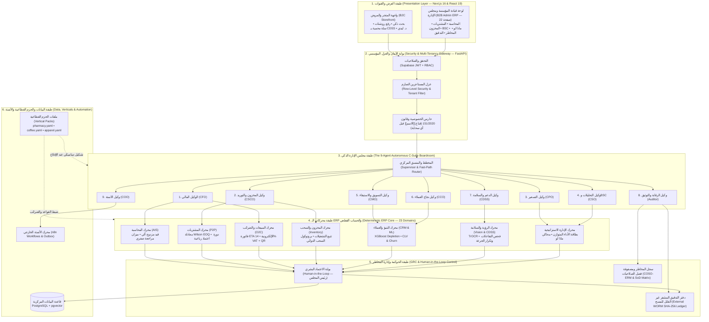
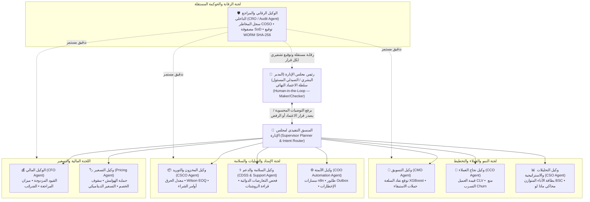
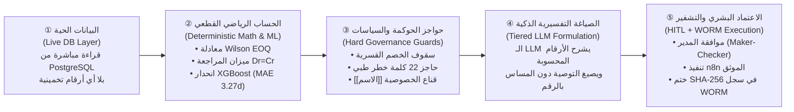
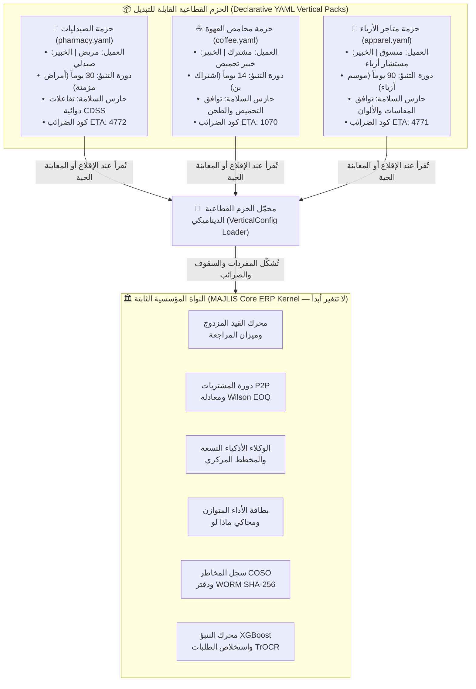
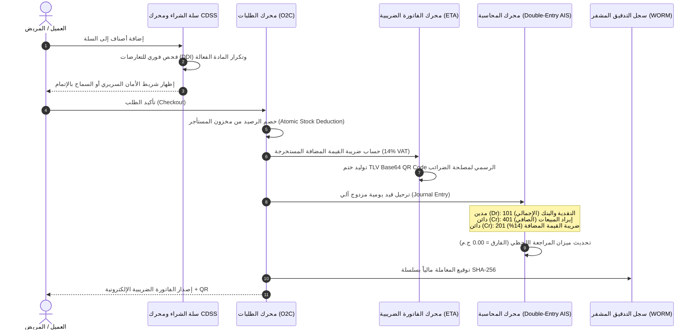
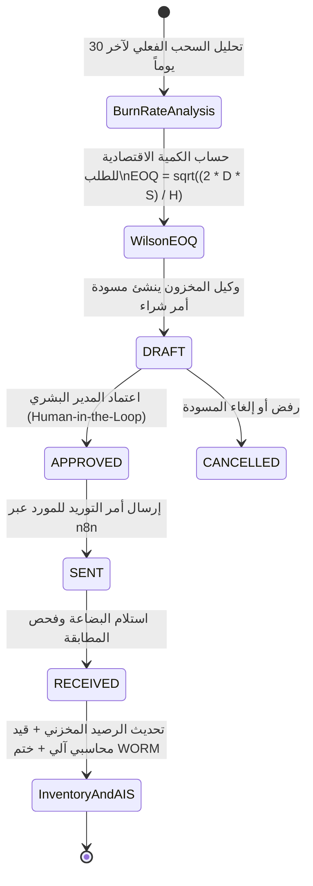
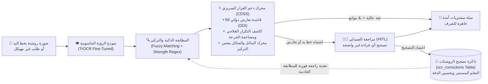
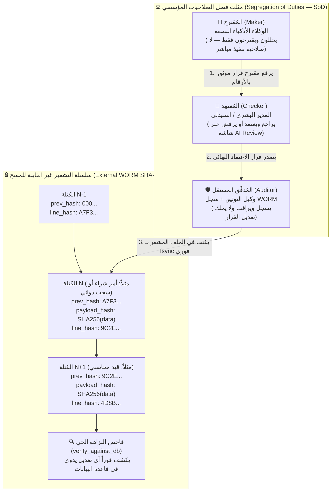
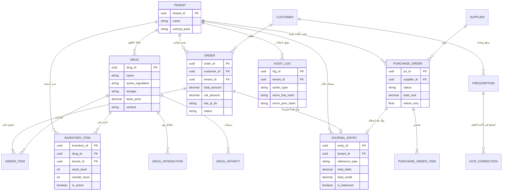

# 🏛️ الهوية الرسمية والعنوان الأكاديمي للمشروع
## **MAJLIS · مَجلِس** — نظام تخطيط موارد المؤسسات بمجلس إدارة ذكي
### **(Agentic AI ERP for SMEs — MAJLIS Pharmacy Edition)**

---

## 1️⃣ البطاقة التعريفية الرسمية للمشروع (Official Project Identity)

| العنصر | الصياغة المعتمدة |
|---|---|
| **الاسم الرئيسي (Brand Name)** | **MAJLIS · مَجلِس** |
| **الشعار التقني المختصر (Logo Sub-badge)** | **MAJLIS \| AI · ERP** |
| **الوصف المؤسسي (English Tagline)** | **Agentic AI ERP for SMEs** |
| **الوصف المؤسسي (Arabic Tagline)** | **نظام تخطيط موارد المؤسسات بمجلس إدارة ذكي للمنشآت الصغيرة والمتوسطة** |
| **حالة التطبيق المرجعية (Flagship Case Study)** | **MAJLIS Pharmacy — حزمة إدارة وتشغيل الصيدليات** |
| **الحزم القطاعية الإضافية المنفّذة (Vertical Packs)** | **MAJLIS Coffee** (محامص القهوة المتخصصة) · **MAJLIS Apparel** (متاجر الأزياء الموسمية) |
| **اسم النواة البرمجية في الكود (Kernel ID)** | `AI-COS Enterprise Kernel` |
| **التخصص الأكاديمي** | **كلية تكنولوجيا الإدارة ونظم المعلومات (MBT / BIS / MTIS) — جامعة بورسعيد** |

---

## 2️⃣ العنوان الأكاديمي الرسمي (للغلاف والمستخلص والخطابات الرسمية)

### 📘 الصياغة العربية الرسمية (لغلاف الكتاب والمناقشة):
> **«مَجلِس (MAJLIS): تصميم وتنفيذ نظام تخطيط موارد مؤسسية (ERP) قائم على الوكلاء الأذكياء لدعم القرار الإداري وحوكمة العمليات في المنشآت الصغيرة والمتوسطة — تطبيق مرجعي على قطاع الصيدليات»**

#### صياغة عربية مختصرة (للعروض التقديمية والبوستر):
> **«مَجلِس (MAJLIS AI-ERP): نظام تخطيط موارد المنشأة بمجلس إدارة ذكي وحوكمة رقابية متكاملة»**

---

### 📗 الصياغة الإنجليزية الرسمية (Academic English Title):
> **"MAJLIS: Design and Implementation of an Agentic AI-Driven Enterprise Resource Planning (ERP) System for Managerial Decision Support and Corporate Governance in SMEs — Community Pharmacies as a Flagship Case Study"**

#### صياغة إنجليزية مختصرة (Short Title):
> **"MAJLIS: An Agentic AI-ERP & Autonomous Boardroom for SMEs"**

---

## 3️⃣ الفلسفة الإدارية وراء اسم «مَجلِس · MAJLIS» (لماذا هذا الاسم تحديداً؟)

يرتكز اسم **«مَجلِس»** على معالجة فجوة إدارية وتنظيمية حقيقية في علم إدارة الأعمال:

1. **المشكلة الإدارية في المنشآت الصغيرة والمتوسطة (The SME C-Suite Gap):**
   الشركات الكبرى تمتلك هيكلاً تنظيمياً يضم مجلس إدارة ومديرين تنفيذيين متخصصين (مدير مالي CFO، مدير إمداد ومشتريات CSCO، مدير تسعير، مدير تسويق CMO، مدير مخاطر ومراجع داخلي CRO/CIA). أما المنشآت الصغيرة والمتوسطة (مثل الصيدليات، المحامص، المتاجر المتخصصة) فلا تستطيع تحمّل تكلفة توظيف هذا المجلس الإداري، فيضطر المالك لاتخاذ قرارات التسعير والشراء والمحاسبة بمفرده وبشكل عشوائي.
2. **الحل الذي يقدمه نظام MAJLIS:**
   بدلاً من تقديم برنامج ERP تقليدي يكتفي بتسجيل الفواتير والقيود بشكل سلبي، يوفّر النظام للمنشأة **«مجلس إدارة ذكي مستقل» (Autonomous C-Suite Boardroom)** مكوّناً من **9 وكلاء ذكاء اصطناعي متخصصين** يعملون فوق نواة ERP محاسبية وتشغيلية كاملة.
3. **سيادة القرار البشري وحوكمة المجلس (Human-in-the-Loop = رئيس المجلس):**
   في علم حوكمة الشركات (Corporate Governance)، يرفع المديرون التنفيذيون توصياتهم المحسوبة إلى **رئيس مجلس الإدارة** لاعتمادها. وبنفس المبدأ الإداري، لا ينفّذ وكلاء **MAJLIS** أي قرار حساس منفردين؛ بل يحسبون المؤشرات بالمعادلات الرياضية القطعية، ويلتزمون بسقوف الحوكمة، ثم يرفعون التوصية إلى **المدير البشري (أو الصيدلي)** لاعتمادها أو تعديلها أو رفضها مع توثيق القرار في سجل تدقيق مشفّر غير قابل للتلاعب.

---

## 4️⃣ مصفوفة محاكاة «مجلس الإدارة» والهيكل التنظيمي داخل النظام

يوضّح الجدول التالي كيف يربط مشروع **MAJLIS** بين **الهيكل التنظيمي الإداري** و**الوكلاء الأذكياء التسعة** و**موديولات الـ ERP الفعلية في الكود**:

| # | عضو مجلس الإدارة الذكي (Agent) | المنصب الإداري المكافئ (C-Suite Role) | موديول الـ ERP المرتبط | الوظيفة الإدارية والقرارات التي يصنعها | أداة الرقابة والحوكمة (Control) |
|---|---|---|---|---|---|
| 1 | **Finance Agent** (الوكيل المالي) | المدير المالي (**CFO**) | `accounting` + `order` | القيود المزدوجة الآلية، ميزان المراجعة الصفري، التدفقات النقدية، وفاتورة الضرائب المصرية ETA (14% VAT) | معادلة التوازن المحاسبي الصارم (`Dr = Cr`) |
| 2 | **Inventory Agent** (وكيل المخزون والتوريد) | مدير سلاسل الإمداد (**CSCO**) | `inventory` + `procurement` | حساب معدل الحرق (Burn Rate)، نقطة إعادة الطلب، والكمية الاقتصادية للطلب بنموذج **Wilson EOQ**، وإصدار مسودات أوامر الشراء | دورة اعتماد رباعية (`DRAFT → APPROVED → SENT → RECEIVED`) |
| 3 | **Pricing Agent** (وكيل التسعير) | مدير التسعير والربحية (**Chief Pricing Officer**) | `drug` / `catalog` + `what-if` | التسعير الديناميكي، حماية هامش الربح، ومحاكاة سيناريوهات "ماذا لو" قبل تغيير الأسعار | سقوف خصم وحماية هامش قسرية في الكود (`margin_caps`) |
| 4 | **Analytics Agent — DSS** (وكيل التحليلات ودعم القرار) | مدير التخطيط الاستراتيجي (**CSO / BI Director**) | `analytics` + `balanced-scorecard` + `business_value` | تغذية **بطاقة الأداء المتوازن (Kaplan & Norton)** بأبعادها الأربعة، وحساب القيمة الاقتصادية والعائد على الاستثمار (ROI) | مبدأ نزاهة البيانات (كل مؤشر محسوب من قاعدة البيانات الحية) |
| 5 | **Marketing Agent** (وكيل التسويق والاستبقاء) | مدير التسويق (**CMO**) | `customer_cycle` + `prediction` | التنبؤ بموعد نفاد السلعة لدى العميل عبر **XGBoost (MAE = 3.27 يوم)**، وإطلاق حملات استعادة العملاء المعرضين للتسرب (Churn Win-Back) | قناع الخصوصية `[[الاسم]]` وفق قانون حماية البيانات المصري 151/2020 وHIPAA |
| 6 | **Customer Success Agent** (وكيل نجاح العملاء) | مدير علاقات العملاء (**CCO**) | `customer` | تحليل قيمة العميل مدى الحياة (CLV)، متابعة الالتزام الدوائي/الاستهلاكي، وتقليل معدل الشكاوى | سجل متابعة العملاء وفصل صلاحيات الوصول (RLS) |
| 7 | **Support & Clinical Agent** (وكيل الدعم والسلامة) | مدير السلامة والجودة (**Chief Safety Officer**) | `ai` + `prescriptions` | مساعدة العملاء فوريًا، قراءة الطلبات والروشتات بخط اليد عبر **TrOCR**، وفحص التعارضات الدوائية والتكرار العلاجي (CDSS) | حاجز أمان قسري (22 كلمة خطر + فحص DDI وتكرار الجرعة) |
| 8 | **Documentation & Audit Agent** (الوكيل الرقابي) | المراجع الداخلي ومدير المخاطر (**CRO / Internal Auditor**) | `governance` + `tracking` | إدارة **سجل المخاطر (COSO-ERM)**، مصفوفة فصل الصلاحيات (**SoD**)، وتوقيع الأحداث في سجل **WORM** المشفر | سلسلة هاش متسلسلة `SHA-256` تكشف أي تلاعب حتى من مدير قاعدة البيانات |
| 9 | **Automation Agent** (وكيل الأتمتة والتنسيق) | مدير العمليات التشغيلية (**COO**) | `webhooks` + `runtime` | تنسيق مسارات العمل الخارجية عبر **n8n**، إدارة طوابير التنفيذ (Outbox Pattern)، وإعادة المحاولة الآلية | توثيق حالات التنفيذ (`automation_runs`) ومفاتيح عدم التكرار (Idempotency) |

---

## 5️⃣ أركان نظام الـ ERP السبعة المنفّذة في مشروع MAJLIS

لكي يكون الاسم صادقاً علمياً وعملياً أمام لجنة الإدارة، يضم النظام الدورات المؤسسية الكاملة لأي نظام ERP معياري:

1. **نظم المعلومات المحاسبية (AIS & Double-Entry Accounting):**
   دفتر يومية آلي بنظام القيد المزدوج (مدين/دائن)، وشاشة ميزان مراجعة لحظي بفارق صفري (`Zero-Variance Trial Balance`)، مع توليد الفاتورة الضريبية الإلكترونية المصرية (**ETA e-Invoice**) شاملة ضريبة القيمة المضافة (14% VAT) ورمز الاستجابة السريع المشفر بصيغة **TLV Base64 QR**.
2. **دورة المشتريات وسلاسل الإمداد (Procure-to-Pay — P2P & Wilson EOQ):**
   دورة مشتريات محكمة تبدأ بحساب الكمية الاقتصادية للطلب رياضياً عبر نموذج ويلسون:
   $$EOQ = \sqrt{\frac{2 \times D \times S}{H}}$$
   وتمر بأربع مراحل رسمية (`DRAFT → APPROVED → SENT → RECEIVED`) مع قيد محاسبي وتحديث مخزني ذري فور الاستلام.
3. **إدارة المخزون وبروتوكول السحب الطارئ (Inventory & Recall Protocol):**
   مراقبة الأرصدة متعددة المستأجرين (Multi-Tenant Inventory)، تسويات الجرد الموثقة، وبروتوكول السحب الدوائي/السلعي للتشغيلات المعيبة الذي يجمّد المخزون فوراً ويحصر المشترين المتأثرين خلال آخر 90 يوماً لإخطارهم.
4. **إدارة علاقات العملاء والتجارة الاستباقية (CRM & Predictive Replenishment):**
   تحويل المتجر من "نظام انتظاري سلبي" إلى "تجارة استباقية" عبر نموذج انحدار **XGBoost** يتنبأ بمنحنى نضوب السلعة لدى العميل، مع حساب مؤشرات **CLV** و**Churn Risk**.
5. **الإدارة الاستراتيجية ودعم القرار (Strategic Management & DSS):**
   - **بطاقة الأداء المتوازن (Balanced Scorecard — Kaplan & Norton):** تقيس الأداء المؤسسي حياً عبر المنظورات الأربعة (المالي، العملاء، العمليات الداخلية، التعلم والنمو).
   - **محاكي القرارات "ماذا لو" (What-If Decision Simulator):** يسمح للمدير بمحاكاة أثر تغيير الأسعار أو الخصومات أو تكاليف التوريد قبل اتخاذ القرار.
   - **لوحة مراجعة قرارات الذكاء الاصطناعي (AI Review — HITL):** شاشة اعتماد ومراجعة بشرية مع ذاكرة تصحيح مستمرة لنتائج قراءة الروشتات (OCR Continuous Learning).
6. **الحوكمة المؤسسية وإدارة المخاطر والامتثال (GRC — Governance, Risk & Compliance):**
   - **سجل المخاطر المؤسسي (COSO-ERM Risk Register):** مصفوفة احتمالية × أثر (5×5) مع الضوابط الرقابية المطبقة.
   - **مصفوفة فصل الصلاحيات (Segregation of Duties — SoD):** فصل قسري بين من يقترح القرار (الوكيل الذكي)، ومن يعتمده (المدير/الصيدلي)، ومن يدققه ويسجله (وكيل التوثيق وسجل WORM).
   - **سجل التدقيق غير القابل للمسح (WORM Cryptographic Ledger):** دفتر خارجي بسلسلة `SHA-256` متوافقة مع معايير **FDA 21 CFR Part 11** و**COSO**.
7. **معمارية الحزم القطاعية القابلة للتخصيص (Multi-Industry Vertical Packs):**
   فصل كامل بين **نواة النظام الثابتة (Core ERP OS)** وبين **حزمة القطاع المتغيرة (Vertical Pack YAML)**، مع إثبات عملي حي على 3 قطاعات مختلفة تماماً:
   - 💊 **حزمة الصيدليات (`pharmacy.yaml`):** مريض، روشتة، تفاعلات دوائية CDSS، نشاط ضريبي `4772`.
   - ☕ **حزمة محامص القهوة (`coffee.yaml`):** عميل، اشتراك نصف شهري (14 يوماً)، توافق التحميص والطحن، نشاط ضريبي `1070`.
   - 👔 **حزمة متاجر الأزياء (`apparel.yaml`):** متسوق، دورة موسمية (90 يوماً)، توافق المقاسات والألوان، نشاط ضريبي `4771`.

---

## 6️⃣ الكلمة الافتتاحية الجاهزة للإلقاء أمام رئيسة قطاع الإدارة (Defense Opening Pitch)

> 🎤 **تُلقى في أول 90 ثانية من المناقشة:**
>
> «بسم الله الرحمن الرحيم. أهلاً بحضراتكم.
>
> لما بنبص على أي منشأة صغيرة أو متوسطة في مصر — سواء صيدلية، أو محمصة، أو متجر تجزئة — بنلاقي إن سبب تعثرها الإداري مش نقص البضاعة، بل **غياب مجلس الإدارة**. الشركات الكبيرة عندها مدير مالي، ومدير مشتريات وسلاسل إمداد، ومدير تسعير، ومدير تسويق، ومراجع داخلي. لكن المنشأة الصغيرة مستحيل تقدر تدفع رواتب 9 مديرين تنفيذيين، فصاحب المنشأة بيلاقي نفسه بيشتري بالتخمين، ويسعّر بالتقريب، ويراجع حساباته آخر الشهر بعد فوات الأوان.
>
> عشان كده بنينا مشروعنا تحت اسم **«مَجلِس — MAJLIS»**: وهو **أول نظام تخطيط موارد مؤسسية (Agentic AI ERP)** بيمنح المنشأة الصغيرة والمتوسطة **مجلس إدارة ذكي متكامل من 9 وكلاء متخصصين** يعملون فوق نواة ERP حقيقية فيها محاسبة قيد مزدوج وميزان مراجعة صفري، ودورة مشتريات بنموذج ويلسون EOQ، وفاتورة إلكترونية مصرية ETA، وبطاقة أداء متوازن لـ Kaplan & Norton، وسجل مخاطر وحوكمة COSO-ERM.
>
> والأهم إدارياً: إن الذكاء الاصطناعي في **«مَجلِس»** لا يحسب أرقاماً من خياله ولا ينفرد بالقرار؛ بل يمشي على خط أنابيب خماسي يبدأ بحسابات رياضية قطعية، ويمر بسقوف حوكمة صارمة، ثم يرفع التوصية لصاحب القرار البشري اللي بيمثل **رئيس مجلس الإدارة (Human-in-the-Loop)**.
>
> اخترنا **قطاع الصيدليات (MAJLIS Pharmacy)** كحالة تطبيقية أولى لأنها البيئة الأعلى حساسية ورقابة (Zero-Tolerance for Error)، وأثبتنا بالـ **Vertical Packs** إن نفس النواة بتتحول في ثوانٍ لإدارة محمصة قهوة أو متجر أزياء بمجرد تغيير ملف تهيئة القطاع.»

---

## 7️⃣ الملخص التنفيذي للكتاب والغلاف الخلفي (Abstract — عربي / إنجليزي)

### المستخلص (باللغة العربية):
تواجه المنشآت الصغيرة والمتوسطة فجوة إدارية هيكلية تتمثل في عجزها عن توظيف كوادر تنفيذية متخصصة لإدارة وظائف التمويل، وسلاسل الإمداد، والتسعير، والتسويق، والرقابة الداخلية، في حين تقتصر أنظمة تخطيط موارد المؤسسات التقليدية (Traditional ERPs) على التسجيل الدفتري السلبي دون تقديم دعم استباقي للقرار. يقدم هذا المشروع نظام **«مَجلِس — MAJLIS»**، وهو نظام تخطيط موارد مؤسسية قائم على الوكلاء الأذكياء (**Agentic AI-Driven ERP**)، يدمج بين الدورات التشغيلية والمحاسبية الكاملة (نظام القيد المزدوج الآلي، ميزان المراجعة الصفري، دورة الشراء والتوريد P2P وفق نموذج ويلسون للكمية الاقتصادية EOQ، والفاتورة الضريبية الإلكترونية المصرية ETA) وبين **مجلس إدارة ذكي مكوّن من 9 وكلاء متخصصين** يعملون وفق عقيدة تشغيل خماسية المراحل تفصل بين الحساب الرياضي القطعي (Python & XGBoost) والصياغة التفسيرية للنماذج اللغوية تحت مظلة اعتماد بشري إلزامي (Human-in-the-Loop). كما يرسّخ النظام أطر الإدارة الاستراتيجية والحوكمة المؤسسية عبر تطبيق **بطاقة الأداء المتوازن (Kaplan & Norton BSC)**، ومحاكي القرارات (What-If Simulator)، وسجل المخاطر المؤسسي (**COSO-ERM**)، ومصفوفة فصل الصلاحيات (**SoD**)، وسجل تدقيق تشفيري غير قابل للتعديل (**WORM SHA-256 Ledger**). وقد طُبّق النظام مرجعياً على **قطاع الصيدليات (MAJLIS Pharmacy)** شاملاً نظام دعم القرار السريري (CDSS) وقراءة الوصفات الطبية بخط اليد (TrOCR)، مع إثبات قابليته للتعميم الفوري على أي قطاع تجاري عبر معمارية **الحزم القطاعية (Vertical Packs)**.

### Abstract (in English):
Small and Medium Enterprises (SMEs) face a structural management gap: they cannot afford a specialized executive boardroom (CFO, CSCO, CMO, Pricing Director, and Internal Auditor), while traditional ERP systems remain passive record-keeping tools that lack proactive decision intelligence. This graduation project introduces **MAJLIS**, an **Agentic AI-Driven Enterprise Resource Planning (ERP) System** designed to equip SMEs with an autonomous 9-agent executive boardroom operating under strict human-in-the-loop governance. **MAJLIS** unifies core enterprise transaction cycles—including automated double-entry accounting with a zero-variance trial balance, a four-stage Procure-to-Pay (P2P) lifecycle powered by Wilson’s Economic Order Quantity (EOQ) model, Egyptian Tax Authority (ETA) e-invoicing with 14% VAT and TLV QR encoding, and XGBoost-based predictive customer replenishment—with strategic management and governance frameworks: Kaplan & Norton’s **Balanced Scorecard (BSC)**, a **What-If Decision Simulator**, a **COSO-ERM Risk Register**, a **Segregation of Duties (SoD)** matrix, and a tamper-evident **WORM SHA-256 cryptographic audit ledger**. Engineered with a 5-stage deterministic-first pipeline that eliminates numerical hallucination, **MAJLIS** is demonstrated through its flagship **MAJLIS Pharmacy** implementation—featuring a Clinical Decision Support System (CDSS) and TrOCR handwritten prescription parsing—while proving cross-industry adaptability across specialty coffee and seasonal apparel sectors via declarative **Vertical Packs**.


---

# 🏗️ الأطلس المعماري الكامل لمشروع «مَجلِس · MAJLIS AI-ERP»
## (10 مخططات معمارية شاملة لكل طبقات ودورات ومحركات النظام)

---

## 1️⃣ المعمارية الشاملة للنظام (High-Level 6-Layer Enterprise Architecture)

يوضّح هذا المخطط الطبقات الست المتكاملة لنظام **MAJLIS** من واجهات المستخدم وحتى قاعدة البيانات وسجل التشفير الرقابي:



---

## 2️⃣ معمارية «مجلس الإدارة الذكي» والهيكل التنظيمي (The 9-Agent Boardroom Architecture)

يُبرز هذا الشكل كيف يحاكي نظام **MAJLIS** هيكل مجلس إدارة حقيقي برئاسة المدير البشري:



---

## 3️⃣ معمارية خط الأنابيب الخماسي لمنع الهلوسة (The 5-Stage Deterministic-First Pipeline)

هذا المخطط هو **حجر الزاوية في الدفاع الأكاديمي**؛ فهو يثبت للجنة أن الذكاء الاصطناعي لا يولّد أرقاماً مالية أو طبية من خياله، بل يعمل خلف محرك رياضي قطعي:



### تمثيل بصري سريع لخط الأنابيب الخماسي (للعرض النصي):
```text
┌─────────────────┐    ┌──────────────────┐    ┌──────────────────┐    ┌──────────────────┐    ┌──────────────────┐
│ ① قاعدة البيانات│───►│ ② الحساب القطعي  │───►│ ③ حواجز الحوكمة  │───►│ ④ صياغة التوصية  │───►│ ⑤ اعتماد وتشفير  │
│  أرقام حقيقية   │    │ EOQ / AIS / ML   │    │ سقوف + أمان سريري│    │ LLM يشرح ولا يحسب│    │ HITL + SHA-256   │
└─────────────────┘    └──────────────────┘    └──────────────────┘    └──────────────────┘    └──────────────────┘
```

---

## 4️⃣ معمارية النواة الثابتة والحزم القطاعية المتغيرة (Core ERP OS vs. Vertical Packs)

يوضّح هذا الشكل كيف يعمل **MAJLIS** كنظام ERP عام قابل للتشغيل في أي قطاع تجاري عبر تبديل ملف تهيئة واحد (`YAML`):



---

## 5️⃣ معمارية دورة المبيعات، الفاتورة الضريبية، والقيد المحاسبي الآلي (O2C + ETA + AIS Flow)



---

## 6️⃣ معمارية دورة المشتريات والتوريد ونموذج ويلسون (Procure-to-Pay P2P & Wilson EOQ)



---

## 7️⃣ معمارية قراءة الروشتات، دعم القرار السريري، والتعلم المستمر (TrOCR + CDSS + Memory Loop)



---

## 8️⃣ معمارية الحوكمة، فصل الصلاحيات، وسجل التدقيق المشفر (GRC, SoD & WORM Hash Chain)

يوضّح هذا الشكل كيف يطبّق نظام **MAJLIS** معيار **COSO** الرقابي ومبدأ **فصل المهام (Segregation of Duties — SoD)** وسلسلة البلوكتشين المصغّرة (**WORM SHA-256**):



---

## 9️⃣ معمارية الإدارة الاستراتيجية: بطاقة الأداء المتوازن ومحاكي "ماذا لو" (BSC + What-If Architecture)

```mermaid
flowchart TD
    DB_LIVE[("قاعدة البيانات التشغيلية الحية\n(المبيعات • القيود • المخزون • العملاء • الأتمتة)")]

    subgraph BSC["📐 بطاقة الأداء المتوازن (Kaplan & Norton Balanced Scorecard)"]
        P_FIN["💰 1. المنظور المالي (Financial)\n• صافي الإيرادات وحماية الهامش\n• الإيراد المعرض للخطر (Revenue at Risk)\n• العائد على استثمار الذكاء الاصطناعي (ROI)"]
        P_CUST["👥 2. منظور العملاء (Customer)\n• قيمة العميل مدى الحياة (CLV)\n• معدل استعادة العملاء (Win-Back Rate)\n• دقة الفرز السريري ورضا المرضى"]
        P_PROC["⚙️ 3. منظور العمليات الداخلية (Internal Processes)\n• دقة التنبؤ بنفاد المخزون (MAE = 3.27 يوم)\n• نسبة نجاح أتمتة مسارات n8n\n• سرعة دورة التوريد P2P"]
        P_LEARN["🌱 4. منظور التعلم والنمو (Learning & Growth)\n• ذاكرة تصحيح الروشتات المتراكمة (OCR Memory)\n• كفاءة النماذج الهجينة (Cloud + Local)\n• تغطية الاختبارات الرقابية (130+ اختبار)"]
    end

    SIM["🎛️ محاكي القرارات الاستراتيجي (What-If Decision Simulator)\nمحاكاة أثر تغيير الأسعار • نسب الخصم • تكلفة التوريد • تغير الطلب"]

    DECISION["🎯 قرار إداري مستنير خالٍ من المفاجآت المالية"]

    DB_LIVE --> P_FIN & P_CUST & P_PROC & P_LEARN
    P_FIN & P_CUST & P_PROC & P_LEARN --> SIM
    SIM --> DECISION
```



---

## 🔟 مخطط علاقات الكيانات الأساسية لقاعدة البيانات (Core ERP Entity-Relationship Diagram — ERD)




---

# 📐 الأشكال التخطيطية المرسومة (Unicode Box-Drawing Diagrams — للنسخ المباشر في Word أو العروض النصية)

فيما يلي نفس المعماريات العشر مرسومة كأشكال صندوقية جاهزة للعرض الفوري في أي محرر نصوص أو ملف Word حتى بدون مشغّل Mermaid:

### الشكل (1): المعمارية الكلية للطبقات الست (6-Layer MAJLIS ERP Architecture)
```text
╔════════════════════════════════════════════════════════════════════════════════════════╗
║                        MAJLIS · مَجلِس — Agentic AI ERP System                         ║
╠════════════════════════════════════════════════════════════════════════════════════════╣
║ [الطبقة 1: القنوات وواجهات العرض — Next.js 16 & React 19]                              ║
║  ┌──────────────────────────────────────┐  ┌────────────────────────────────────────┐  ║
║  │ 🛒 واجهة المتجر والمريض (B2C)        │  │ 🏢 لوحة قيادة المؤسسة ومجلس الإدارة (B2B)│  ║
║  │ بحث ذكي • رفع روشتة • سلة CDSS • ليدي│  │ 22 شاشة: محاسبة • مشتريات • BSC • مخاطر│  ║
║  └──────────────────┬───────────────────┘  └───────────────────┬────────────────────┘  ║
╠═════════════════════╪══════════════════════════════════════════╪═══════════════════════╣
║ [الطبقة 2: بوابة الأمان والعزل والخصوصية — FastAPI Gateway]     ▼                       ║
║  ┌──────────────────┴──────────────────────────────────────────┴────────────────────┐  ║
║  │ 🔐 Supabase JWT + RBAC  │ 🏢 Multi-Tenant RLS  │ 🛡️ قناع الخصوصية [[الاسم]] 151/2020 │  ║
║  └──────────────────────────────────────────┬───────────────────────────────────────┘  ║
╠═════════════════════════════════════════════╪══════════════════════════════════════════╣
║ [الطبقة 3: مجلس الإدارة الذكي المستقل — The 9-Agent Autonomous C-Suite]               ║
║                             ┌───────────────▼───────────────┐                          ║
║                             │ 🧠 المنسق المركزي (Supervisor)│                          ║
║                             └───┬───────┬───────┬───────┬───┘                          ║
║     ┌───────────────────────────┼───────┼───────┼───────┼────────────────────────┐     ║
║     ▼                           ▼       ▼       ▼       ▼                        ▼     ║
║ ┌──────────┐ ┌──────────┐ ┌──────────┐ ┌──────────┐ ┌──────────┐ ┌──────────┐ ┌──────┐ ║
║ │1. المالي │ │2. المخزون│ │3. التسعير│ │4. تحليلات│ │5. التسويق│ │6-7. الدعم│ │8-9.  │ ║
║ │  (CFO)   │ │  (CSCO)  │ │  (CPO)   │ │  (CSO)   │ │  (CMO)   │ │  وCDSS   │ │الرقابة│ ║
║ └────┬─────┘ └────┬─────┘ └────┬─────┘ └────┬─────┘ └────┬─────┘ └────┬─────┘ └──┬───┘ ║
╠══════╪════════════╪════════════╪════════════╪════════════╪════════════╪══════════╪═════╣
║ [الطبقة 4: محركات الـ ERP والحساب الرياضي القطعي — 23 Backend Domains]            │     ║
║  ┌───▼──────────┐ ┌▼───────────┐ ┌▼───────────┐ ┌▼───────────┐ ┌▼───────────┐   │     ║
║  │ المحاسبة AIS │ │المشترياتP2P│ │المبيعات O2C│ │التنبؤ وCRM │ │الرؤية وCDSS│   │     ║
║  │ قيد مزدوج آلي│ │Wilson EOQ  │ │فاتورة ETA  │ │XGBoost 3.27│ │TrOCR + DDI │   │     ║
║  │ ميزان صفري   │ │4 مراحل صرف │ │14% VAT + QR│ │CLV & Churn │ │بدائل الدواء│   │     ║
║  └──────┬───────┘ └─────┬──────┘ └─────┬──────┘ └─────┬──────┘ └─────┬──────┘   │     ║
╠═════════╪═══════════════╪══════════════╪══════════════╪══════════════╪══════════╪═════╣
║ [الطبقة 5: الحوكمة والاعتماد البشري والتشفير الرقابي — GRC & HITL]    ▼          ▼     ║
║  ┌──────▼───────────────▼──────────────▼──────────────▼──────────────┴──────────┴───┐ ║
║  │ 👤 رئيس المجلس (Human-in-the-Loop) ◄──► ⚖️ مصفوفة SoD & COSO ◄──► 🔒 WORM SHA-256│ ║
║  └──────────────────────┬─────────────────────────────┬─────────────────────────────┘ ║
╠═════════════════════════╪═════════════════════════════╪═══════════════════════════════╣
║ [الطبقة 6: البيانات، الحزم القطاعية، والأتمتة]        ▼                               ║
║  ┌──────────────────────▼───────┐  ┌──────────────────┴────────┐  ┌─────────────────┐ ║
║  │ 🗄️ PostgreSQL + pgvector     │  │ 📦 Vertical Packs (YAML)  │  │ ⚙️ n8n Workflows│ ║
║  │ قاعدة البيانات الحية المعزولة│  │ صيدلية • محمصة قهوة • أزياء│  │ Outbox + Retries│ ║
║  └──────────────────────────────┘  └───────────────────────────┘  └─────────────────┘ ║
╚════════════════════════════════════════════════════════════════════════════════════════╝
```

---

### الشكل (2): هيكل «مجلس الإدارة الذكي» ومثلث فصل الصلاحيات (Boardroom & SoD Structure)
```text
                         ┌──────────────────────────────────────────┐
                         │   👤 رئيس مجلس الإدارة (المدير / الصيدلي) │
                         │     [Checker — سلطة الاعتماد النهائي]     │
                         └────────────────────┬─────────────────────┘
                                              │ يعتمد / يعدّل / يرفض
                                              ▼
                         ┌──────────────────────────────────────────┐
                         │     🧠 المنسق التنفيذي (AI Supervisor)    │
                         └──────┬─────────────┬─────────────┬───────┘
                                │             │             │
        ┌───────────────────────┘             │             └───────────────────────┐
        ▼                                     ▼                                     ▼
┌───────────────────────────────┐ ┌───────────────────────────────┐ ┌───────────────────────────────┐
│   💼 اللجنة المالية والتسعير   │ │  📦 لجنة الإمداد والسلامة     │ │  📈 لجنة النمو والاستراتيجية  │
├───────────────────────────────┤ ├───────────────────────────────┤ ├───────────────────────────────┤
│ • الوكيل المالي (CFO)         │ │ • وكيل المخزون والتوريد (CSCO)│ │ • وكيل التحليلات وBSC (CSO)   │
│   القيد المزدوج + فاتورة ETA   │ │   حساب Wilson EOQ + أوامر شراء│ │   بطاقة الأداء المتوازن       │
│ • وكيل التسعير (CPO)          │ │ • وكيل السلامة السريرية (CDSS)│ │ • وكيل التسويق (CMO)          │
│   حماية الهامش + محاكي ماذا لو│ │   فحص 59 تعارضاً + TrOCR      │ │   تنبؤ XGBoost + استبقاء      │
│                               │ │ • وكيل الأتمتة (COO)          │ │ • وكيل نجاح العملاء (CCO)     │
│                               │ │   مسارات n8n + طابور Outbox   │ │   قيمة العميل CLV + رضا العملاء│
└───────────────┬───────────────┘ └───────────────┬───────────────┘ └───────────────┬───────────────┘
                └─────────────────────────────────┼─────────────────────────────────┘
                                                  ▼
                         ┌──────────────────────────────────────────┐
                         │ 🛡️ لجنة المراجعة والحوكمة المستقلة (CRO)  │
                         │ [Auditor — وكيل التوثيق + سجل WORM]      │
                         │ يختم كل عملية بـ SHA-256 ويكشف أي تلاعب   │
                         └──────────────────────────────────────────┘
```

---

### الشكل (3): معمارية الدورات المؤسسية الثلاث الكبرى (O2C + P2P + AIS)
```text
┌────────────────────────────────────────────────────────────────────────────────────────┐
│ 1. دورة المبيعات والضرائب والمحاسبة (Order-to-Cash & Double-Entry AIS)                 │
│                                                                                        │
│  [سلة العميل] ──► [حارس CDSS] ──► [خصم المخزون] ──► [فاتورة ETA 14% VAT + TLV QR]      │
│                                                            │                           │
│                                                            ▼                           │
│  [دفتر WORM SHA-256] ◄── [ميزان المراجعة Dr-Cr=0] ◄── [قيد مزدوج: 101 نقدية / 401 إيراد]│
├────────────────────────────────────────────────────────────────────────────────────────┤
│ 2. دورة المشتريات والتوريد ونموذج ويلسون (Procure-to-Pay & Wilson EOQ)                 │
│                                                                                        │
│  [مبيعات 30 يوم] ──► [معدل الحرق D] ──► [معادلة Wilson EOQ] ──► [أمر شراء DRAFT]       │
│                                                                       │                │
│  [تحديث المخزون + قيد يومية + ختم WORM] ◄── [RECEIVED] ◄── [SENT] ◄── [APPROVED بشرياً]│
├────────────────────────────────────────────────────────────────────────────────────────┤
│ 3. دورة قراءة الروشتات والتعلم المستمر (Handwritten OCR & Continuous Memory Loop)      │
│                                                                                        │
│  [صورة روشتة] ──► [نموذج TrOCR] ──► [Fuzzy + معايرة التركيز] ──► [فحص تعارضات CDSS]    │
│                                              ▲                        │                │
│                                              └── [ذاكرة التصحيح] ◄── [اعتماد الصيدلي]  │
└────────────────────────────────────────────────────────────────────────────────────────┘
```
