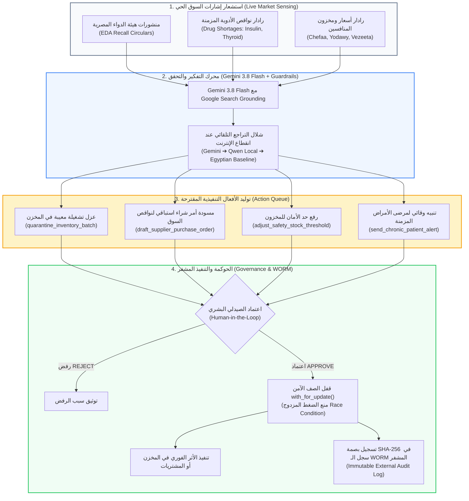

# 🌐 وثيقة المعمارية الهندسية واستخبارات السوق (Market Intelligence & Agentic AI)
## شاشة استخبارات السوق والأفعال التنفيذية (Market Intelligence & Autonomous Actions)
**المسار البرمجي في النظام:**
- **الواجهة الأمامية (Frontend):** `frontend/src/app/admin/market-intelligence/page.tsx`
- **الخلفية ومحرك الاستخبارات (Backend):**
  - `backend/app/domains/agents/market_intelligence.py` (محرك البحث الحي وربط Gemini ونواقص السوق)
  - `backend/app/domains/agents/router.py` (واجهات برمجة التطبيقات للأفعال التنفيذية)
  - `backend/app/models/market_action.py` (نموذج بيانات الأفعال التنفيذية وقفل الصفوف)
  - `backend/app/core/worm_ledger.py` (التوثيق الجنائي المشفر بسجل WORM)
- **الرابط المباشر:** `http://localhost:3000/admin/market-intelligence`

---

## 🏛️ 1. المفهوم المعماري والأكاديمي (The Agentic AI & Market Intelligence Concept)
تمثل هذه الشاشة قمة التطور في معمارية الوكلاء الأذكياء (Agentic AI) في مشروع التخرج؛ حيث ينتقل النظام من مرحلة "المساعد الذي يجيب على الأسئلة" (Passive Chatbot) إلى مرحلة **الوكيل الفاعل المستقل الموجه بالأفعال التنفيذية (Action-Oriented Autonomous Agent)**.

يرتكز الوكيل العاشر في نظام AI-COS على 4 قدرات فريدة:
1. **الربط بالبحث الحي المباشر (Google Search Grounding via Gemini 3.8 Flash):** مسح السوق المصري لحظياً بحثاً عن منشورات هيئة الدواء ونواقص الأدوية.
2. **شلال التراجع التلقائي المقاوم للفشل (Multi-Tier Fallback Cascade):** Gemini 3.8 Flash ➔ Secondary Flash ➔ Local Qwen ➔ Grounded Baseline.
3. **الأفعال التنفيذية المغلقة (Autonomous Executive Actions):** تحويل الإشارات الخارجية إلى أوامر حقيقية داخل النظام (عزل مخزون، إنشاء أوامر شراء، تعديل حدود الأمان).
4. **الحوكمة والتشفير الجنائي (Row-Level Locking & WORM Ledger):** حماية القرارات من سباق التزامن (Race Conditions) وتوثيق كل قرار ببصمة تشفيرية تتابعية (SHA-256) مقاومة للتلاعب.

---

## 📊 2. الرسم التدفقي لمعمارية استخبارات السوق والأفعال (Market Intelligence Flowchart)



---

## 📡 3. الرادارات الثلاثة لاستشعار السوق المصري (The 3 Live Market Radars)

### الرادار الأول: رادار هيئة الدواء المصرية (EDA Circulars Radar)
- **الوظيفة:** رصد منشورات سحب الأدوية غير المطابقة للمواصفات أو المغشوشة المنشورة رسمياً من هيئة الدواء المصرية (مثل منشورات سحب تشغيلات معيبة من `Augmentin 1g` أو `Concor 5mg`).
- **المعلومات المعروضة:** رقم المنشور، تاريخه، اسم الدواء والشركة المنتجة، أرقام التشغيلات المتضررة (Affected Batches)، ورابط المنشور الرسمي للتأكد.

---

### الرادار الثاني: رادار نواقص السوق (Drug Shortage Radar)
- **الوظيفة:** رصد أزمات نقص الأدوية الاستراتيجية في السوق المصري (مثل حقن الأنسولين، أدوية الغدة الدرقية، أدوية السيولة).
- **المؤشرات:** 
  - نسبة توفر الدواء في السوق العام (`market_availability_pct`).
  - رصيد الصيدلية الحالي مقارنة بحد الأمان المطلوب (`recommended_safety_stock`).
  - البدائل العلاجية المتطابقة سريرياً المعتمدة من محرك الـ CDSS.

---

### الرادار الثالث: رادار المنافسين الرقمي (Competitor Intelligence Radar)
- **الوظيفة:** مقارنة أسعار وتوافر الأدوية مع كبرى منصات الصيدلة الرقمية في مصر:
  - **شفاء (Chefaa)**
  - **يدوي (Yodawy)**
  - **فيزيتا (Vezeeta)**
- **القيمة التجارية:** رصد المنتجات النافذة عند المنافسين لاقتناص فرصة بيعها (Opportunity Capture)، أو تعديل الأسعار للمحافظة على التنافسية.

---

## ⚡ 4. الأفعال التنفيذية المستقلة الأربعة (The 4 Autonomous Actions)

الذكاء الاصطناعي هنا لا يقدم نصائح نظرية، بل يضع في طابور الاعتماد **أوامر برمجية قابلة للتنفيذ المباشر**:

1. **عزل تشغيلة دواء في المخزن (`quarantine_inventory_batch`):**
   - **السبب:** صدور منشور سحب من هيئة الدواء المصرية لتشغيلة محددة.
   - **الأثر البرمجي:** تجميد بيع هذه التشغيلة فوراً في قاعدة البيانات، وإرسال تنبيه لأمين المخزن بنقلها لمنطقة الحجر الصحي الدوائي لمنع صرفها للمرضى.
2. **إنشاء مسودة أمر شراء استباقي (`draft_supplier_purchase_order`):**
   - **السبب:** رصد بوادر نقص في دواء حيوي في السوق المصري.
   - **الأثر البرمجي:** إنشاء أمر شراء P2P استباقي فوري في شاشة المشتريات لتأمين كميات من الموردين قبل اختفاء الدواء أو ارتفاع سعره.
3. **تعديل حد الأمان للمخزون (`adjust_safety_stock_threshold`):**
   - **السبب:** دخول موسم انتشار أمراض معينة (مثل أدوية الحساسية والإنفلونزا في الشتاء).
   - **الأثر البرمجي:** رفع حد إعادة الطلب آلياً لضمان عدم نفاد المخزون.
4. **تنبيه وقائي لمرضى الأمراض المزمنة (`send_chronic_patient_alert`):**
   - **السبب:** نقص مرتقب في دواء ضغط أو سكر معين.
   - **الأثر البرمجي:** استهداف المرضى المسجلين على هذا العلاج برسائل تذكير وقائية لتأمين جرعاتهم مسبقاً وتوفير البدائل المعتمدة.

---

## 🛡️ 5. الحوكمة والأمان والتشفير الجنائي (Concurrency & WORM Security)

في ملف `market_intelligence.py`، تم تسليح النظام بتقنيات أمنية معتمدة في الأنظمة البنكية:

### أ) منع التكرار وسباق التزامن (Row-Level Locking via `with_for_update()`):
عند ضغط الصيدلي على "اعتماد" أو "تنفيذ"، يقفل الخادم سجل الحركة في قاعدة البيانات:
```python
stmt = select(MarketIntelligenceAction).where(
    MarketIntelligenceAction.action_id == action_id
).with_for_update()
```
يضمن هذا أنه إذا ضغط المستخدم مرتين متتاليتين بسرعة (Double Click) أو حاول صيدليان اعتماد نفس القرار في نفس اللحظة، لا يتم تنفيذ الإجراء مرتين أبداً (`Idempotency Guaranteed`).

### ب) سلسلة التشفير التتابعية غير القابلة للتلاعب (WORM Ledger):
كل قرار اعتماد أو رفض يتم توقيعه برمجياً وحفظ بصمته المشفرة بـ **SHA-256** في ملف السجل الخارجي (`WORM_LEDGER/external_audit_ledger.log`):
$$\text{Current Hash} = \text{SHA-256}(\text{Previous Hash} + \text{Action Data} + \text{Timestamp})$$
- يضمن هذا أنه حتى لو حاول مسؤول قاعدة البيانات (Rogue DBA) التلاعب في السجلات لاحقاً، ستنكسر السلسلة التشفيرية ويفضح أمره فوراً أمام لجان التفتيش والرقابة.

---

## 🎓 6. سيناريو المناقشة المثالي أمام لجنة التحكيم (BIS Defense Pitch)

عند استعراض شاشة استخبارات السوق، تحدث بثقة ووضوح:

> **"يا فندم، هذه الشاشة تمثل الوكيل العاشر في نظامنا (The Autonomous Market Intelligence Agent)، وهي النقلة النوعية من الـ Passive AI إلى الـ Agentic Action-Oriented AI:**
> 
> 1. **الربط بالسوق الحي (Live Market Grounding):** يعمل الوكيل بنموذج **Gemini 3.8 Flash** المزود بـ Google Search Grounding، ليمسح منشورات هيئة الدواء المصرية (EDA) ونواقص السوق وأسعار المنافسين (Chefaa, Yodawy, Vezeeta) لحظياً.
> 
> 2. **الأفعال التنفيذية وليس مجرد نصوص (Autonomous Executive Actions):** الوكيل لا يكتفي بعرض نشرة أخبار؛ بل يولد إجراءات تنفيذية محوكمة: كعزل تشغيلات الأدوية المغشوشة فوراً من المخزن (**Batch Quarantine**)، وتوليد أوامر شراء استباقية لنواقص السوق قبل ارتفاع أسعارها.
> 
> 3. **الحوكمة والتشفير الجنائي (Concurrency & WORM):** كل قرار يخضع لرقابة الصيدلي البشري (HITL)، ومحمي ضد سباق التزامن بقفل الصفوف (**Row-Level Locking**)، وتُسجل كل حركة في سجل التدقيق المشفر (**SHA-256 WORM Ledger**) لضمان الحصانة التامة ضد تلاعب مسؤولي قواعد البيانات."

---

**تم إنشاء وتوثيق هذا الدليل المرجعي بنجاح ليغطي كافة جوانب استخبارات السوق والوكلاء الأذكياء لمشروع تخرجك.**
