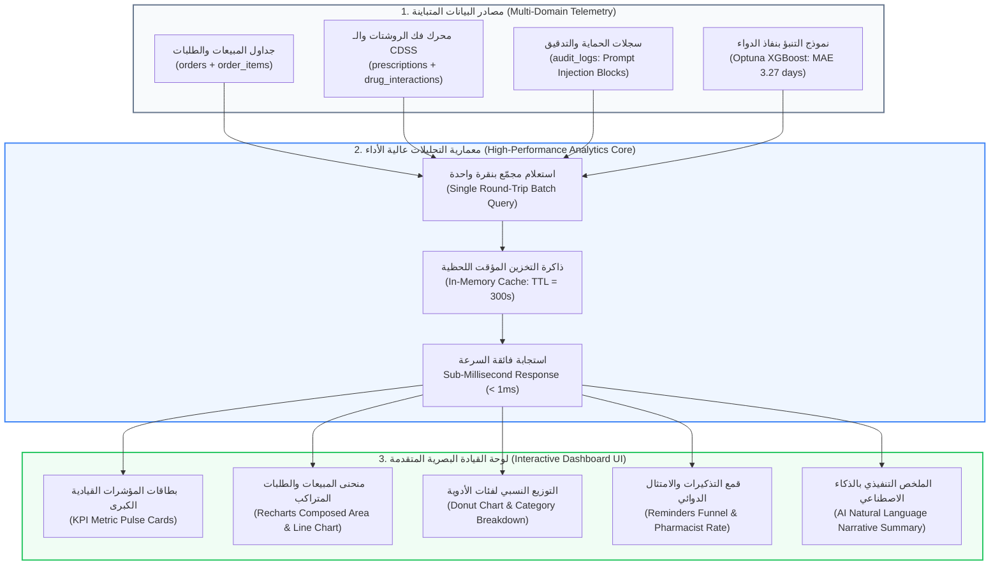

# 📊 وثيقة المعمارية الهندسية والذكاء التجاري (BI & Executive Analytics)
## شاشة التحليلات ولوحة القيادة التنفيذية (Analytics & Business Intelligence Dashboard)
**المسار البرمجي في النظام:**
- **الواجهة الأمامية (Frontend):** `frontend/src/app/admin/analytics/page.tsx`
- **الخلفية ومحركات التحليلات (Backend):**
  - `backend/app/domains/analytics/service.py` (تجميع المؤشرات والتخزين المؤقت المتقدم)
  - `backend/app/domains/analytics/router.py` (واجهات برمجة التطبيقات ونقاط الاتصال)
  - `backend/app/domains/analytics/schemas.py` (مخططات البيانات والأنماط الصارمة)
- **الرابط المباشر:** `http://localhost:3000/admin/analytics`

---

## 🏛️ 1. المفهوم المعماري والأكاديمي (The BIS & BI Concept)
تمثل هذه الشاشة ركيزة **ذكاء الأعمال (Business Intelligence - BI) ونظم دعم القرار التنفيذي (Executive Decision Support Systems - EDSS)** في مشروع التخرج.

الهدف الأساسي للشاشة ليس مجرد عرض إحصائيات تقليدية، بل تحقيق **الرؤية الشاملة بزاوية 360 درجة (360-Degree Operational & Clinical Visibility)** من خلال دمج 4 أبعاد حيوية للصيدلية في واجهة واحدة:
1. **المؤشرات المالية والتجارية (Commercial KPIs):** المبيعات، الطلبات، متوسط سلة المشتريات (AOV)، ونشاط العملاء.
2. **المؤشرات السريرية وسلامة المرضى (Clinical AI Telemetry):** الروشتات المفكوكة بـ TrOCR، التعارضات الدوائية المحجوبة، وحالات الطوارئ.
3. **أمان وحوكمة الذكاء الاصطناعي (AI Security & Governance):** التصدي لهجمات حقن الأوامر (Prompt Injections) وسجلات التدقيق الرقابي.
4. **دقة النماذج التنبؤية (ML Model Performance):** متابعة خطأ التنبؤ بمواعيد نفاذ الأدوية (Optuna XGBoost MAE).

---

## 📊 2. الرسم التدفقي لمعمارية معالجة وتجميع التحليلات (BI Pipeline Flowchart)



---

## ⚡ 3. هندسة الأداء العالي وقواعد البيانات (High-Performance Query Engineering)

في بيئات المؤسسات الكبيرة (Enterprise Scale)، يتسبب طلب 18 مؤشراً مختلفاً في إبطال أداء الخادم بسبب مشكلة (N+1 Query Problem). 
تم حل هذه المعضلة هندسياً في ملف `service.py` عبر تقنيتين متقدمتين:

### أ) الاستعلام الدفعي الموحد (Single Batch SQL Round-Trip):
ينفذ الخادم استعلاماً واحداً فائق السرعة يجمع كل العمليات الحسابية في رحلة واحدة لقاعدة البيانات:
```sql
SELECT 
  (SELECT count(*) FROM customers) as total_customers,
  (SELECT count(*) FROM orders WHERE status = 'completed') as total_orders,
  (SELECT count(DISTINCT customer_id) FROM orders WHERE status = 'completed' AND order_date >= now() - interval '30 days') as active_30d,
  (SELECT COALESCE(SUM(oi.price * oi.quantity), 0) FROM order_items oi JOIN orders o ON oi.order_id = o.order_id WHERE o.status = 'completed') as total_revenue,
  (SELECT count(*) FROM prescriptions) as prescriptions_count,
  (SELECT count(*) FROM drug_interactions WHERE severity = 'high') as high_interactions_count,
  (SELECT count(*) FROM audit_logs WHERE action_type = 'sec_block_prompt_injection_defense') as security_defenses_count,
  ...
```

### ب) التخزين المؤقت الذكي في الذاكرة (In-Memory Caching):
- **زمن الصلاحية (TTL):** محدد بـ **300 ثانية (5 دقائق)** لمنع الضغط المتكرر على قاعدة البيانات عند تصفح عدة مستخدمين للشاشة في نفس اللحظة.
- **سرعة الاستجابة:** بمجرد تخزين البيانات في الذاكرة، يتم تسليم الاستجابة في أقل من **1 مللي ثانية** (`< 1ms Cache Hit`).

---

## 📈 4. الأبعاد التحليلية الأربعة في لوحة القيادة (The 4 Analytics Dimensions)

### البعد الأول: الصحة التجارية وسلوك العملاء (Commercial & Customer Health)
- **متوسط قيمة سلة المشتريات (Average Order Value - AOV):**
  $$\text{AOV} = \frac{\text{Total Revenue}}{\text{Total Completed Orders}}$$
- **معدل نشاط العملاء (Activity Rate):**
  $$\text{Activity Rate (\%)} = \frac{\text{Active Customers (30 Days)}}{\text{Total Customers}} \times 100$$
  يسمح للإدارة بمعرفة نسبة العملاء المتفاعلين مقارنة بالعملاء الخاملين للبدء في حملات استبقاء.

---

### البعد الثاني: الأمان السريري ومؤشرات الـ CDSS (Clinical Safety Telemetry)
- **إجمالي التعارضات الدوائية المحجوبة:** عدد المرات التي أنقذ فيها محرك CDSS المريض من أدوية تتفاعل سلباً.
- **التعارضات عالية الخطورة (High-Severity Interactions):** التداخلات الدوائية التي تسبب خطراً يهدد الحياة (مثل تعارض أدوية السيولة مع الأسبرين بجرعات معينة).
- **تصعيد حالات الطوارئ (Critical Escalations):** التحويل الفوري للرعاية الطبية العاجلة عند رصد أعراض حرجة في شات الذكاء الاصطناعي.

---

### البعد الثالث: حماية الذكاء الاصطناعي والرقابة (AI Security Guardrails)
- **صد هجمات حقن الأوامر (Prompt Injection Defense):**
  يوثق النظام عدد المرات التي حاول فيها مستخدم كتابة تعليمات خبيثة للمساعد الذكي لمحاولة الحصول على أدوية جدول أو تجاوز القواعد، وتم صده تلقائياً عند حاجز الأمان دون أن تصل التعليمات للـ LLM.
- **سجلات التدقيق الرقابي المشفرة:** إجمالي الحركات الموثقة لضمان الشفافية ومطابقة اشتراطات هيئة الدواء المصرية (EDA).

---

### البعد الرابع: الأداء الحقيقي لنموذج الذكاء الاصطناعي (ML Model Telemetry)
- **مؤشر MAE للتنبؤ بمواعيد إعادة الشراء (Refill Prediction MAE):**
  يتابع النظام دقة نموذج **Optuna XGBoost** المتخصص في التنبؤ بموعد نفاد علاج الأمراض المزمنة (الضغط، السكر)، حيث يسجل الكود خطأ مطلقاً متوسطاً يبلغ **3.27 يوماً فقط** (`REGRESSION_MAE_DAYS = 3.27`)، وهو رقم قياسي يسمح بإرسال تذكيرات الشراء في التوقيت الأمثل تماماً قبل نفاد الدواء بيومين.

---

## 🎨 5. المكونات البصرية التفاعلية (Visual Analytics & Charts)

1. **الرسم البياني المركب للإيرادات (Composed Area & Line Chart):**
   - يدمج بين المساحة المظللة (Area) للإيرادات والخط البياني (Line) لعدد الطلبات عبر محورين متزامنين، مع إمكانية التبديل بين فترات (7 أيام، 10 أيام، 30 يوماً).
2. **مخطط كعكة الفئات الدوائية (Donut / Category Breakdown):**
   - يوضح الحصة النسبية لأعلى 5 فئات دوائية مبيعاً للمساعدة في قرارات المساحات التخزينية في الصيدلية.
3. **قمع التذكيرات ونسبة اعتماد الصيدلي (Reminders Funnel):**
   - يعرض مراحل التذكير الذكي (تم التوليد ➔ قيد المراجعة ➔ تم الإرسال ➔ تم الصرف)، ونسبة موافقة الصيدلي البشري (Pharmacist Approval Rate) لضمان مبدأ الرقابة البشرية المشتركة (Human-in-the-Loop).
4. **السرد التحليلي التنفيذي بالذكاء الاصطناعي (AI Executive Summary):**
   - فقرة ذكية ومصاغة تلقائياً تلخص للإدارة أهم اتجاهات اليوم (Trends) والنقاط الحرجة التي تتطلب تدخلاً فورياً دون الحاجة لقراءة الجداول المعقدة.

---

## 🎓 6. سيناريو المناقشة المثالي أمام لجنة التحكيم (BIS Defense Pitch)

عند استعراض شاشة التحليلات أمام الأساتذة ولجنة التحكيم، تحدث بهذا التسلسل القوي:

> **"يا فندم، هذه الشاشة تمثل لوحة القيادة التنفيذية الذكية (Executive BI Dashboard) التي تمنح الإدارة رؤية متكاملة 360 درجة:**
> 
> 1. **من الناحية الهندسية والمعمارية (System Architecture & Performance):** لم نقم بإنشاء استعلامات منفصلة تبطئ النظام (N+1 Problem)؛ بل قمنا بدمج كافة المؤشرات في **استعلام SQL مجمع واحد (Single Batch Round-Trip)** مع تطبيق **In-Memory Caching (TTL = 300s)** يضمن تسليم الشاشة في زمن استجابة يقل عن 1 مللي ثانية.
> 
> 2. **التكامل بين التجارة والرعاية الصحية (Commercial & Clinical Alignment):** الشاشة لا تقتصر على مراقبة المبيعات و الـ AOV؛ بل تتابع لحظياً **مؤشرات السلامة السريرية** مثل عدد التعارضات الدوائية المحجوبة والروشتات المفكوكة بواسطة TrOCR، مما يربط بين كفاءة الأطباء وأرباح الصيدلية.
> 
> 3. **حوكمة وأمان نماذج الذكاء الاصطناعي (AI Governance & Telemetry):** اللوحة تعرض بوضوح مؤشر **MAE (3.27 يوماً)** لنموذج الـ Machine Learning الخاص بالتنبؤ بمواعيد إعادة صرف الأدوية المزمنة، بالإضافة إلى رصد أمني لحظي لمحاولات **Prompt Injection** التي تصدى لها حاجز الأمان بنجاح."

---

**تم إنشاء وتوثيق هذا الدليل المرجعي بنجاح ليغطي كافة تفاصيل التحليلات والذكاء التجاري لمشروع تخرجك.**
