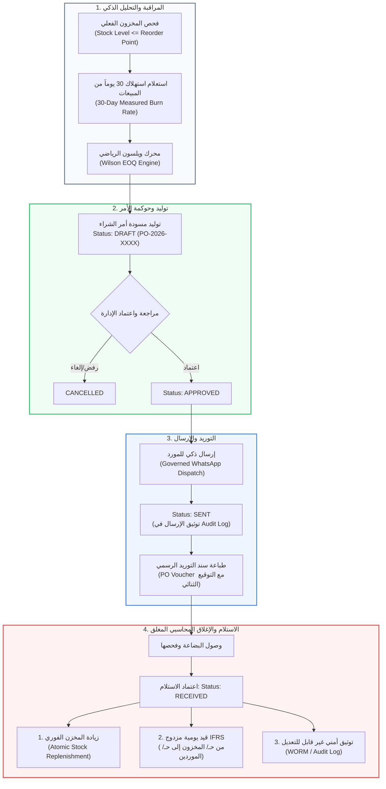
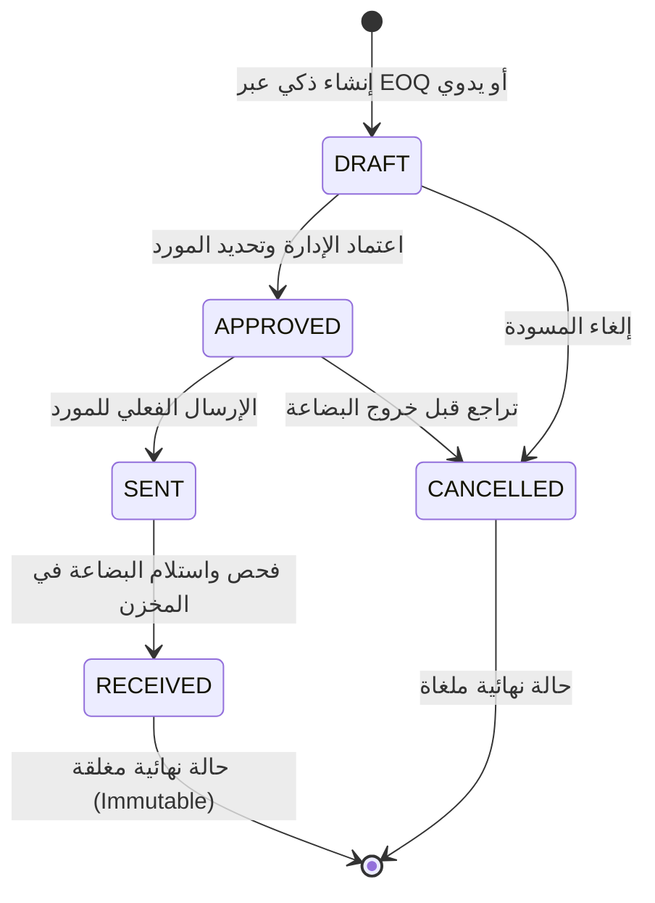
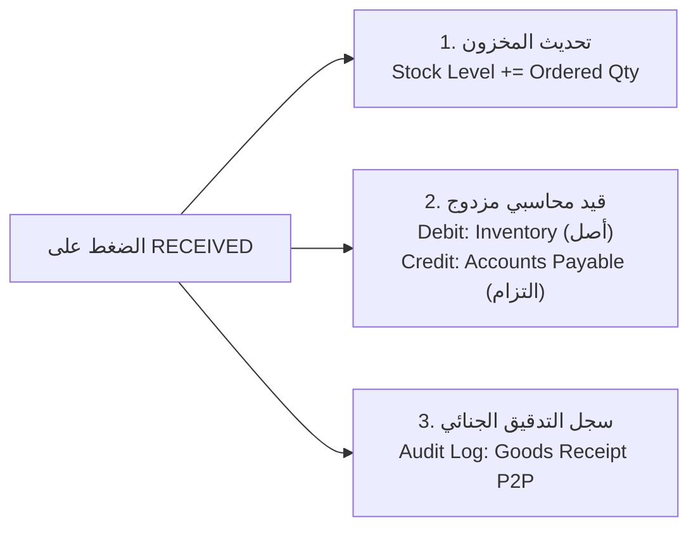

# 📦 وثيقة المعمارية الهندسية ونظم معلومات الأعمال (BIS)
## شاشة المشتريات وإدارة سلاسل الإمداد الذكية (Smart Procurement & P2P Engine)
**المسار البرمجي في النظام:**
- **الواجهة الأمامية (Frontend):** `frontend/src/app/admin/procurement/page.tsx`
- **الخلفية وقواعد البيانات (Backend):** `backend/app/domains/procurement/service.py` & `router.py`
- **الرابط المباشر:** `http://localhost:3000/admin/procurement`

---

## 🏛️ 1. المفهوم المعماري والأكاديمي (The Architecture Concept)
هذه الصفحة ليست مجرد واجهة لإدخال الفواتير (CRUD Interface)، بل تمثل نظاماً متكاملاً لإدارة **دورة المشتريات المؤسسية (Procure-to-Pay / P2P Cycle)** المعتمد في أنظمة الـ ERP العالمية مثل SAP و Oracle.

يربط هذا النظام بين أربعة محاور رئيسية في تخصص نظم معلومات الأعمال (BIS):
1. **بحوث العمليات وسلاسل الإمداد (Operations Research & SCM):** تحديد كميات الطلب المثلى رياضياً لمنع تجميد رأس المال أو نفاد الأدوية.
2. **آلة الحالات الصلبة (Finite State Machine - FSM):** حوكمة مسار أمر الشراء ومنع التلاعب الإداري.
3. **أتمتة التواصل (Automated Dispatch):** الإرسال المشفر والمباشر لأوامر الشراء إلى الموردين عبر WhatsApp.
4. **التكامل المحاسبي والمخزني المغلق (Closed-Loop Synchronization):** المزامنة الفورية بين رصيد المخزن الفعلي والقيود المحاسبية المزدوجة وسجل التدقيق.

---

## 📊 2. الرسم التدفقي لمعمارية دورة الشراء (P2P Architecture Flowchart)



---

## 🧮 3. الركيزة الرياضية: محرك ويلسون للكمية الاقتصادية (Wilson EOQ)

بدلاً من الاعتماد على التخمين البشري الذي يسبب إما **تجميد السيولة في مخزون زائد (Overstock / Dead Capital)** أو **ضياع المبيعات بسبب نفاد الدواء (Stockout Cost)**، يطبق النظام خوارزمية ويلسون الرياضية من الكود الفعلي:

### المعادلة الرياضية المطبقة:
$$EOQ = \sqrt{\frac{2 \times D \times S}{H}}$$

### تفكيك المتغيرات البرمجية من واقع ملف `service.py`:
1. **الطلب السنوي ($D$ - Annual Demand):**
   النظام لا يفترض رقماً ثابتاً، بل ينفذ استعلام SQL فعلي يحسب معدل السحب اليومي في آخر شهر:
   ```sql
   SELECT oi.drug_id, SUM(oi.quantity) AS units_30d
   FROM order_items oi
   JOIN orders o ON o.order_id = oi.order_id
   WHERE o.order_date >= now() - interval '30 days'
     AND o.tenant_id = :tid
   GROUP BY oi.drug_id
   ```
   ثم يحسب:
   $$\text{Daily Burn} = \frac{\text{units\_30d}}{30}$$
   $$D = \max(120.0, \text{Daily Burn} \times 365.0)$$

2. **تكلفة إعداد الطلب ($S$ - Ordering Setup Cost):**
   محددة بـ **45.0 ج.م** لكل أمر توريد (تمثل تكاليف الاتصالات، المتابعة الإدارية، والنقل الثابت).

3. **تكلفة الاحتفاظ بالمخزون ($H$ - Unit Holding Cost per Year):**
   محسوبة برمجياً بـ **18% سنوياً** من سعر تكلفة الوحدة:
   $$H = \max(1.5, 0.18 \times \text{Unit Cost})$$
   (تغطي تكلفة تبريد الأدوية Cold Chain، التأمين، الإيجار، وتكلفة رأس المال المعطل).

4. **صمام الأمان (Safety Floor):**
   يفرض الكود حداً أدنى للأمر $\ge 15$ علبة لتجنب إصدار أوامر شراء مجزأة بشكل غير اقتصادي.

---

## 🔄 4. آلة الحالات المنطقية والحوكمة (State Machine & Internal Controls)

تم تصميم النظام بمصفوفة انتقالات صارمة (`ALLOWED_TRANSITIONS`) لمنع أي تلاعب أو تجاوز إداري:



### القواعد الرقابية الصارمة:
- **منع الحذف بعد الاستلام (Immutable RECEIVED State):**
  إذا تم استلام الطلب، يتم رفض حذفه برمجياً برمز خطأ `HTTP 400 Bad Request`؛ لأن الاستلام ترتبت عليه زيادة في رصيد المخزن وقيد محاسبي مزدوج، ولا يمكن حذفه إلا بتسوية إرجاع رسمية.
- **توليد تسلسلي فريد للأوامر:**
  رقم أمر الشراء يتبع نمط `PO-2026-XXXX` ويُحسب عبر `MAX` بدلاً من `COUNT` لضمان عدم تكرار الأرقام حتى في حالة حذف المسودات السابقة.

---

## 📱 5. الإرسال المحوكم عبر واتساب (Governed WhatsApp Dispatch)

لتسريع دورة التوريد وتقليل الوقت المستغرق (Lead Time)، يرتبط النظام بقنوات التواصل المباشرة مع الموردين:
1. **التحقق من الاعتماد:** لا يُسمح بإرسال أي طلب إلا إذا كانت حالته **`APPROVED`**.
2. **صياغة الرسالة المهنية:** يُولد النظام رسالة نصية باللغة العربية الرسمية تحتوي على:
   - رقم أمر الشراء وتاريخه.
   - قائمة الأدوية والكميات المطلوبة المحسوبة بـ EOQ.
   - التكلفة التقديرية واسم الصيدلية.
3. **التوثيق الرقابي الفوري:** بمجرد النقر على الإرسال، يُحول النظام الحالة فوراً إلى **`SENT`** ويسجل في جدول `audit_logs` هوية واسم المستخدم وتوقيت الإرسال.
4. **رابط التوجيه المباشر:** يفتح المتصفح مباشرة رابط `wa.me` موجه لرقم المورد المعتمد المسجل في بطاقة الموردين.

---

## 🔐 6. الإغلاق الثلاثي المتكامل عند الاستلام (The Closed-Loop Cycle)

عند وصول البضاعة لمقر الصيدلية وضغط المسؤول على **"استلام البضاعة" (RECEIVED)**، تنفذ قاعدة البيانات عملية ذرية متزامنة (Atomic Transaction) تتكون من:



1. **تحديث المخزون (Inventory Mutation):**
   تحديث رصيد الدواء في المخزن فوراً وإعادة حساب نسبة التغطية (Stock Coverage).
2. **التسجيل المحاسبي (Double-Entry Bookkeeping):**
   استدعاء `record_goods_receipt_entry` لإنشاء قيد يومية محاسبي رسمي يثبت التزام الصيدلية المالي تجاه المورد ويزيد من قيمة الأصول المتداولة (المخزون).
3. **التدقيق الأمني (Audit Trail):**
   تسجيل العملية تحت نوع `procurement_goods_received_p2p` لضمان الشفافية ومطابقة الجرد الدوري مع فواتير الشراء.

---

## 📄 7. سند التوريد ومبدأ الرقابة المزدوجة (PO Voucher & Four-Eyes Principle)

تحتوي الصفحة على قالب طباعة احترافي مخصص (Print-optimized Voucher) يمكن طباعته بنقرة واحدة:
- يعرض بيانات الأصناف، الكميات، ومعادلة الحساب، والتكلفة التقديرية.
- **تطبيق مبدأ الرقابة الثنائية (Four-Eyes Principle):** يحتوي السند في أسفله على خانتين للتوقيع اليدوي الإجباري:
  1. **توقيع أمين المخزن والصيدلي المسؤول (Warehouse & Pharmacist Signature).**
  2. **توقيع مندوب شركة التوزيع / المورد (Supplier Representative Signature).**
- يضمن هذا التوثيق عدم استلام أي كرتونة دواء ناقصة أو غير مطابقة للمواصفات السريرية والتاريخ.

---

## 🎓 8. سيناريو المناقشة المثالي أمام لجنة التحكيم (BIS Defense Pitch)

إذا طلبت منك لجنة المناقشة شرح هذه الشاشة، قدم إجابتك بالخطوات التالية لتنال الدرجة النهائية:

> **"يا فندم، هذه الشاشة ليست مجرد صفحة إضافة مشتريات عادية، بل هي تطبيق عملي لدورة المشتريات المؤسسية (Procure-to-Pay Pipeline) المتبعة في كبرى سلاسل الإمداد العالمية:**
> 
> 1. **من الناحية الرياضية (Operations Research):** قمنا بتطبيق خوارزمية **Wilson EOQ**، حيث يقوم النظام بتحليل استهلاك الصيدلية الفعلي خلال آخر 30 يوماً من واقع جداول المبيعات لحساب (Daily Burn Rate)، ومن ثم يحدد الكمية الاقتصادية المثلى للطلب التي توازن بين تكلفة إصدار أمر التوريد (45 ج.م) وتكلفة حفظ وتبريد المخزون (18% سنوياً). هذا يمنع ظاهرتين خطيرتين: تجميد السيولة في مخزون راكد (**Dead Stock**)، أو خسارة المبيعات بنفاد الأدوية (**Stockout Cost**).
> 
> 2. **من ناحية الحوكمة (Governance & Internal Control):** دورة حياة الطلب محكومة بـ **Finite State Machine** صارمة (Draft ➔ Approved ➔ Sent ➔ Received). لا يمكن إرسال أمر إلا بعد اعتماده، والأمر الذي يصل لحالة **Received** يصبح غير قابل للحذف نهائياً (**Immutable**) لمنع أي تلاعب مالي أو مخزني.
> 
> 3. **من الناحية المحاسبية (Double-Entry Accounting):** لحظة استلام البضاعة، لا نكتفي بزيادة الأعداد في جدول الأدوية، بل يقوم النظام في نفس الـ Transaction بإنشاء **قيد محاسبي مزدوج** رسمي (من حـ/ أصل المخزون إلى حـ/ التزامات الموردين) مع تسجيل بصمة أمنية في سجل التدقيق (**Audit Log**)، مما يتيح التوافق الكامل مع معايير المحاسبة الدولية IFRS ومبدأ الرقابة الثنائية (**Four-Eyes Principle**)."

---

**تم إنشاء هذه الوثيقة وتثبيتها بنجاح لتكون مرجعاً هندسياً وأكاديمياً متكاملاً لمشروع تخرجك.**
