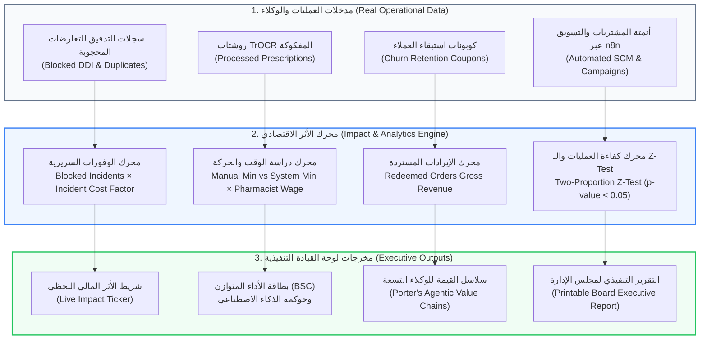

# 💎 وثيقة المعمارية الهندسية وقيمة الأعمال (BIS Core)
## شاشة القيمة الاقتصادية وعائد الاستثمار (Business Value & Economic Impact Dashboard)
**المسار البرمجي في النظام:**
- **الواجهة الأمامية (Frontend):** `frontend/src/app/admin/business-value/page.tsx`
- **الخلفية ومحركات القيمة (Backend):**
  - `backend/app/domains/business_value/router.py` (واجهات برمجة التطبيقات والتقارير التنفيذية)
  - `backend/app/domains/business_value/impact_engine.py` (شريط الأثر المالي الحي والحسابات الواقعية)
  - `backend/app/domains/business_value/value_chains.py` (سلاسل القيمة لمايكل بورتر للوكلاء الأذكياء)
- **الرابط المباشر:** `http://localhost:3000/admin/business-value`

---

## 🏛️ 1. المفهوم المعماري والأكاديمي (The BIS Core Concept)
في لجان تحكيم مشاريع التخرج لنظم معلومات الأعمال (BIS)، السؤال الأهم دائماً ليس فقط "ماذا يفعل النظام تقنياً؟" بل:
> **"ما هو العائد على الاستثمار (ROI) والأثر المالي المحقق على أرباح وتكاليف المؤسسة؟"**

تمثل هذه الشاشة قلب وروح تخصص الـ BIS؛ حيث تحول كل خوارزمية ذكاء اصطناعي، وكل عملية سريرية، وكل أتمتة برمجية في النظام إلى **أرقام مالية، وساعات عمل موفرة، وخسائر محجوبة، ونسب نمو مثبتة إحصائياً**.

ترتكز الشاشة على 5 نظريات إدارية واقتصادية عالمية:
1. **عائد الاستثمار السريري (Clinical CDSS ROI):** تحويل الأخطاء الطبية المحجوبة إلى وفورات مالية.
2. **دراسة الوقت والحركة (Time & Motion Study - Taylorism):** قياس إنتاجية العمل وساعات الصيدلي الموفرة.
3. **اختبارات A/B بالدلالة الإحصائية (Hypothesis Testing & Z-Test):** إثبات جدوى وكلاء التسويق رياضياً ($p < 0.05$).
4. **سلاسل القيمة لمايكل بورتر (Porter's Value Chains):** ربط الوكلاء التسعة بسلسلة القيمة المضافة للصيدلية.
5. **بطاقة الأداء المتوازن (Kaplan & Norton Balanced Scorecard):** قياس الأداء من 4 محاور (المالي، العملاء، العمليات الداخلية، والتعلم والنمو).

---

## 📊 2. الرسم التدفقي لمحرك قياس الأثر الاقتصادي (Business Value Engine Flowchart)

---

## 🧮 3. الركائز الحسابية والرياضية للشاشة (The Mathematical Mechanics)

### أ) شريط الأثر المالي اللحظي (Real-Time Impact Ticker):
يعمل في ملف `impact_engine.py` باستعلامات SQL لحظية تحسب أربعة أرقام رئيسية:
1. **الإيرادات المستردة من التسرب (Saved Revenue):**
   قيمة المبيعات الفعلية للطلبات التي استخدمت كوبونات استبقاء أطلقها وكيل التسعير الذكي لمنع العميل من التحول للمنافسين (Churn Prevention).
2. **الخسائر القانونية والطبية المحجوبة (Loss Prevented):**
   $$\text{Loss Prevented} = \text{Blocked Incidents} \times \text{Average Basket Value} \times \text{Incident Factor}$$
   حيث أن كل خطأ دوائي محجوب يحمي الصيدلية من تكلفة إرجاع، تعويضات، وإضرار بالسمعة التجارية.
3. **ساعات العمل الموفرة (Hours Saved):**
   - كل رسالة ترويجية أُرسلت عبر n8n توفر 15 دقيقة عمل يدوي.
   - كل أمر توريد تم توليده بـ EOQ يوفر 30 دقيقة مقارنة بالجرد والطلب اليدوي.

---

### ب) دراسة الوقت والحركة لفك الروشتات (Time & Motion Study):
مستوحاة من الهندسة الصناعية ومبادئ الإدارة العلمية (Taylorism):
- **الزمن اليدوي:** الصيدلي يستغرق في المتوسط **8 إلى 10 دقائق** لقراءة خط يد الطبيب غير الواضح، البحث عن بدائل، والتأكد من عدم وجود تعارض.
- **زمن النظام:** يستغرق موديل TrOCR ونظام الـ CDSS **أقل من 30 ثانية**.
- **المعادلة الرياضية في الكود:**
  $$\text{Minutes Saved (30d)} = \text{Prescriptions Count} \times (\text{Manual Time} - \text{System Time})$$
  $$\text{Annual Hours Saved} = \frac{\text{Minutes Saved (30d)} \times 12}{60}$$
  $$\text{Annual Economic Value (EGP)} = \text{Annual Hours Saved} \times \text{Pharmacist Hourly Rate}$$

---

### ج) الصرامة الإحصائية لاختبارات أ/ب (Two-Proportion Z-Test):
عند مقارنة استراتيجيتين تسويقيتين (Variant A vs Variant B)، لا يكتفي النظام بمجرد مقارنة النسب ظاهرياً، بل يطبق اختبار الفرضيات الإحصائي الحقيقي في ملف `router.py`:
$$Z = \frac{p_1 - p_2}{\sqrt{p(1-p)\left(\frac{1}{n_1} + \frac{1}{n_2}\right)}}$$
حيث أن:
$$p = \frac{c_1 + c_2}{n_1 + n_2}$$
- **الدلالة الإحصائية:** إذا كان $p\text{-value} < 0.05$ (أو $|Z| \ge 1.96$)، يعلن النظام رسمياً: **Significant at 95% Confidence**، مما يثبت للجنة التحكيم أن زيادة المبيعات حقيقية وليست صدفة عشوائية.

---

## ⛓️ 4. سلاسل القيمة لمايكل بورتر لوكلاء الذكاء الاصطناعي (Porter's Value Chains)

في ملف `value_chains.py`، يرتبط كل وكيل ذكي في النظام ببطاقة قيمة اقتصادية واضحة تتضمن 9 محاور:
1. **المشكلة التجارية (Business Problem):** مثل نفاذ الدواء أو تسرب العملاء.
2. **مصدر البيانات (Data Source):** جداول قاعدة البيانات المرتبطة.
3. **المحرك الرياضي (Deterministic Logic):** الخوارزمية المطبقة (EOQ, Churn XGBoost, CLV).
4. **دور النموذج اللغوي (LLM Role):** الوظيفة المحددة الموكلة للذكاء الاصطناعي بدون تشتت.
5. **حاجز الأمان (Guardrail):** السقف الصارم لمنع الهلوسة أو الخسائر.
6. **الإجراء التنفيذي (Autonomous Action):** إصدار أمر شراء، إرسال كوبون، منع طلب.
7. **مؤشر الأداء التجاري (KPI):** نسبة خفض النفاذ، معدل الاستبقاء، هامش الربح.
8. **القيمة الاقتصادية المضافة (Business Value):** العائد المالي المباشر على الأرباح.
9. **الإثبات البرمجي الحي (Live Proof):** اختبارات Pytest وأرقام المعاملات الفعلية.

---

## 📑 5. التقرير التنفيذي لمجلس الإدارة (Executive Board Report)

توفر الشاشة ميزة توليد **تقرير مجلس الإدارة القابل للطباعة بضغطة زر (Print Board Report)**:
- يحتوي على ترويسة رسمية وشعار النظام.
- يعرض ملخص التدقيق المالي ومؤشرات السيولة والعائد على الاستثمار.
- يعرض مؤشر دقة فك خط الروشتات (OCR Accuracy) ومعدل تدخل الصيدلي البشري (Human-in-the-Loop Override Rate).
- يحتوي على توصيات استراتيجية وتوقيعات رئيس مجلس الإدارة والمدير الطبي.

---

## 🎓 6. سيناريو المناقشة المثالي أمام لجنة التحكيم (BIS Defense Pitch)

عندما تقف أمام لجنة المناقشة لتشرح هذه الشاشة، قدمها بهذا الأسلوب القيادي المبهر:

> **"يا فندم، هذه الشاشة هي الإجابة الحاسمة على سؤال: (ما هي الجدوى الاقتصادية لنظامكم في دنيا الأعمال؟):**
> 
> 1. **من منظور إدارة الأعمال والـ BIS:** نحن لا نبيع تقنية للتقنية؛ هذه اللوحة تترجم كل عملية ذكاء اصطناعي إلى **وفورات نقدية (Monetary Savings)**. شريط الأثر المالي الحي (**Impact Ticker**) يعكس بالجنيه المصري الإيرادات التي تم إنقاذها من تسرب العملاء والخسائر الطبية المحجوبة.
> 
> 2. **دراسة الوقت والحركة (Industrial Engineering):** طبقنا نموذج **Time & Motion Study** لإثبات أن فك الروشتات آلياً بنظام TrOCR يوفر ما يصل إلى 9 دقائق للصيدلي في كل معاملة، مما يتحول إلى مئات الساعات الموفرة سنوياً ويوفر آلاف الجنيهات من تكاليف التشغيل.
> 
> 3. **الصرامة الإحصائية (Scientific A/B Testing):** عندما نختبر حملات التسويق، نطبق اختبار **Two-Proportion Z-Test** العلمي؛ فلا نعتمد أي حملة إلا إذا كانت ذات دلالة إحصائية عند فاصل ثقة 95% ($p < 0.05$) لنضمن للمستثمر عدم إهدار الميزانية التسويقية.
> 
> 4. **سلاسل القيمة لمايكل بورتر (Porter's Value Chain):** صغنا لكل وكيل ذكي سلسلة قيمة متكاملة توضح المشكلة، المحرك الحتمي، حاجز الأمان، ومؤشر الـ KPI، وصولاً للتقرير التنفيذي الموجه لمجلس الإدارة (**Executive Board Report**) الجاهز للطباعة."

---

**تم إنشاء وتوثيق هذا الدليل المرجعي بنجاح ليثبت للجنة التحكيم الفهم العميق لعلوم إدارة الأعمال ونظم المعلومات.**
