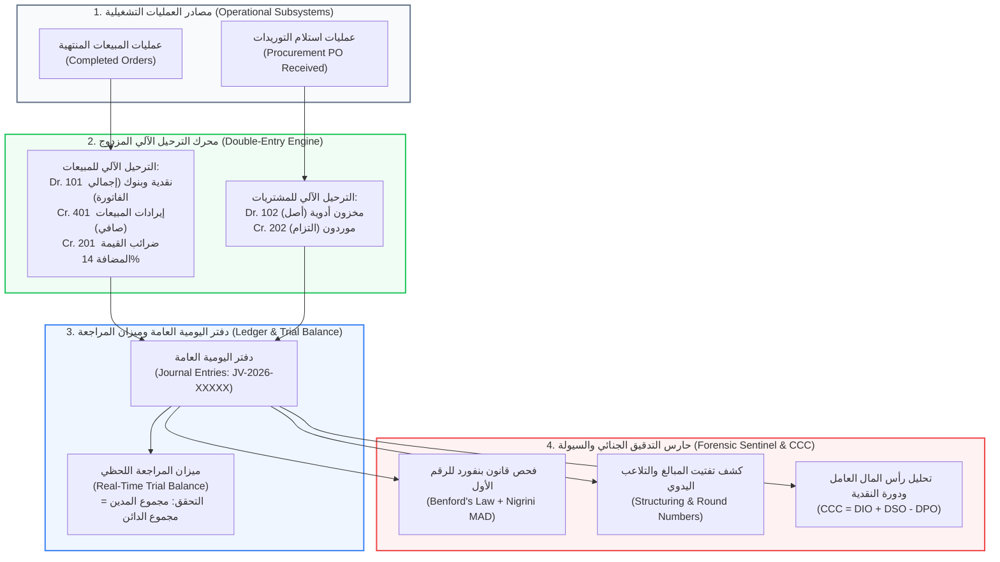
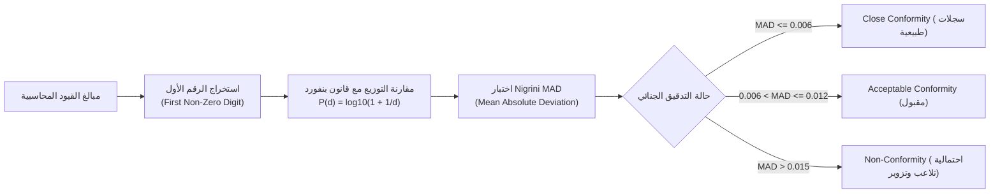

# 🏛️ وثيقة المعمارية الهندسية والمحاسبة الجنائية (AIS & BIS)
## شاشة المحاسبة وميزان المراجعة والتدقيق الجنائي (Accounting, General Ledger & Forensic Audit)
**المسار البرمجي في النظام:**
- **الواجهة الأمامية (Frontend):** `frontend/src/app/admin/accounting/page.tsx`
- **الخلفية ومحركات المحاسبة (Backend):**
  - `backend/app/domains/accounting/service.py` (دفتر اليومية وميزان المراجعة)
  - `backend/app/domains/accounting/forensics.py` (التدقيق الجنائي وقانون بنفورد)
  - `backend/app/domains/accounting/working_capital.py` (رأس المال العامل ودورة النقدية CCC)
  - `backend/app/domains/accounting/router.py` (واجهات برمجة التطبيقات)
- **الرابط المباشر:** `http://localhost:3000/admin/accounting`

---

## 🏛️ 1. المفهوم المعماري والأكاديمي (The BIS & AIS Concept)
تعتبر هذه الصفحة تجسيداً حياً لـ **نظم المعلومات المحاسبية (Accounting Information Systems - AIS)**.
المشروع هنا يتجاوز فكرة مجرد تسجيل فواتير، بل يطبق **نظام المحاسبة المالية المزدوجة (Double-Entry Bookkeeping)** وفقاً لـ:
1. **معايير المحاسبة المصرية والدولية (EAS / IFRS):** الالتزام بفصل الأصول والالتزامات والإيرادات والمصروفات، واحتساب ضريبة القيمة المضافة (ETA 14% VAT).
2. **معيار التدقيق الدولي 240 (ISA 240):** مسؤولية مراجع الحسابات عن كشف الاحتيال المالي والتلاعب في السجلات.
3. **إطار الرقابة الداخلية (COSO ERM Framework):** حوكمة العمليات المالية ومنع التدخل البشري اليدوي (Manual Plugs).

---

## 📊 2. الرسم التدفقي لمعمارية المعالجة المحاسبية والتدقيق (AIS Architecture Flowchart)

---

## 📋 3. شجرة الحسابات الرسمية المعتمدة (Chart of Accounts - COA)
الكود البرمجي في `service.py` منظم بشجرة حسابات قياسية مخصصة لقطاع الصيدليات والرعاية الصحية:

| رمز الحساب | اسم الحساب بالعربية والإنجليزية | تصنيف الحساب | طبيعة الحساب المعتادة |
| :---: | :--- | :---: | :---: |
| **101** | النقدية وحسابات الدفع الإلكتروني (`Cash & Digital Clearing`) | أصل (ASSET) | مدين (Debit) |
| **102** | مخزون الأدوية والمستلزمات الطبية (`Drug Inventory`) | أصل (ASSET) | مدين (Debit) |
| **201** | مصلحة الضرائب المصرية - ض.ق.م 14% (`ETA 14% VAT Payable`) | التزام (LIABILITY) | دائن (Credit) |
| **202** | الموردون وشركات التوزيع (`Accounts Payable - Suppliers`) | التزام (LIABILITY) | دائن (Credit) |
| **301** | حقوق الشركاء ورأس المال (`Partners' Equity / Capital`) | حقوق ملكية (EQUITY) | دائن (Credit) |
| **401** | إيرادات مبيعات الأدوية والمستحضرات (`Pharma Sales Revenue`) | إيراد (REVENUE) | دائن (Credit) |
| **501** | خصومات المبيعات الترويجية المسموح بها (`Sales Discounts Allowed`) | مصروف (EXPENSE) | مدين (Debit) |
| **502** | تكلفة البضاعة المباعة (`Cost of Goods Sold - COGS`) | مصروف (EXPENSE) | مدين (Debit) |

---

## 🧮 4. المنطق الرياضي لترحيل العمليات (Double-Entry Engine Mechanics)

### أ) ترحيل فواتير المبيعات (Sales Order Posting):
عند النقر على زر **"ترحيل المبيعات لقيود يومية" (`/sync-from-orders`)**، يقوم الخادم بفحص الفواتير المكتملة وحساب ضريبة القيمة المضافة وفصل الإيراد رياضياً:
$$\text{Net Revenue} = \frac{\text{Gross Order Amount}}{1.14}$$
$$\text{ETA 14\% VAT} = \text{Gross Order Amount} - \text{Net Revenue}$$

ويتم إنشاء القيد المحاسبي المتوازن:
- **من حـ/ 101 النقدية وحسابات الدفع الإلكتروني** (بإجمالي المبلغ المدفوع).
- **إلى حـ/ 401 إيرادات المبيعات** (بصافي القيمة قبل الضريبة).
- **إلى حـ/ 201 مصلحة الضرائب - ض.ق.م 14%** (بقيمة الضريبة المحصلة قانوناً).

### ب) ترحيل استلام المشتريات (Procurement Goods Receipt Posting):
لحظة وصول البضاعة من شاشة المشتريات واختيار حالة `RECEIVED`:
- **من حـ/ 102 مخزون الأدوية** (زيادة في الأصول المتداولة بالتكلفة).
- **إلى حـ/ 202 الموردون وشركات التوزيع** (إثبات التزام واستحقاق مالي).

---

## ⚖️ 5. ميزان المراجعة اللحظي (Real-Time Trial Balance)

تولد الصفحة تقريراً شاملاً لميزان المراجعة يتوافق مع المعايير المصرية (EAS Compliance Verdict):
1. **تجميع الأرصدة التلقائي:**
   - إجمالي الحركات المدينة ($\sum \text{Debits}$) وإجمالي الحركات الدائنة ($\sum \text{Credits}$).
   - صافي الرصيد لكل حساب (رصيد مدين أو رصيد دائن).
2. **شرط التوازن الصارم (Balance Equation):**
   $$\text{Difference} = |\sum \text{Debit} - \sum \text{Credit}| = 0.00$$
   إذا تحقق التوازن، يعرض النظام شارة خضراء تفيد الامتثال الكامل، وإذا حدث أي خلل يظهر تحذير أحمر بوجود عدم اتساق مالي.
3. **الطباعة الرسمية (Print Trial Balance):** تتيح الصفحة طباعة الميزان كوثيقة محاسبية رسمية معتمدة للتسليم لمراقبي الحسابات.

---

## 🕵️ 6. محرك التدقيق الجنائي وقانون بنفورد (Forensic Accounting & Benford's Law)

أقوى ميزة أكاديمية فريدة في النظام موجودة في ملف `forensics.py`، حيث يطبق النظام اختبارات جنائية حقيقية لكشف التلاعب:

### أ) قانون بنفورد للرقم الأول (Benford's First-Digit Law):
ينص القانون الرياضي على أن الأرقام المالية الطبيعية لا تتوزع بالتساوي، بل يظهر الرقم 1 كأول رقم بنسبة **30.1%**، بينما الرقم 9 يظهر بنسبة **4.6%** فقط:
$$P(d) = \log_{10}\left(1 + \frac{1}{d}\right) \quad \text{where } d \in \{1, 2, \dots, 9\}$$

### ب) اختبار الانحراف المطلق المتوسط (Nigrini's MAD):
يستخدم النظام مقياس MAD المعتمد عالمياً في فحص الاحتيال بدلاً من كاي تربيع (Chi-Square) لضمان دقة النتائج حتى مع العينات المتفاوتة:
$$MAD = \frac{\sum_{d=1}^{9} |Actual\_Ratio_d - Benford\_Ratio_d|}{9}$$

### ج) كشف التلاعب اليدوي وتفتيت المبالغ:
1. **كتل الأرقام المستديرة (Round-Number Clustering):** كشف الفواتير التي تنتهي بأصفار كثيرة (مثل 5000 ج.م، 10000 ج.م)، وهي دلالة على إدخال أرقام تقديرية يدوية وهمية (Manual Plugs).
2. **كشف تفادي سقوف الاعتماد (Structuring / Smurfing):** كشف المعاملات المتكررة التي تقع أسفل حد معين عمداً (مثلاً 4950 ج.م لتفادي طلب موافقة المدير على المبالغ من 5000 ج.م).

---

## 📈 7. محرك رأس المال العامل ودورة النقدية (Working Capital & CCC Engine)

في ملف `working_capital.py`، يقيس النظام كفاءة إدارة السيولة النقدية للصيدلية من خلال **دورة تحويل النقدية (Cash Conversion Cycle - CCC)**:
$$CCC = DIO + DSO - DPO$$
- **$DIO$ (Days Inventory Outstanding):** عدد أيام بقاء الدواء في الرف قبل بيعه.
- **$DSO$ (Days Sales Outstanding):** عدد أيام تحصيل مستحقات الدفع الإلكتروني وشركات التأمين.
- **$DPO$ (Days Payable Outstanding):** عدد الأيام التي تستغرقها الصيدلية لسداد ديون الموردين.
- **المؤشرات الحيوية:**
  - **النسبة الجارية (Current Ratio):** $\frac{\text{الأصول المتداولة}}{\text{الالتزامات المتداولة}}$
  - **النسبة السريعة (Quick Ratio):** $\frac{\text{الأصول المتداولة - المخزون}}{\text{الالتزامات المتداولة}}$
  - **فترة كفاية السيولة (Cash Runway):** كم شهراً تستطيع الصيدلية الصمود بالسيولة الحالية.

---

## 🎓 8. سيناريو المناقشة المثالي أمام لجنة التحكيم (BIS Defense Pitch)

عند استعراض هذه الصفحة أمام أساتذة المحاسبة ونظم المعلومات، اشرحها بهذا التسلسل الاحترافي:

> **"يا فندم، هذه الشاشة تمثل نواة نظام المعلومات المحاسبي (AIS Core) المتوافق مع معايير المحاسبة المصرية والدولية (EAS / IFRS):**
> 
> 1. **الترحيل الآلي المتوازن (Automated Double-Entry):** العمليات لا تسجل بشكل أحادي، بل بنظام القيد المزدوج. عند بيع أي دواء، يقوم النظام آلياً بتسجيل قيد يفصل إيرادات المبيعات عن ضريبة القيمة المضافة المحصلة لمصلحة الضرائب المصرية (14% VAT) لضمان الامتثال الضريبي الكامل.
> 
> 2. **ميزان المراجعة اللحظي (Real-Time Trial Balance):** شجرة الحسابات (COA) مصممة طبقاً لقطاع الصيدليات، ويتم التحقق برمجياً ولحظياً من توازن الميزان ($\sum \text{Debit} = \sum \text{Credit}$)، مع إمكانية طباعة تقرير مالي رسمي بضغطة زر.
> 
> 3. **التدقيق الجنائي وقانون بنفورد (Forensic Auditing - ISA 240):** قمنا بدمج محرك ذكاء جنائي يطبق **قانون بنفورد (Benford's Law)** واختبار **Nigrini MAD** لكشف التلاعب المحاسبي وتزوير الفواتير، بالإضافة إلى خوارزميات ترصد الأرقام المستديرة (Round Numbers) وتفتيت العمليات (Structuring) للتهرب من السقوف الرقابية.
> 
> 4. **تحليل السيولة ورأس المال العامل (Working Capital & CCC):** يحسب النظام دورة تحويل النقدية (CCC = DIO + DSO - DPO) لمساعدة إدارة الصيدلية على اتخاذ قرارات تمويلية ذكية وتحقيق أقصى عائد على رأس المال المستثمر."

---

**تم إنشاء وتوثيق هذا الدليل المرجعي بنجاح ليخدم مناقشة مشروع تخرجك بأعلى درجات التميز الأكاديمي والمهني.**
