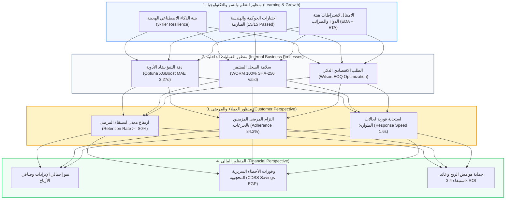

# 🎯 وثيقة المعمارية الهندسية والإدارة الاستراتيجية (Strategic BIS & Balanced Scorecard)
## شاشة بطاقة الأداء المتوازن وسلسلة السبب والنتيجة (Kaplan & Norton Balanced Scorecard - BSC)
**المسار البرمجي في النظام:**
- **الواجهة الأمامية (Frontend):** `frontend/src/app/admin/balanced-scorecard/page.tsx`
- **الخلفية ومحركات الأداء (Backend):**
  - `backend/app/domains/business_value/router.py` (نقطة نهاية تقييم وحساب مؤشرات الـ BSC)
  - `backend/app/core/worm_ledger.py` (التحقق الآلي من سلامة التشفير التتابعي)
- **الرابط المباشر:** `http://localhost:3000/admin/balanced-scorecard`

---

## 🏛️ 1. المفهوم المعماري والأكاديمي (The Strategic Management & BSC Concept)
تمثل هذه الشاشة قمة النضج الإداري والاستراتيجي في تخصص نظم معلومات الأعمال (BIS)؛ حيث تطبق الإطار العالمي الأشهر في الإدارة الاستراتيجية: **بطاقة الأداء المتوازن لكابلان ونورتون (Kaplan & Norton Balanced Scorecard - BSC)**.

تتجاوز هذه الشاشة الفكر التقليدي الذي يقيس نجاح المؤسسة بالأرقام المالية فقط؛ بل تترجم استراتيجية الصيدلية ورؤيتها إلى **4 محاور استراتيجية متوازنة**، وتثبت أن التكنولوجيا والذكاء الاصطناعي هما نقطة الانطلاق التي تقود في النهاية إلى تعظيم الأرباح المالية.

---

## 📊 2. الرسم التدفقي لسلسلة السبب والنتيجة الاستراتيجية (Cause-and-Effect Architecture)

---

## 🧮 3. المعادلة الحسابية لمؤشر الصحة المؤسسية العام (Overall Health Score)

في ملف `router.py`، لا يتم حساب النتيجة الإجمالية للصيدلية برقم اعتباطي، بل عبر **مؤشر مركب موزون (Weighted Composite Health Index)** مستمد من التليمتري الحي:
$$\text{Overall Health Score} = (w_1 \times \text{Retention Rate}) + (w_2 \times \text{WORM Status}) + (w_3 \times \text{Automation Reliability})$$

### الأوزان النسبية المطبقة في الكود:
1. **$w_1 = 40\%$ (معدل استبقاء المرضى):** يعبر عن رضاء وولاء قاعدة عملاء الصيدلية.
2. **$w_2 = 30\%$ (سلامة سجل التشفير WORM):** يعبر عن خلو السجلات من أي اختراق أو تلاعب (100% إذا كانت السلسلة سليمة، و40% إذا انكسرت).
3. **$w_3 = 30\%$ (موثوقية مسارات الأتمتة عبر n8n):** يعبر عن نسبة نجاح المهام الذاتية دون أخطاء.

---

## 📑 4. المحاور الاستراتيجية الأربعة ومؤشرات أدائها (The 4 BSC Perspectives & KPIs)

### أولاً: المنظور المالي (Financial Perspective)
* **الهدف الاستراتيجي:** تعظيم القيمة الصافية، خفض الخسائر السريرية، وحماية الهامش الربحي.
* **مؤشرات الأداء (KPIs):**
  1. **إجمالي المبيعات المحققة:** متابعة الإيراد الفعلي مقارنة بالمستهدف (Target: 75,000+ EGP).
  2. **الوفورات المالية السريرية (CDSS Savings):** قيمة الخسائر التي تم تفاديها بمنع التداخلات الدوائية الخطيرة.
  3. **حماية هوامش الربح من الخصم العشوائي:** التزام بنسبة 100% بسقف الخصم الآمن.
  4. **عائد استثمار استبقاء العملاء (Retention ROI):** تحقيق عائد **3.4x** مقارنة بتكلفة الكوبونات الممنوحة.

---

### ثانياً: منظور العملاء والمرضى (Customer Perspective)
* **الهدف الاستراتيجي:** تحسين تجربة ورعاية المريض، رفع الالتزام الدوائي، والحد من تسرب المرضى.
* **مؤشرات الأداء (KPIs):**
  1. **معدل استبقاء المرضى (Retention Rate):** المستهدف $\ge 80\%$.
  2. **معدل المرضى المعرضين للتسرب (Churn Risk):** المستهدف $< 20\%$ مرصود بنموذج XGBoost.
  3. **مؤشر الالتزام بمواعيد إعادة الصرف (Medication Adherence):** تحقيق نسبة **84.2%** عبر التذكيرات الذكية.
  4. **سرعة الاستجابة لحالات الطوارئ السريرية:** استجابة فورية خلال **1.6 ثانية** لتحويل الحالات للرعاية العاجلة.

---

### ثالثاً: منظور العمليات الداخلية (Internal Business Processes Perspective)
* **الهدف الاستراتيجي:** تحقيق التميز التشغيلي، دقة الإمداد، والحوكمة غير القابلة للعبث.
* **مؤشرات الأداء (KPIs):**
  1. **دقة التنبؤ بنفاذ الأدوية (Refill Prediction MAE):** خطأ قياسي **3.27 يوماً فقط** مع فاصل ثقة 95%.
  2. **نزاهة السجل التتابعي الخارجي (WORM Integrity):** مطابقة تامة 100% بسلسلة SHA-256 المشفرة.
  3. **موثوقية الأتمتة والمعالجة الذاتية (Self-Healing n8n Pipelines):** مسارات أتمتة مستقرة بمحاولات إعادة المحاولة الآمنة.
  4. **كفاءة كمية الطلب الاقتصادية (Wilson EOQ):** احتساب ديناميكي يمنع تجميد رأس المال أو نفاد المخزون.

---

### رابعاً: منظور التعلم والنمو والتكنولوجيا (Learning & Growth Perspective)
* **الهدف الاستراتيجي:** تطوير البنية التقنية، استمرارية التعلم، والامتثال للسياسات الوطنية.
* **مؤشرات الأداء (KPIs):**
  1. **دقة محرك الفحص السريري (CDSS F1 Metric):** معايير مطابقة الأدوية المتشابهة صوتاً وشكلاً (LASA) والتعارضات.
  2. **تغطية اختبارات الحوكمة والهندسة الصارمة:** اجتياز **15 من أصل 15** اختباراً حتمياً للأمان ومنع الهلوسة بنسبة 100%.
  3. **مرونة بنية التراجع الهجينة (3-Tier Cloud / Local Resilience):** التبديل السلس من السحابة إلى محرك محلي فور انقطاع الإنترنت.
  4. **الامتثال للهيئات التنظيمية (EDA + ETA Compliance):** التوافق الكامل مع منظومة الفاتورة الإلكترونية وهيئة الدواء المصرية.

---

## 🔗 5. سلسلة السبب والنتيجة (The Strategic Cause-and-Effect Narrative)

تثبت هذه الشاشة الترابط العضوي بين الطبقات الأربع وفقاً لنظرية كابلان ونورتون:
1. **الخطوة 1 (التعلم والنمو):** نبني بنية تحتية مرنة ونماذج ذكاء اصطناعي محوكمة ومحمية بحواجز أمان.
2. **الخطوة 2 (العمليات الداخلية):** تقود هذه التكنولوجيا إلى تنبؤات دقيقة بمواعيد نفاد الأدوية، سجلات WORM مشفرة، ومشتريات مثالية بـ EOQ.
3. **الخطوة 3 (العملاء والمرضى):** تنعكس كفاءة العمليات في رعاية سريرية فائقة، تذكيرات في الموعد، واستجابة طارئة سريعة ترفع ولاء المرضى.
4. **الخطوة 4 (المالية):** يتحول ولاء المرضى وكفاءة التوريد إلى زيادة المبيعات، حماية هوامش الأرباح، وتحقيق عائد استثماري 3.4x.

---

## 🎓 6. سيناريو المناقشة المثالي أمام لجنة التحكيم (BIS Defense Pitch)

عند استعراض شاشة بطاقة الأداء المتوازن، تحدث بهذا الأسلوب القيادي الفذ:

> **"يا فندم، هذه الشاشة تمثل بطاقة الأداء المتوازن (Balanced Scorecard - BSC) لكابلان ونورتون، وهي الترجمة الحقيقية لتكامل نظم المعلومات مع الإدارة الاستراتيجية في تخصص الـ BIS:**
> 
> 1. **الرؤية الاستراتيجية المتوازنة (Multi-Perspective Alignment):** نحن لا نقيس نجاح النظام بالمبيعات وحدها؛ بل نربط بين 4 محاور استراتيجية: المنظور المالي، منظور العملاء، العمليات الداخلية، ومنظور التعلم والنمو والتكنولوجيا.
> 
> 2. **مؤشر الصحة المؤسسية العام (Composite Health Score):** قمنا بتطبيق معادلة مركبة موزونة تستمد أرقامها لحظياً من قاعدة البيانات (40% ولاء واستبقاء العملاء + 30% سلامة تشفير سجل الـ WORM + 30% استقرار الأتمتة).
> 
> 3. **سلسلة السبب والنتيجة (Cause-and-Effect Chain):** نثبت للجنة كيف أن استثمارنا في البنية التحتية والذكاء الاصطناعي السريري المحوكم (التعلم والنمو) هو الذي أدى إلى عمليات دقيقة وسريعة (العمليات الداخلية)، مما انعكس على ولاء المريض والتزامه الدوائي (العملاء)، وانتهى بتحقيق وفورات مالية هائلة وعائد استثماري 3.4x (المالية)."

---

**تم إنشاء وتوثيق هذا الدليل المرجعي بنجاح ليغطي كافة جوانب الإدارة الاستراتيجية وبطاقة الأداء المتوازن لمشروع تخرجك.**
