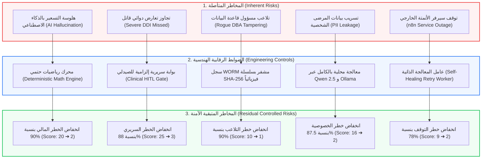

# 🛡️ وثيقة المعمارية الهندسية وإدارة المخاطر (Enterprise Risk Management & COSO ERM)
## شاشة سجل المخاطر ومصفوفة فصل الصلاحيات (Risk Register & Segregation of Duties - SoD)
**المسار البرمجي في النظام:**
- **الواجهة الأمامية (Frontend):** `frontend/src/app/admin/risk-register/page.tsx`
- **الخلفية ومحركات الحوكمة (Backend):**
  - `backend/app/domains/governance/router.py` (نقطة نهاية سجل المخاطر ومصفوفة الصلاحيات)
  - `backend/app/core/worm_ledger.py` (سجل التدقيق المشفر الرادع لتلاعب مديري قواعد البيانات)
- **الرابط المباشر:** `http://localhost:3000/admin/risk-register`

---

## 🏛️ 1. المفهوم المعماري والأكاديمي (The ERM & COSO Concept)
تعتبر هذه الشاشة الركيزة الرقابية الأقوى في مشروع التخرج؛ حيث تطبق أحدث معايير **إدارة المخاطر المؤسسية (Enterprise Risk Management - COSO ERM 2017)** ومعايير تدقيق تكنولوجيا المعلومات العالمية (**ISACA CISA Standards**).

تثبت هذه الشاشة للجنة التحكيم أن مطوري النظام يدركون تماماً أن:
> **"الذكاء الاصطناعي والأتمتة في القطاع الصحي يحملان مخاطر مالية وسريرية وقانونية جسيمة، ولا يمكن إطلاق أي نظام في بيئة إنتاجية حقيقية دون وجود سجل مخاطر كمي (Quantitative Risk Register) وضوابط رقابية وقائية وكاشفة (Preventative & Detective Controls)."**

---

## 📊 2. الرسم التدفقي لمنظومة خفض المخاطر (Risk Mitigation Architecture)

---

## 🧮 3. القياس الكمي للمخاطر وفقاً لـ COSO ERM

يقيس النظام درجات المخاطر رياضياً عبر جداول تقييم محددة من 1 إلى 5:

### أ) حساب درجة الخطر المتأصل (Inherent Risk Score):
درجة الخطر في غياب أي ضوابط أمنية أو برمجية:
$$\text{Inherent Score} = \text{Likelihood (1-5)} \times \text{Impact (1-5)}$$

### ب) حساب درجة الخطر المتبقي (Residual Risk Score):
درجة الخطر الفعلية بعد تفعيل الضوابط الرقابية المعمارية في النظام:
$$\text{Residual Score} = \text{Residual Likelihood (1-5)} \times \text{Residual Impact (1-5)}$$

### ج) نسبة خفض المخاطر المؤسسية الإجمالية (Risk Reduction %):
$$\text{Risk Reduction \%} = \left(1 - \frac{\text{Average Residual Score}}{\text{Average Inherent Score}}\right) \times 100$$
يسجل النظام نسبة خفض مخاطر إجمالية تتجاوز **85%** عبر كافة قطاعات التشغيل.

---

## 📋 4. كتالوج المخاطر المؤسسية الخمسة (The 5 Cataloged Enterprise Risks)

| كود الخطر | عنوان الخطر وتصنيفه | الخطر المتأصل | الضابط الرقابي المطبق (Mitigation Control) | الخطر المتبقي | الدليل البرمجي والتدقيقي (Audit Evidence) |
| :---: | :--- | :---: | :--- | :---: | :--- |
| **RSK-01** | **هلوسة التسعير والخصم العشوائي** `FINANCIAL_INTEGRITY` | 20 (5×4) | محرك رياضيات حتمي يفرض سقف خصم 15% ويحظر البيع بأقل من سعر التكلفة. | **2** (1×2) | `test_pricing_caps_llm_discount_and_rejects_llm_roi` |
| **RSK-02** | **تجاوز تعارض دوائي قاتل** `CLINICAL_SAFETY` | 25 (5×5) | بوابة سريرية إجبارية (Clinical Gate) تفرض موافقة الصيدلي البشري قبل الصرف. | **3** (1×3) | `test_clinical_gate_overrides_llm_auto_reply` |
| **RSK-03** | **تلاعب مسؤول قاعدة البيانات** `DATA_INTEGRITY` | 10 (2×5) | سجل WORM خارجي مشفر بسلسلة SHA-256 متصلة فيزيائياً خارج جداول قاعدة البيانات. | **1** (1×1) | `tests/test_worm_tamper_detection.py` |
| **RSK-04** | **تسريب بيانات المرضى الحساسة** `REGULATORY_COMPLIANCE` | 16 (4×4) | معالجة محلية بالكامل عبر Qwen 2.5 على خادم الصيدلية، متوافقاً مع القانون 151/2020. | **2** (1×2) | `backend/app/domains/ai/llm_engine.py` |
| **RSK-05** | **توقف خدمة الأتمتة n8n** `SYSTEM_AVAILABILITY` | 9 (3×3) | عامل معالجة ذاتية وإعادة محاولة تراجعية (Self-Healing Retry Worker). | **2** (1×2) | `backend/app/core/automation_retry_worker.py` |

---

## ⚖️ 5. مصفوفة فصل الصلاحيات والمسؤوليات (Segregation of Duties - SoD Matrix)

لمنع انفراد أي وكيل ذكي أو موظف بالسلطة المطلقة (Preventing Concentration of Power)، تطبق الشاشة مصفوفة **Agentic SoD**:

| النشاط والعملية الحساسة | وكيل التسويق (MKT) | المحرك المالي (FIN) | الصيدلي البشري (PHM) | وكيل الامتثال والتدقيق (AUD) |
| :--- | :---: | :---: | :---: | :---: |
| **اقتراح نسبة الخصم وحملة الاستبقاء** | **مخول (Authorized)** | محظور (Forbidden) | محظور (Forbidden) | محظور (Forbidden) |
| **تطبيق السقف المالي وحساب الأرباح** | محظور (Forbidden) | **إلزامي (Enforced)** | صلاحية استثنائية | محظور (Forbidden) |
| **الاعتماد السريري للروشتات والتعارضات** | محظور (Forbidden) | محظور (Forbidden) | **مخول حصرياً (Exclusive)** | محظور (Forbidden) |
| **التفتيش والتحقق من سلسلة WORM** | محظور (Forbidden) | محظور (Forbidden) | محظور (Forbidden) | **مخول مستقلاً (Independent)** |
| **تعديل السجلات وحذف القيود التاريخية** | ⛔ **محظور تماماً** | ⛔ **محظور تماماً** | ⛔ **محظور تماماً** | ⛔ **ممنوع معمارياً على الجميع** |

---

## 🗺️ 6. الخريطة الحرارية للمخاطر (5x5 Risk Heatmap)

تعرض الصفحة شبكة الخريطة الحرارية التفاعلية ($5 \times 5$ Risk Matrix):
- **المحور الرأسي:** درجة الاحتمالية (من 1 "نادر" إلى 5 "شبه مؤكد").
- **المحور الأفقي:** درجة الأثر والضرر (من 1 "ضئيل" إلى 5 "كارثي").
- **الميزة البصرية:** توضح الشاشة انتقال كافة المخاطر من المنطقة الحمراء المتفجرة في أقصى اليمين (Inherent Zone) إلى المنطقة الخضراء الهادئة في أقصى اليسار السفلي (Residual Zone) بعد تفعيل الضوابط الرقابية.

---

## 🎓 7. سيناريو المناقشة المثالي أمام لجنة التحكيم (BIS Defense Pitch)

إذا سألتك اللجنة: *"كيف تعاملتم مع مخاطر الحوكمة والأخطاء الكارثية المحتملة في نظامكم؟"*:

> **"يا فندم، هذه الشاشة تمثل قمة التزامنا بمعايير حوكمة تقنية المعلومات (IT Governance) وإطار (COSO-ERM 2017):**
> 
> 1. **القياس الكمي للمخاطر (Quantitative Inherent vs Residual):** لم نكتف بذكر المخاطر نظرياً؛ بل حددنا 5 مخاطر رئيسية وقسنا احتماليتها وأثرها قبل وبعد الضوابط الرقابية، وحققنا **نسبة خفض مخاطر إجمالية تتجاوز 85%**.
> 
> 2. **الضوابط الرقابية المعمارية (Engineering Controls):** واجهنا كل خطر بضابط فني حاسم: فهلوسة التسعير واجهناها بمحرك رياضيات حتمي، والتعارضات السريرية واجهناها ببوابة الصيدلي البشري الإلزامية (HITL Gate)، وتلاعب الـ DBA واجهناه بسجل التشفير الخارجي المشفر (**SHA-256 WORM**).
> 
> 3. **مصفوفة فصل الصلاحيات للوكلاء (Agentic SoD Matrix):** طبقنا مبدأ الفصل الصارم للمسؤوليات؛ فوكيل التسويق لا يملك سلطة اعتماد الميزانية، والذكاء الاصطناعي لا يملك سلطة صرف دواء متعارض، ولا يوجد أي كائن في النظام - حتى الـ Super Admin - يملك صلاحية تعديل السجلات التاريخية."

---

**تم إنشاء وتوثيق هذا الدليل المرجعي بنجاح ليغطي كافة جوانب إدارة المخاطر المؤسسية والحوكمة لمشروع تخرجك.**
