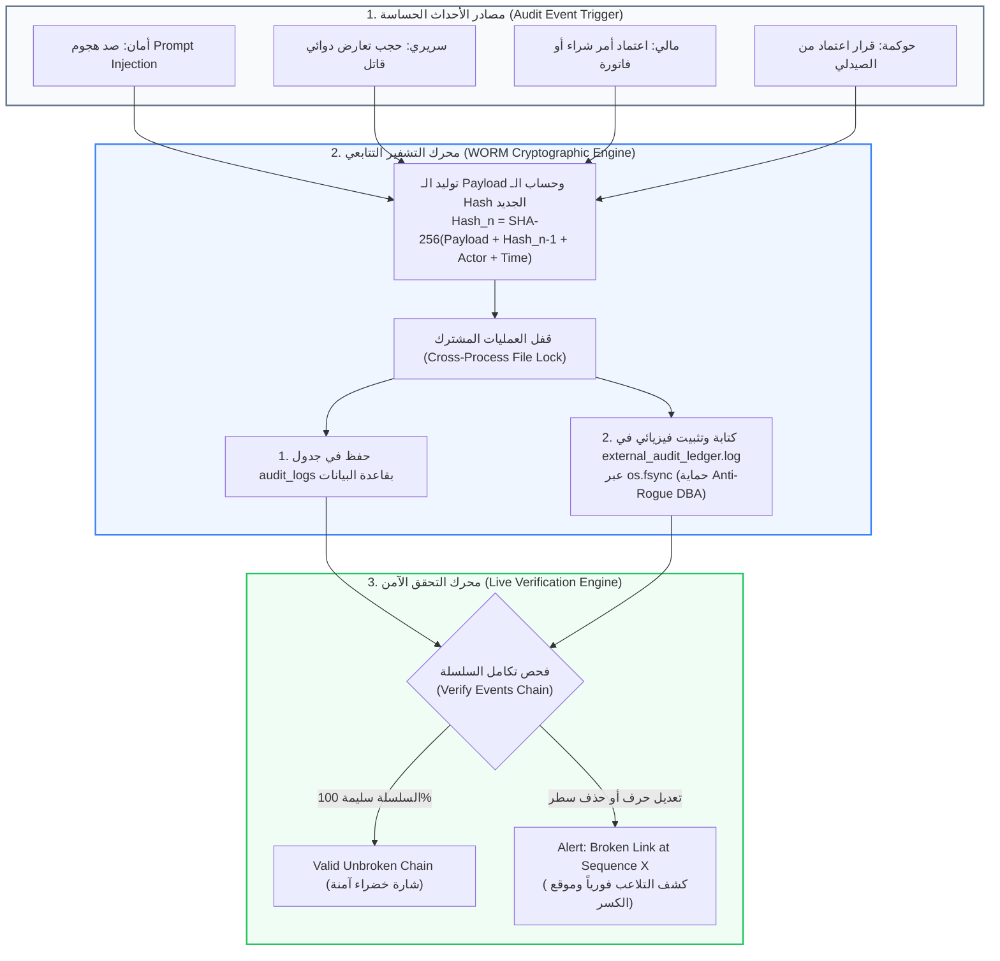

# 🛡️ وثيقة المعمارية الهندسية والأمن السيبراني (Cybersecurity & Audit Trail)
## شاشة سجلات التدقيق والتشفير الرقابي (Regulatory Audit Logs & SHA-256 WORM Ledger)
**المسار البرمجي في النظام:**
- **الواجهة الأمامية (Frontend):** `frontend/src/app/admin/audit-logs/page.tsx`
- **الخلفية ومحركات التشفير (Backend):**
  - `backend/app/domains/governance/router.py` (واجهات برمجة التطبيقات وفحص السلسلة التشفيرية)
  - `backend/app/core/worm_ledger.py` (محرك سجل WORM الخارجي المشفر بالكامل)
  - `backend/app/models/tracking.py` (نموذج بيانات `AuditLog`)
- **الرابط المباشر:** `http://localhost:3000/admin/audit-logs`

---

## 🏛️ 1. المفهوم المعماري والأكاديمي (The Cybersecurity & Compliance Concept)
تعتبر هذه الشاشة خط الدفاع الأخير والحصن الرقابي لنظام AI-COS-Pharmacy؛ حيث تطبق معايير **التدقيق الجنائي الرقمي (Digital Forensic Readiness)** ومبدأ **عدم القابلية للإنكار (Non-Repudiation)** المتوافق مع:
1. **معيار الرقابة ضد تلاعب مسؤولي قواعد البيانات (Anti-Rogue DBA Architecture):**
   حماية النظام من أخطر ثغرة داخلية؛ وهي قدرة مسؤول السيرفر أو مدير قاعدة البيانات (DBA) على حذف أو تعديل سجلات قديمة لإخفاء أخطاء أو سرقات.
2. **سجل WORM المستقل (Write-Once-Read-Many):**
   كتابة السجلات في وسط خارجي يمنع التعديل أو المسح بعد الكتابة مباشرة، مع تثبيتها فيزيائياً عبر `os.fsync`.
3. **سلسلة الكتل التشفيرية التتابعية (Cryptographic Hash Chaining - SHA-256):**
   ربط كل حركة أمنية أو سريرية أو مالية ببصمة الـ Hash للحركة السابقة، تماماً كمعمارية البلوك تشين (Blockchain).

---

## 📊 2. الرسم التدفقي لمعمارية التدقيق التتابعي المشفر (WORM Chaining Architecture)



---

## 🧮 3. الرياضيات التشفيرية لسلسلة WORM (`worm_ledger.py`)

### أ) معادلة السلسلة التتابعية (Hash Chaining):
تبدأ السلسلة ببصمة التكوين الأولى (Genesis Hash):
$$\text{Hash}_0 = \text{"0"} \times 64$$
ثم تشتق كل بصمة تالية من سابقتها:
$$\text{Hash}_n = \text{SHA-256}\left(\text{Payload}_n \parallel \text{Hash}_{n-1} \parallel \text{Actor ID} \parallel \text{Timestamp}\right)$$

### ب) استحالة التلاعب الرياضي (Avalanche Effect):
إذا حاول أي مخترق أو مسؤول قاعدة بيانات تعديل حرف واحد فقط في سجل قديم رقم $k$:
$$\text{Hash}_k \ne \text{Expected Hash}$$
ينتج عن ذلك انكسار كافة الـ Hashes التالية ($k+1, k+2, \dots$)، وتفشل دالة `verify_file_integrity()` فوراً وتحدد رقم السطر المتلاعب به بدقة.

### ج) التثبيت الفيزيائي على القرص الصلب (Physical Disk Flushes):
لتجنب بقاء السجلات في الذاكرة المؤقتة (OS Buffer) وإمكانية ضياعها أو التلاعب بها عند انقطاع الكهرباء، ينفذ الكود:
```python
f.flush()
os.fsync(f.fileno())  # إجبار نظام التشغيل على الكتابة الفيزيائية اللحظية
```

---

## 🏷️ 4. التصنيفات الرقابية الستة للسجلات (The 6 Audit Categories)

تتيح الشاشة فلترة السجلات المليونية عبر 6 مسارات رقابية متخصصة:

1. 🔴 **الأمن السيبراني (SECURITY):**
   - حركات صد محاولات حقن الأوامر (`sec_block_prompt_injection_defense`).
   - محاولات الوصول غير المصرح به وكسر الرموز.
2. 🟠 **السلامة السريرية (CLINICAL_SAFETY):**
   - تصعيد الحالات الطارئة الحرجة (`escalation_critical_emergency`).
   - حجب التعارضات الدوائية الخطيرة وتنبيهات الجرعات المفرطة.
3. 🟢 **المالية والمخزون (FINANCIAL_INVENTORY):**
   - أوامر الشراء الصادرة والمستلمة (`procurement_goods_received_p2p`).
   - فواتير المبيعات وحركات التعديل المخزني.
4. 🔵 **الروشتات الطبية (PRESCRIPTION):**
   - عمليات فك خط اليد بنموذج TrOCR وتعديلات الصيادلة البشرية.
5. 🟣 **حوكمة الذكاء الاصطناعي (AI_GOVERNANCE):**
   - قرارات اعتماد أو رفض التوصيات الذكية وقرارات اختبارات A/B.
6. ⚪ **العمليات العامة (OPERATIONAL):**
   - تعديل إعدادات النظام وتغيير الصلاحيات الإدارية.

---

## 🔍 5. التحقق المباشر من السلسلة بنقرة واحدة (One-Click Chain Verification)

تحتوي الشاشة على زر استراتيجي في أعلى الصفحة: **"فحص سلامة السلسلة التشفيرية" (Verify Events Chain)**:
- ينفذ فحصاً كاملاً لآلاف السجلات المتصلة.
- **في الحالة الطبيعية:** يعرض شارة خضراء براقة: `Valid (100% Unbroken SHA-256 Chain)` مع بيان عدد السجلات الموثقة.
- **في حالة التلاعب:** إذا حاول أحد التعديل، يعرض فوراً:
  - رقم التسلسل الذي حدث عنده الكسر (`broken_at_seq`).
  - البصمة المتوقعة مقابل البصمة الفعلية.
  - سبب الفشل لعرضه كدليل إدانة جنائي أمام سلطات التفتيش.

---

## ⚡ 6. هندسة الواجهة والبحث السريع (Debounced Real-Time Search)

لحماية السيرفر من الانهيار عند البحث في ملايين السجلات:
- تم تزويد الواجهة بآلية **البحث المتباطئ (Debounced Search 300ms)**؛ حيث لا يرسل المتصفح استعلامات للخلفية إلا بعد توقف المستخدم عن الكتابة بـ 300 مللي ثانية.
- تقسيم الصفحات (Server-Side Pagination) بحد أقصى 200 سجل لكل طلب لضمان استجابة لحظية وسريعة للواجهة.

---

## 🎓 7. سيناريو المناقشة المثالي أمام لجنة التحكيم (BIS Defense Pitch)

عند استعراض شاشة سجلات التدقيق، تحدث بهذا الأسلوب الأمني القاطع:

> **"يا فندم، هذه الشاشة تمثل أعلى درجات الحوكمة والأمن السيبراني والامتثال القانوني (Forensic Audit Readiness):**
> 
> 1. **الحماية ضد تلاعب مسؤولي قواعد البيانات (Anti-Rogue DBA Architecture):** نحن لا نكتفي بحفظ سجلات التدقيق داخل جداول PostgreSQL؛ لأن أي شخص يملك صلاحية (Root DBA) يستطيع تعديلها. قمنا بإنشاء **سجل WORM خارجي** مستقل يكتب في ملف محصن خارج قاعدة البيانات.
> 
> 2. **سلسلة الكتل التشفيرية (SHA-256 Cryptographic Chain):** كل حركة مسجلة مربوطة رياضياً ببصمة الحركة السابقة (Genesis to Head). أي تلاعب في أي حرف أو رقم مستقبلاً يكسر السلسلة الرياضية فوراً.
> 
> 3. **التثبيت الفيزيائي الحقيقي (os.fsync):** يتم إجبار نظام التشغيل على تفريغ السجلات فيزيائياً على الهارد ديسك لحظة وقوع الحدث لضمان عدم ضياعها.
> 
> 4. **الفحص اللحظي بنقرة زر (Live Chain Verification):** يستطيع مفتش هيئة الدواء أو مراجع الحسابات الضغط على زر (Verify Chain) ليتأكد النظام خلال أجزاء من الثانية من سلامة السلسلة وخلوها من أي عبث بنسبة 100%."

---

**تم إنشاء وتوثيق هذا الدليل المرجعي بنجاح ليغطي كافة جوانب التدقيق الجنائي والأمن السيبراني وسجلات الـ WORM لمشروع تخرجك.**
