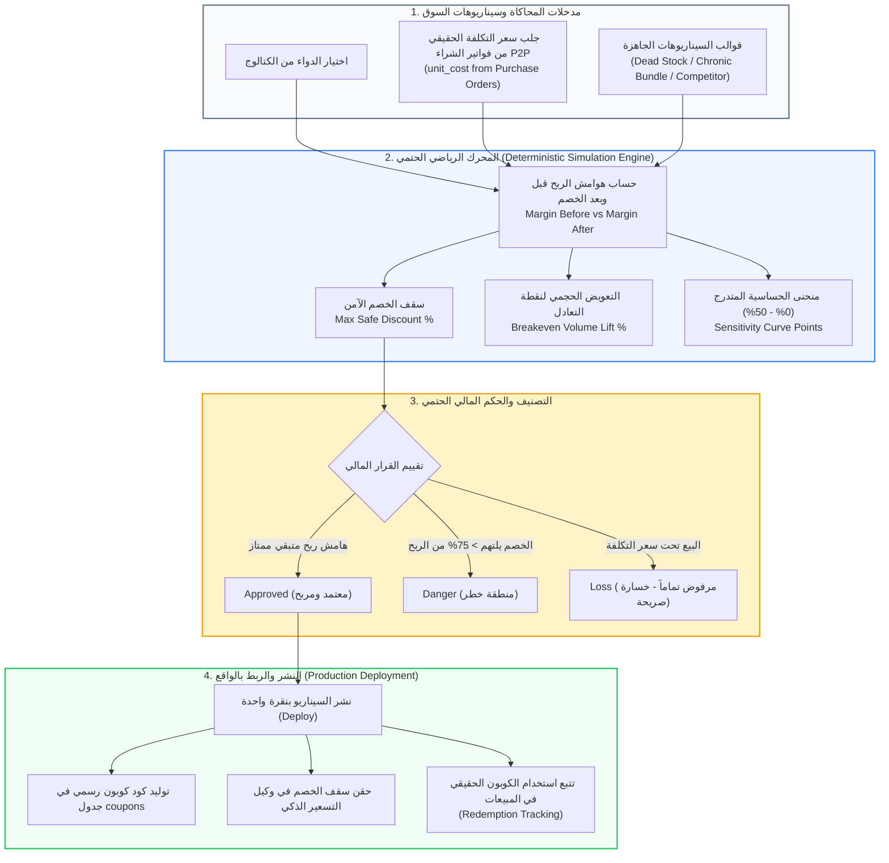

# 🎯 وثيقة المعمارية الهندسية والاقتصاد الإداري (Econometrics & DSS)
## شاشة محاكي القرارات وحساسية التسعير (What-If Pricing Simulator & Sensitivity Sandbox)
**المسار البرمجي في النظام:**
- **الواجهة الأمامية (Frontend):** `frontend/src/app/admin/what-if/page.tsx`
- **الخلفية ومحركات المحاكاة (Backend):**
  - `backend/app/domains/agents/simulator.py` (المحرك الرياضي الحتمي للقرارات)
  - `backend/app/domains/agents/simulator_data.py` (استرجاع تكلفة التوريد من فواتير P2P وحزم السيناريوهات)
  - `backend/app/domains/agents/router.py` (واجهات برمجة التطبيقات ونشر الكوبونات الحية)
- **الرابط المباشر:** `http://localhost:3000/admin/what-if`

---

## 🏛️ 1. المفهوم المعماري والأكاديمي (The Managerial Economics & DSS Concept)
تمثل هذه الشاشة ركيزة **نظم دعم القرار التفاعلية (Interactive Decision Support Systems - DSS)** وبحوث **الاقتصاد الإداري (Managerial Economics)**.

تعتمد الشاشة على فلسفة تشغيلية صارمة:
> **"الصفر المطلق للهلوسة (Zero LLM Hallucination & Zero DB Side Effects): لا يجوز اتخاذ قرارات التسعير وهوامش الربح بناءً على احتمالات نماذج لغوية، بل بناءً على رياضيات مالية حتمية 100%."**

تتيح الشاشة لمدير الصيدلية اختبار أثر أي خصم ترويجي أو تغيير في الأسعار في **بيئة معزولة (Sandbox)** قبل تطبيقه على أرض الواقع، للإجابة على الأسئلة الاستراتيجية:
1. *ما هو أقصى خصم يمكن تقديمه دون البيع بخسارة؟*
2. *إذا قدمت خصماً 15%، كم علبة إضافية يجب بيعها لتعويض تآكل هامش الربح (**Breakeven Volume Lift**)؟*
3. *كيف نتحول من المحاكاة النظرية إلى التطبيق العملي بضغطة زر (**Deploy to Production**)؟*

---

## 📊 2. الرسم التدفقي لمعمارية محاكي القرارات (Simulator Architecture Flowchart)

---

## 🧮 3. المعادلات الاقتصادية الصارمة من الكود الفعلي (`simulator.py`)

### أ) هامش ربح الوحدة وسقف الخصم الآمن (Max Safe Discount):
- **هامش الربح قبل الخصم:**
  $$\text{Margin}_{\text{before}} = \text{Unit Price} - \text{Unit Cost}$$
- **سعر البيع بعد الخصم:**
  $$\text{Price}_{\text{discounted}} = \text{Unit Price} \times \left(1 - \frac{d}{100}\right)$$
- **هامش الربح بعد الخصم:**
  $$\text{Margin}_{\text{after}} = \text{Price}_{\text{discounted}} - \text{Unit Cost}$$
- **سقف الخصم الآمن (الحد الأقصى للخصم قبل التحول للخسارة):**
  $$\text{Max Safe Discount \%} = \frac{\text{Margin}_{\text{before}}}{\text{Unit Price}} \times 100$$

---

### ب) التعويض الحجمي لنقطة التعادل (Breakeven Volume Lift):
أهم معادلة اقتصادية في هندسة التسعير: *ما هي نسبة المبيعات الإضافية المطلوبة لتغطية النقص في هامش ربح العلبة الواحدة؟*
$$(1 + \text{Lift}) \times \text{Margin}_{\text{after}} = \text{Margin}_{\text{before}}$$
$$\text{Breakeven Volume Lift \%} = \left(\frac{\text{Margin}_{\text{before}}}{\text{Margin}_{\text{after}}} - 1\right) \times 100$$

> **قاعدة حتمية برمجية:** إذا كان $\text{Margin}_{\text{after}} \le 0$، يرجع النظام `breakeven_lift = None`، ويعلن أن التعويض الحجمي مستحيل رياضياً؛ لأن بيع المزيد من العلب سيؤدي فقط إلى مضاعفة الخسائر!

---

## 🚦 4. الأحكام المالية الأربعة للقرارات (Deterministic Verdicts)

يُصنف المحرك أي قرار تسعير إلى واحدة من 4 حالات دقيقة:
1. 🟢 **معتمد (Approved):**
   الخصم آمن، وهامش الربح بعد الخصم لا يزال يحتفظ بأكثر من 25% من قيمته الأصلية.
2. 🟡 **منطقة خطر (Danger):**
   الخصم يلتهم أكثر من **75%** من هامش الربح، والربح المتبقي ضئيل جداً ويتطلب قفزة حجمية هائلة للتعويض.
3. 🔴 **خسارة صريحة (Loss):**
   سعر البيع المقترح بعد الخصم أقل من سعر التكلفة الحقيقي المستورد من فواتير الشراء $\to$ **مرفوض قطعاً**.
4. ⚪ **غير صالح (Invalid):**
   تكلفة الدواء المسجلة في الأصل أكبر من سعر بيعه قبل الخصم، ويطلب النظام مراجعة فواتير الشراء.

---

## 📦 5. قوالب السيناريوهات الواقعية الأربعة (Scenario Templates)

توفر الشاشة نماذج محاكاة مجهزة مسبقاً تلبي احتياجات إدارة الصيدليات:
1. **سيناريو تسييل المخزون الراكد (Dead Stock Liquidation):**
   - مخصص للأدوية التي لم تبع منذ أكثر من 60 يوماً ويقترب تاريخ صلاحيتها.
   - الهدف: تحديد خصم حاد يحرر رأس المال المعطل دون الهبوط تحت التكلفة.
2. **سيناريو حزم الأمراض المزمنة (Chronic Patient Bundle):**
   - مخصص لمرضى الضغط والسكري ذوي السحب الشهري المتكرر.
   - الهدف: تقديم خصم طفيف (5% - 8%) لضمان ولاء المريض طوال العام وتحقيق عائد حجمي مستمر.
3. **سيناريو حرب أسعار المنافسين (Competitor Price War):**
   - مخصص عند إعلان صيدلية منافسة عن عروض خاصة.
   - الهدف: فحص إمكانية مجاراة الخصم مع الحفاظ على الربحية، وتحديد نقطة الانسحاب إذا نزل المنافس تحت سعر التكلفة.
4. **الوضع اليدوي الحر (Manual Custom Mode):**
   - تجربة أي أرقام وتغيير نسبة نمو الحجم يدويّاً لرؤية النتيجة فورياً.

---

## 📈 6. منحنى حساسية الربحية التفاعلي (Sensitivity Curve)

يرسم المحرك منحنى استجابة الربحية بتدرج من **0% إلى 50% بخطوة 2.5%**:
- يوضح المنحنى البصري نقطة التقاطع مع محور الصفر (Zero Margin Point).
- يساعد الإدارة على رؤية التدهور التدريجي في هوامش الربح واختيار "النقطة السحرية" (Sweet Spot) التي تجمع بين جاذبية العرض للعميل وأمان الربح للصيدلية.

---

## 🚀 7. النشر المباشر إلى الإنتاج (One-Click Production Deployment)

أقوى ميزة تربط الـ Simulation بالواقع العملي:
1. بمجرد الوصول لسيناريو ناجح، يضغط المدير على **"نشر السيناريو" (Deploy to Production)**.
2. يقوم النظام آلياً بإنشاء **كود كوبون رسمي** في قاعدة البيانات محكوم بتاريخ صلاحية ومربوط بالدواء المعني.
3. يحقن النظام هذا السقف في **وكيل التسعير الذكي (Dynamic Pricing Agent)** ليعتمد هذه الحدود في حملاته الترويجية.
4. تتابع الشاشة لاحقاً هل تم صرف الكوبون واستخدامه في المتجر الإلكتروني أم لا (`Redemption Tracking`).

---

## 🎓 8. سيناريو المناقشة المثالي أمام لجنة التحكيم (BIS Defense Pitch)

عند استعراض شاشة محاكي القرارات، اشرحها بهذا التسلسل المالي والإداري المبهر:

> **"يا فندم، هذه الشاشة تمثل نظام دعم القرار التفاعلي (Interactive DSS) الخاص بالتسعير واختبار السيناريوهات الاقتصادية (What-If Analysis):**
> 
> 1. **مبدأ الصفر المطلق للهلوسة (Zero Hallucination Deterministic Engine):** نحن لا نعتمد على نماذج الذكاء الاصطناعي في تحديد هوامش الربح والأسعار؛ لأن القرارات المالية يجب أن تكون حتمية بنسبة 100%. المحرك مبني بمعادلات رياضية واقتصادية حتمية.
> 
> 2. **استيراد التكلفة من فواتير P2P الحقيقية:** النظام لا يفترض تكلفة عشوائية للدواء، بل يسترجع التكلفة الفعلية للوحدة مباشرة من فواتير الشراء المعتمدة (**P2P Invoices**) لضمان دقة الحسابات المحاسبية.
> 
> 3. **التعويض الحجمي لنقطة التعادل (Breakeven Volume Lift):** نحسب بدقة كمية الوحدات الإضافية التي يجب بيعها لتعويض الخصم. وإذا كان الخصم يبيع تحت التكلفة، يعلن النظام فوراً استحالة التعويض الحجمي رياضياً لمنع الخسائر الفادحة.
> 
> 4. **من المحاكاة إلى التنفيذ المباشر (Deploy to Production):** لا تتوقف الشاشة عند عرض الرسوم البيانية؛ بل تتيح بضغطة زر نشر السيناريو في صورة كوبون رسمي حي، وتتبعه في سجلات المبيعات لمعرفة أثره الفعلي على أرض الواقع."

---

**تم إنشاء وتوثيق هذا الدليل المرجعي بنجاح ليغطي كافة جوانب المحاكاة الاقتصادية والتسعير لمشروع تخرجك.**
