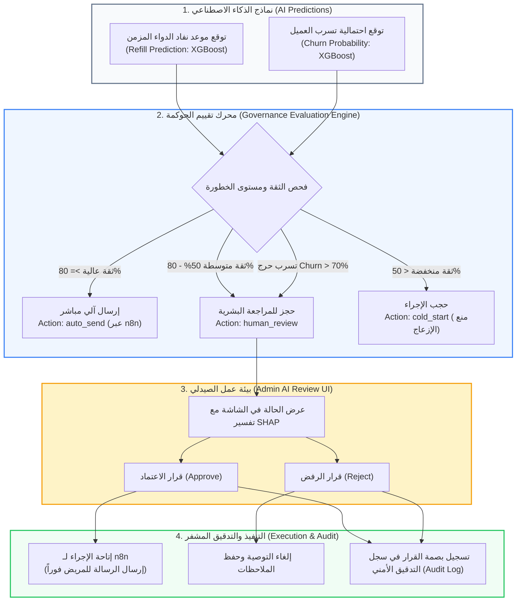

# 🛡️ وثيقة المعمارية الهندسية وحوكمة الذكاء الاصطناعي (AI Governance & HITL)
## شاشة مراجعة قرارات الذكاء الاصطناعي (AI Review & Human-in-the-Loop Governance)
**المسار البرمجي في النظام:**
- **الواجهة الأمامية (Frontend):** `frontend/src/app/admin/ai-review/page.tsx`
- **الخلفية ومحركات الحوكمة (Backend):**
  - `backend/app/domains/governance/router.py` (واجهات برمجة التطبيقات ونقاط n8n)
  - `backend/app/domains/governance/service.py` (محرك تقييم الثقة والحوكمة)
  - `backend/app/domains/governance/schemas.py` (مخططات قرارات الحوكمة)
- **الرابط المباشر:** `http://localhost:3000/admin/ai-review`

---

## 🏛️ 1. المفهوم المعماري والأكاديمي (The AI Governance & HITL Concept)
تعتبر هذه الشاشة الركيزة الأخلاقية والرقابية الأهم في نظام AI-COS-Pharmacy؛ حيث تطبق مبدأ **الإنسان داخل حلقة القرار (Human-in-the-Loop - HITL)** المتوافق مع:
1. **معايير منظمة الصحة العالمية وهيئات الدواء (WHO & FDA SaMD Guidelines):** لا يُسمح لنماذج الذكاء الاصطناعي باتخاذ قرارات تؤثر على صحة المريض أو صرف الأدوية دون وجود إشراف بشري مرخص (Licensed Pharmacist Oversight).
2. **الذكاء الاصطناعي القابل للتفسير (Explainable AI - XAI):** ربط كل توصية بمحرك التفسير **SHAP** ونموذج **XGBoost** ليعرف الصيدلي *لماذا* اقترح النظام هذا الإجراء تحديداً.
3. **التكامل المؤسسي غير المتزامن مع n8n:** فصل محرك اتخاذ القرار (FastAPI) عن محرك الإرسال والأتمتة (n8n Engine).

---

## 📊 2. الرسم التدفقي لمعمارية الحوكمة ثلاثية المستويات (Tri-Band Governance Architecture)

---

## 🧮 3. القواعد البرمجية الصارمة للمحرك (Governance Evaluation Rules)

يخضع تصنيف التوصيات في ملف `governance/router.py` و `service.py` لقواعد حتمية ومحددة سلفاً:

| مستوى الثقة / الشرط | النطاق الرياضي | الإجراء البرمجي | المسار التنفيذي |
| :---: | :---: | :---: | :--- |
| **High Confidence** | $\text{Confidence} \ge 80\%$ | `auto_send` | يُرسل إلى طابور n8n ليتم إرساله للعميل تلقائياً بدون إزعاج الصيدلي. |
| **Medium Confidence** | $50\% \le \text{Confidence} < 80\%$ | `human_review` | **يُحجز في شاشة AI Review** ويلزم موافقة الصيدلي البشري. |
| **Low Confidence** | $\text{Confidence} < 50\%$ | `cold_start` | يُحجب الإجراء نهائياً لعدم كفاية البيانات وتجنب الهلوسة. |
| **قاعدة كسر المسار (Churn Override)** | $\text{Churn Risk} > 70\%$ | `human_review` | **قاعدة إجبارية:** إذا كان العميل معرضاً للتسرب بنسبة > 70%، يتم إجباره على المراجعة البشرية حتى لو كانت ثقة النموذج 99%! |

---

## 🎯 4. الإجراءات الذكية المعروضة على الصيدلي (Contextual AI Actions)

تقوم الشاشة بدراسة ملف المريض واشتقاق نوع الإجراء المقترح ديناميكياً:
1. **خصم استبقاء استراتيجي 10% (Churn Prevention Discount):**
   يُقترح إذا كان احتمال التسرب $\text{Churn} > 0.70$، حيث يقترح الذكاء الاصطناعي تقديم كود خصم محسوب لمنع فقدان المريض لصالح صيدلية منافسة.
2. **متابعة الالتزام بالجرعات (Dosage Adherence Follow-up):**
   يُقترح إذا كان احتمال التسرب متوسطاً ($0.40 < \text{Churn} \le 0.70$) للتأكد من انتظام مريض السكر أو الضغط على علاجه.
3. **تذكير إعادة صرف الدواء المزمن (Chronic Refill Reminder):**
   الإجراء القياسي عندما يقترب موعد نفاد الدواء المحسوب بـ XGBoost (تذكير عبر SMS / WhatsApp).
4. **اقتراح مكمل علاجي متوافق (Cross-Sell Indication Prompt):**
   يُقترح عند وجود ثقة سريرية عالية ($\text{Confidence} > 0.85$) لاقتراح مكمل غذائي مصاحب (مثل فيتامين B12 مع أدوية ميتفورمين لمرضى السكر).

---

## 🔍 5. القابلية للتفسير بالذكاء الاصطناعي (XAI & SHAP Integration)

لا تكتفي الشاشة بعرض التوصية مجردة، بل تقدم **سطر التفسير المنطقي (Explainability Rationale)**:
- مثل: `Churn risk 78% · predicted refill in 28 days (XGBoost + SHAP)`
- يوضح هذا السطر للصيدلي المتغيرات التي اعتمد عليها الموديل:
  - تاريخ آخر طلبات المريض.
  - معدل استهلاك العبوة المعتاد.
  - الوزن النسبي للعوامل التي أدت لرفع درجة الخطورة (SHAP Feature Importance).

---

## ⚡ 6. المعمارية التقنية للتكامل مع n8n (Asynchronous Pull Pattern)

تم بناء التكامل بين FastAPI و n8n وفق نمط الـ **Pull Pattern** المعتمد في بنية النظم الآمنة:
1. **المسار الآمن (`/internal/governance/pending`):**
   محمي برمز توثيق داخلي (`X-Internal-Token`) للخدمات الخلفية، أو `Bearer JWT` لمديري النظام.
2. **استطلاع n8n الدوري:**
   يستيقظ سيرفر n8n كل صباح لطلب الحالات المعتمدة (`approved`) فقط.
3. **تحديث الحالة الفوري:**
   بمجرد أن يضغط الصيدلي على **"اعتماد" (Approve)** في صفحة الـ AI Review، تتحول الحالة برمجياً إلى `approved`، فيلتقطها n8n في الدورة التالية ويرسل رسالة الواتساب المخصصة للمريض.

---

## 🔐 7. الرقابة والامتثال لسجلات التدقيق (WORM Audit Trail)

كل قرار يتخذه الصيدلي (سواء بالاعتماد الفردي، الرفض، أو الاعتماد الجماعي Bulk Approve) يُسجل فوراً في جدول `audit_logs`:
- يُسجل كود واسم الصيدلي الذي راجع الحالة.
- يُسجل نوع الإجراء ورقم التذكير (`reminder_id`).
- يتم ربط الحدث بسلسلة الكتل المشفرة للتدقيق لمنع ادعاء أي مسؤول أن رسالة أُرسلت للمريض دون مراجعته.

---

## 🎓 8. سيناريو المناقشة المثالي أمام لجنة التحكيم (BIS Defense Pitch)

عندما تسألك اللجنة: "كيف تضمنون ألا يرسل الذكاء الاصطناعي رسائل أو أدوية خاطئة للمرضى؟"، افتح هذه الشاشة وأجب بثقة:

> **"يا فندم، نحن نطبق معيار (Human-in-the-Loop AI Governance) الصارم المعتمد من منظمة الصحة العالمية وهيئات الدواء:**
> 
> 1. **بنية الحوكمة ثلاثية المستويات (Tri-Band Architecture):** الذكاء الاصطناعي لا يملك تفويضاً مطلقاً؛ فالقرارات مقسمة بناءً على درجة الثقة:
>    - إذا كانت ثقة النموذج عالية ($\ge 80\%$) يُسمح بالإرسال التلقائي.
>    - إذا كانت الثقة متوسطة ($50\% - 80\%$)، **يتم حجز القرار فوراً داخل هذه الشاشة** ولا يمكن إرساله للمريض إلا بعد نقر الصيدلي البشري على (Approve).
>    - إذا كانت الثقة ضعيفة ($< 50\%$) يُلغى الإجراء تماماً لمنع الهلوسة.
> 
> 2. **صمام الأمان لعملاء الخطر (Churn Override Rule):** وضعنا قاعدة حتمية برمجية تنص على أنه إذا تجاوزت نسبة تسرب العميل 70%، يُلغى الإرسال الآلي ويُجبر النظام على إحالة الحالة للصيدلي البشري للمراجعة الشخصية.
> 
> 3. **التفسير السريري (Explainable AI):** نوفر للصيدلي سطر التفسير المستخرج من **XGBoost و SHAP**، ليعرف بدقة أسباب القرار قبل اعتماده.
> 
> 4. **التكامل المؤسسي والحوكمة (n8n & Audit Trail):** بمجرد اعتماد الصيدلي، يلتقط محرك الأتمتة **n8n** التوصية المعتمدة ويرسلها عبر WhatsApp، مع تسجيل بصمة الصيدلي في سجل التدقيق الأمني المشفر (**Audit Log**)."

---

**تم إنشاء وتوثيق هذا الدليل المرجعي بنجاح ليغطي كافة جوانب حوكمة الذكاء الاصطناعي والرقابة البشرية لمشروع تخرجك.**
