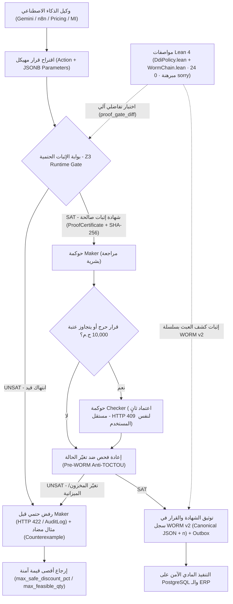

# 🛡️ بوابة الإثبات الحتمية (Deterministic Proof Gate) — المعمارية والتنفيذ الحي والتحقق الشكلي

**Cura AI Pharmacy / Agentic Business OS · 2026-11-23 · الحالة الحالية: منفّذة حيًا بالكامل عبر المراحل الثلاث (Z3 SMT + Lean 4 + WORM v2 + تكامل PostgreSQL)**

> **قاعدة الصدق المنهجي:** بدأت هذه الوثيقة بتدقيق نقدي مباشر للكود الفعلي وقاعدة بيانات PostgreSQL الحية كشف **5 فجوات دقيقة** (محفوظة كاملةً أدناه كتاريخ تدقيق مسبق)، ثم جرى **تنفيذ المراحل الثلاث بالكامل في الكود الحي** مع تحقق آلي مستقل عبر `z3-solver` (`z3-5.4.1`) و`Lean 4` (`v4.36.0` · `lake build` · `0 sorry` · `0 custom axioms`) واختبارات تكامل على PostgreSQL حي بـ `FORCE ROW LEVEL SECURITY` و`pg_advisory_xact_lock` — مع الإبقاء الصريح على جميع **الحدود الصادقة (Honesty Boundaries)** في القسم 7.

---

## 1. الملخص التنفيذي والفكرة المركزية

تمتلك المنصة بنية حوكمة متقدمة لقرارات الوكلاء الذكيين تتكوّن من ثلاث مراحل أصلية:
**الوكيل يقترح (`PENDING_APPROVAL`) ← اعتماد بشري ثنائي (`Maker → Checker`) ← توثيق غير قابل للتعديل (`WORM Ledger`) ← التنفيذ المادي.**

لكن التدقيق المسبق للكود الفعلي كشف أن **الاعتماد البشري وحده لا يضمن صحة القيود الرياضية أو اتساق السياسات**؛ لأن الوكيل كان يمكن أن يمرّر معاملات غير محقَّقة (أو خصمًا يمحو الهامش، أو طلب شراء بلا سقف ميزانية، أو قاعدة تفاعل دوائي بمفردات غير متطابقة عبر القنوات) وتصل إلى الـ Maker أو تُنفَّذ مباشرةً قبل أن يكتشفها أحد.

**الفكرة المركزية (المنفّذة حيًا الآن):** إضافة **طبقة رابعة حتمية (Machine-Proof Layer)** باسم **«بوابة الإثبات الحتمية» (Deterministic Proof Gate)** تتوسط بين اقتراح الوكيل وبين بوابتي `Maker / Checker` البشريتين:

$$\text{AI Agent Proposal} \longrightarrow \text{Deterministic Proof Gate (Z3 / Lean 4)} \longrightarrow \text{Maker} \longrightarrow \text{Checker} \longrightarrow \text{WORM Ledger v2} \longrightarrow \text{Anti-TOCTOU} \longrightarrow \text{Execution}$$

### لماذا هذا النمط عالمي ومُجرَّب صناعيًا؟ (نموذج Amazon Cedar)
تعتمد **AWS (Amazon Cedar)** هذا النمط المعماري نفسه في محرك سياسات الصلاحيات الإنتاجي الخاص بها (Verification-Guided Development)، وهو الآن **مطبّق فعليًا في المستودع**:
1. **إثبات المواصفات والسياسات رياضيًا في `Lean 4`** (وقت البناء/CI): إثبات أن سياسة التفاعلات الدوائية (`backend/specs/DdiPolicy.lean`) وسلسلة سجل WORM v2 (`backend/specs/WormChain.lean`) خاليتان من التناقض ومن «الحالات الصامتة»، وربطهما بكود Python عبر أوراكل اختبار تفاضلي مُترجم (`backend/specs/Main.lean` ← `proof_gate_diff`).
2. **التحقق الحي عند وقت التشغيل عبر محرك SMT (`Z3` / `z3-solver`)**: فحص كل اقتراح صادر من وكيل LLM أو نقطة إصدار كوبون أو أمر شراء أمام القيود الحسابية والمالية والسريرية خلال أجزاء من الثانية، وإرجاع **شهادة إثبات حتمية (`ProofCertificate` + `certificate_hash`)** عند `SAT` أو **مثال مضاد حتمي (`Counterexample`) + قيمة تصحيح محسوبة بـ Z3 Optimize (`max_safe_discount_pct` / `max_feasible_qty`)** عند `UNSAT`.
3. **إبقاء محركات البحث العددي (`decision_lab` / ومستقبليًا `OR-Tools` / `Optuna`)** لدورها الطبيعي: إيجاد أفضل خيار عددي، بينما تضمن بوابة الإثبات أن الخيار المختار **لا يكسر أي قيد حرج أبدًا**.

---

## 2. مخطط تدفق «بوابة الإثبات الحتمية»

---

## 3. الأفكار الخمس — سجل التدقيق المسبق (قبل التنفيذ) وما تم تنفيذه حيًا

كل فكرة أدناه توثّق أولًا **الفجوة الفعلية التي كشفها التدقيق المسبق بالملف والسطر** (محفوظة للأمانة العلمية والتاريخية)، ثم **الحل المنفّذ حيًا في الكود اليوم**.

---

### الفكرة 1: إثبات معاملات القرار قبل الاعتماد (Pre-Maker & Anti-TOCTOU Parameter Verification)

#### سجل التدقيق المسبق (قبل التنفيذ)
- عند اقتراح إجراء من وكيل ذكاء السوق أو عبر Gemini Function Calling في `backend/app/domains/agents/market_intelligence.py` (الأسطر الأصلية `345-362` و`805-820` ودالة `create_cdss_action` في `880-946`)، كان حقل `parameters` من نوع `JSONB` يُخزَّن **بصفر تحقق رقمي أو منطقي على القيم والحدود**.
- كان مسار `Maker → Checker` يُشترَط فقط عندما تكون الأولوية `"CRITICAL"` ولا يتحقق من سلامة `parameters` مطلقًا، ثم يوثّق القرار في WORM قبل التنفيذ.
- كان التحويل الفعلي للأنواع يحدث **وقت التنفيذ المادي فقط بعد الاعتماد والتوثيق**:
  - `quarantine_qty = int(params.get("quantity", 0))` ثم `new_stock = max(0, old_stock - quarantine_qty)`: **الخطر المثبت:** إذا وصلت قيمة سالبة مثل `quantity = -10`، فإن الطرح يحولها إلى جمع و**يزيد المخزون بدل حجزه (Quarantine)**!
  - `qty_ordered = int(params.get("quantity_ordered", 20))` و`unit_cost = float(params.get("estimated_unit_cost", 0.0))`: إذا كانت القيمة نصًا غير رقمي (مثل `"twenty"`)، ينهار التنفيذ بخطأ `HTTP 500` **بعد** تسجيل القرار في WORM.
  - `new_thr = int(params.get("new_threshold", 30))` بلا حدود عليا أو دنيا.

#### الحل المنفّذ حيًا (Z3 SMT)
- **التنفيذ في `backend/app/core/proof_gate/z3_engine.py` (`verify_action_parameters`) و`backend/app/domains/agents/market_intelligence.py`:**
  - فحص **Pre-Maker** عبر Z3 قبل حفظ أي اقتراح في `PENDING_APPROVAL`؛ الاقتراحات المرفوضة (`UNSAT`) لا تصل لقائمة انتظار الأدمن وتُسجَّل تلقائيًا في `audit_logs` بحدث `proof_gate_proposal_rejected`.
  - فحص **Pre-WORM Anti-TOCTOU** لحظة `approve_and_execute_action` ضد الرصيد الفعلي والميزانية الشهرية **قبل** كتابة أي سطر في WORM أو تعديل `inventory_items` أو إنشاء `PurchaseOrder`، مع ربط `proof_certificate_hash` (SHA-256) داخل حمولة `MarketActionOutbox`.
  - قيد حجز المخزون المفروض في Z3:
    $$1 \le \text{quarantine\_qty} \le \min(\text{current\_stock}, 100000) \;\land\; \text{new\_stock} = \text{current\_stock} - \text{quarantine\_qty} \ge 0 \;\land\; \text{new\_stock} < \text{current\_stock}$$
  - رفض القيم السالبة (`-10` ← يُرجع `hazard: "negative_quantity_would_increase_stock"` والمثال المضاد) والنصوص (`"twenty"`) والمنطقيات (`True`/`False`) والكسور والأعداد العملاقة (`10**5000`) دون أي `HTTP 500`.

---

### الفكرة 2: مبرهنة «الكوبون-الهامش» (Coupon-Margin Invariant Theorem)

#### سجل التدقيق المسبق (قبل التنفيذ)
- كان محرك التسعير `backend/app/domains/agents/pricing.py` يحدد هوامش وسقوف خصم حسب الفئة (`chronic: 10%`, `general: 12%`, `premium: 20%` المتقاطعة مع `backend/verticals/pharmacy.yaml`)، لكنه كان يعيد `"requires_human_approval": True` كحقل استشاري فقط.
- في المقابل، كانت نقطة `POST /api/v1/agents/marketing/generate-campaign` (`router.py`) و`MarketingRequest` (`schemas.py:12`) و`issue_coupon()` (`coupon_issuance.py`) تفحص `1 <= discount_pct <= 100` فقط — دون ربط بتكلفة الصنف أو هامشه أو `margin_caps` الخاصة بالقطاع. **النتيجة السابقة:** كان إصدار كوبون بخصم `95%` على دواء مزمن هامشه `15%` ممكنًا فعليًا (مع وجود بوابات منفصلة فقط في `simulator/deploy` و`decision_lab`).

#### الحل المنفّذ حيًا (Z3 SMT + Z3 Optimize)
- **التنفيذ في `backend/app/core/proof_gate/z3_engine.py` (`verify_coupon_margin`, `resolve_vertical_margin_policy`, `_solve_max_safe_discount`) و`backend/app/domains/agents/coupon_issuance.py`:**
  - فرض مبرهنة صيانة الهامش مركزيًا قبل إنشاء أي كوبون في `issue_coupon()`:
    $$P \cdot \left(1 - \frac{d}{100}\right) - C > 0 \;\land\; 1 \le d \le \text{cap}(\text{vertical}, \text{category})$$
  - قراءة آخر تكلفة شراء فعلية (`last_unit_cost`) من `purchase_order_items` (مع استبعاد أوامر `CANCELLED` و`REJECTED` والبنود صفرية التكلفة) أو الهامش المحافظ للفئة عند غياب فاتورة P2P، مع احترام `tenant_store_configs` المخصّصة لكل مستأجر وملفات `backend/verticals/*.yaml` لجميع القطاعات (Multi-Vertical).
  - عند انتهاك القيد (مثل خصم `95%` على دواء مزمن): ترفع البوابة `ProofViolationError` (**HTTP 422** بهيكل `PROOF_GATE_UNSAT`) محتوياً على المثال المضاد + **أقصى خصم آمن مثبَت عبر `z3.Optimize` (`max_safe_discount_pct`)** (مثل `10%` للصنف المزمن أو السقف المخصّص للمستأجر مثل `7%`).

---

### الفكرة 3: إثبات اتساق وعدم تعارض قواعد التفاعلات الدوائية DDI (نموذج Amazon Cedar)

#### سجل التدقيق المسبق (قبل التنفيذ — الخللان الحيان المكتشفان)
كشف التدقيق المسبق للكود ولجدول `drug_interactions` في PostgreSQL الحي (الذي احتوى `47` صفًا `medium` و`12` صفًا `high`) عن تشتت في مفردات الشدة عبر 4 مواضع أدى إلى **خللين حقيقين**:

| الموضع في الكود / البيانات | الوضع قبل التنفيذ (التدقيق المسبق) | الإصلاح المنفّذ حيًا |
|---|---|---|
| `backend/app/models/drug.py` + `drug/schemas.py` | مفردات `low \| medium \| high` (بـ 47 صفًا `medium` و12 `high`) | مدعومة مع `contraindicated` ضمن النوع الجبري المغلق في `ddi_policy.py` و`DdiPolicy.lean` |
| `backend/app/domains/order/service.py` | فحص نصي مباشر لـ `("high", "major", "contraindicated")` | موحّد عبر `is_order_hard_stop(normalize_severity(...))` من `ddi_policy.py` |
| `backend/app/domains/ai/interaction_guard.py` | **خلل حي #2 (تخفيض صامت):** فحص `== "high"` ثم `== "moderate"` وإلا سقطت الـ 47 صفًا `medium` إلى `"بسيط (Low)"`! | **مُصلَح بالكامل:** توحيد `"medium"` و`"moderate"` → `DdiSeverity.MEDIUM` (`"متوسط (Moderate)"`) + حفظ تحذير الفئة الدوائية حتى عند تعثر استعلام DB |
| `backend/app/domains/ai/service.py` | فحص مباشر `severity == "high"` غير مربوط بسياسة موحّدة | موحّد عبر `is_chat_hard_stop(interaction.get("severity"))` |
| `backend/app/domains/drug/service.py` | **خلل حي #1 (فرع ميت):** فحص `== "MAJOR"` لتوليد إجراء CDSS تلقائيًا — لم يعمل أبدًا مع صفوف PostgreSQL (`high`)! | **مُصلَح بالكامل:** يستخدم `should_auto_escalate_cdss()` لكل `high`/`contraindicated` + تمرير `tenant_id` تحت `FORCE RLS` + إرجاع لقطات منفصلة تمنع `MissingGreenlet` |

#### الحل المنفّذ حيًا (Lean 4 + Differential Testing)
- **المواصفة الشكلية:** `backend/specs/DdiPolicy.lean` (**15 مبرهنة عامة · `0 sorry` · `0 custom axioms`**)، مع المرايا الحية في `backend/app/core/proof_gate/ddi_policy.py`.
- **المبرهنات المثبتة آليًا في نواة Lean 4:**
  1. **الشمول وإلغاء الخفض الصامت:** `medium_and_moderate_are_unified`، `medium_never_downgraded_in_chat`، `unknown_severity_fails_closed_never_low` (أي مفردة مجهولة تُصعَّد احترازيًا إلى `high` ولا تُخفَّض أبدًا إلى `low`).
  2. **الرتابة السريرية وإلغاء الفرع الميت:** `pg_high_triggers_cdss_escalation`، `high_or_worse_always_hard_stop_and_escalate`، `decideOrder_monotone`، `decideChat_monotone`، `decideCdss_monotone`.
  3. **عدم التعارض وقوانين الشبكة (Join-Semilattice):** `combine_comm`، `combine_assoc`، `combine_idem`، `combine_dominates_both`، `combine_preserves_order_hard_stop`، `combine_preserves_chat_hard_stop`، `combine_preserves_cdss_escalation`.
- **إغلاق فجوة المواصفة مقابل التنفيذ:** أوراكل Lean 4 المُترجم (`proof_gate_diff`) يُختَبر تفاضليًا ضد `ddi_policy.py` في `backend/tests/test_ddi_policy_and_worm_formal.py` على كامل مصفوفة القرار (4 شدّات × 3 قنوات) و25 نصًا خامًا وجميع الأزواج الـ 16 الممكنة — بتطابق 100%.

---

### الفكرة 4: ميزانية المشتريات المُثبتة (Proven Procurement Budget)

#### سجل التدقيق المسبق (قبل التنفيذ)
- كانت نقطة `POST /api/v1/agents/inventory/create-reorder-po` (`backend/app/domains/agents/router.py`) تنشئ `PurchaseOrder` بحالة `DRAFT` بلا `Maker-Checker` وبلا أي سقف ميزانية مالي (التحقق الوحيد كان `1 <= quantity <= 10000`).
- وكانت أوامر الشراء الصادرة عن وكيل ذكاء السوق (`market_intelligence.py`) بلا حد أعلى للتكلفة وبأولوية افتراضية `"HIGH"` تتجاوز شرط `MAKER_CHECKER_CRITICAL`.

#### الحل المنفّذ حيًا (Z3 SMT + `pg_advisory_xact_lock`)
- **التنفيذ في `backend/app/core/proof_gate/z3_engine.py` (`verify_procurement_budget`, `_solve_max_feasible_po_qty`)، و`backend/app/core/config.py`، و`backend/app/domains/agents/router.py`، و`market_intelligence.py`:**
  - القيود المفروضة رياضيًا عبر Z3 قبل إنشاء أي `PurchaseOrder`:
    $$1 \le \text{qty} \le 10000 \;\land\; \text{unit\_cost} > 0 \;\land\; (\text{qty} \cdot \text{unit\_cost}) \le B_{\text{single\_po}}\,(100{,}000\text{ ج.م})$$
    $$\text{committed\_month\_total} + (\text{qty} \cdot \text{unit\_cost}) \le B_{\text{monthly\_tenant}}\,(500{,}000\text{ ج.م})$$
    $$(\text{qty} \cdot \text{unit\_cost}) > T_{\text{dual\_control}}\,(10{,}000\text{ ج.م}) \implies \text{requires\_maker\_checker} = \text{True}$$
  - عزل صارم للمستأجر (`tenant_id` إلزامي fail-closed، استبعاد أوامر `CANCELLED`/`REJECTED` وأسعار المستأجرين الآخرين) + قفل معاملات PostgreSQL `pg_advisory_xact_lock` لمنع سباق الطلبات المتزامنة على الميزانية الشهرية.
  - عند التجاوز: رفض `HTTP 422` (`PROOF_GATE_UNSAT`) مع إرجاع **`max_feasible_qty`** المحسوبة بـ `z3.Optimize`. وعند تجاوز عتبة `10,000 ج.م`: تصعيد تلقائي إلى أولوية `CRITICAL` ومسار `Maker → Checker` الثنائي.

---

### الفكرة 5: إثبات خاصية سلسلة سجل WORM v2 (`worm_ledger.py` + `WormChain.lean`)

#### سجل التدقيق المسبق (قبل التنفيذ)
- كشف التدقيق المسبق أن `_line_hash` (الإصدار v1) في `backend/app/core/worm_ledger.py` كان يحسب `SHA-256` على `f"{prev}|{event_id}|{payload_hash}|{ts}"` فقط — مُغفلًا الرقم التسلسلي `"n"` وأي مفاتيح JSON إضافية؛ ما كان يعني أن تعديل `"n": 5` إلى `"n": 99` أو حقن حقل JSON إضافي كان يمرّ سابقًا من `verify_file_integrity()`!

#### الحل المنفّذ حيًا (WORM v2 Canonical Hashing + Lean 4 Proof)
- **الترقية الحية في `backend/app/core/worm_ledger.py` (`HASH_VERSION_V2 = 2`):**
  - تسلسل JSON قياسي حتمي (`_canonical_entry_payload` مع `sort_keys=True, separators=(",", ":"), allow_nan=False`) يُجزّئ جميع الحقول (`v`, `n`, `prev`, `event_id`, `created_at`, `payload_hash` وأي حقول إضافية).
  - رفض حتمي للمفاتيح المكررة في JSON (`_reject_duplicate_json_keys`)، وثوابت JSON غير القياسية (`NaN`/`Infinity`)، وتهريب الأنواع (`n=True`, `v=2.0`)، والمفاتيح المحجوزة، وهجمات التراجع من `v2` إلى `v1` (`no_downgrade`) — مع الحفاظ على التوافق الخلفي للتحقق من السطور التاريخية `v1` السابقة للترقية.
- **المواصفة الشكلية في `backend/specs/WormChain.lean` (9 مبرهنات عامة + مبرهنتان مساعدتان = 11 تصريحًا · `0 sorry` · `0 custom axioms`):**
  - `tip_determines_chain`: تحت افتراضي مقاومة التصادم (`CollisionResistant H`) واستحالة الوصول للجذر (`GenesisUnreachable H g`)، أي سلسلتين صالحتين لهما نفس `chainTip` متطابقتان تمامًا ($L_1 = L_2$).
  - `append_preserves_validity`: إلحاق قيد v2 سليم يحافظ على صلاحية السلسلة.
  - `tamper_seq_breaks_validity`: تعديل الرقم التسلسلي `n` في أي موضع يكسر السلسلة حتميًا (إثبات إغلاق ثغرة v1!).
  - `tamper_body_breaks_validity`: تعديل `payloadHash` أو حقن حقل إضافي يكسر السلسلة حتميًا.
  - `delete_first_entry_breaks_validity`: حذف السطر الأول المرتبط بـ `genesis` يكسر السلسلة حتميًا.
  - `verifyChainBool_iff` و`verifyChainFromBool_iff`: تكافؤ المدقق القابل للتنفيذ مع التعريف المنطقي `ValidChain` (ومطابقته تفاضليًا ضد `worm_ledger.py` عبر `proof_gate_diff` في 6 سيناريوهات).

---

## 4. جدول مقارنة الأدوات وحالتها الفعلية في البيئة اليوم

> **الواقع الموثّق في `backend/requirements.txt` (31 سطرًا) و`backend/specs/`:**
> - **`z3-solver>=4.13.0`** مُدرج في `backend/requirements.txt:31` ومُثبّت حيًا (`z3-5.4.1`).
> - **`Lean 4`** مُثبّت حيًا بالإصدار `leanprover/lean4:v4.36.0` (`backend/specs/lean-toolchain`) ومشروع Lake (`proof_gate_specs`) يُبنى بنجاح (`lake build`: 13/13 jobs) ويولّد الأوراكل التنفيذي `proof_gate_diff`.
> - **`scipy>=1.11,<2`** مثبّتة (`decision_lab/engine.py`)؛ أما **`OR-Tools` و`Optuna`** فليستا مثبّتتين بعد (ويظل `decision_lab` يعمل بمحرك `finite-candidates-v1`).

| الأداة / الطبقة | الحالة الفعلية اليوم | الوظيفة الدقيقة في المنصة | وقت التشغيل | ماذا تُخرج؟ | ما لا تُستخدم له |
|---|---|---|---|---|---|
| **Z3 (`z3-solver`, `z3-5.4.1`)** | **منفّذ ومفعّل حيًا** | بوابة التحقق الحي للقيود الحسابية والمنطقية (معاملات الوكلاء، الكوبون-الهامش، ميزانية المشتريات) | حي عند الطلب (`Runtime`، ملي ثانية) | `SAT` + `ProofCertificate` (`certificate_hash`)، أو `UNSAT` + **مثال مضاد** + `max_safe_discount_pct` / `max_feasible_qty` | البحث الإحصائي أو تدريب نماذج التنبؤ |
| **Lean 4 (`v4.36.0`)** | **منفّذ ومُتحقَّق آليًا (`0 sorry`)** | إثبات خصائص مواصفات السياسات ذاتها (`DdiPolicy.lean` · 15 مبرهنة عامة، `WormChain.lean` · 9 مبرهنات عامة) + أوراكل تفاضلي (`Main.lean`) | وقت التطوير والبناء (`lake build` / pytest CI) | برهان رياضي مفحوص في نواة Lean (`0 sorry`، `0 custom axioms`) + اختبار تفاضلي ضد Python | تنفيذ استعلامات حيّة داخل HTTP Request |
| **OR-Tools / Optuna** | **مستقبلي (غير مثبّت)** | البحث العددي وإيجاد الحل الأمثل بجانب `decision_lab` | دفعات / محاكاة (`Batch / What-If`) | خطة مثلى عدديًا (تُمرَّر بعدها لبوابة Z3 لاعتماد سلامتها) | إثبات انعدام التناقض في السياسات النصية |
| **Maker / Checker + WORM v2** | **منفّذ ومحدَّث حيًا (v2)** | الحوكمة البشرية والمساءلة القانونية وسجل التدقيق المتسلسل قياسيًا (`HASH_VERSION_V2 = 2`) | حي عند الاعتماد والتنفيذ | سجل مسؤولية بشري + تجزئة قياسية شاملة لـ `n` و`proof_certificate_hash` | اكتشاف أخطاء المنطق أو الفروع الميتة في الكود |

---

## 5. جرد التنفيذ الحي عبر المراحل الثلاث ونتائج التحقق المستقل

### أ) الملفات الجديدة والمعدَّلة في `AI-COS-Pharmacy/backend`
1. **نواة بوابة الإثبات (`app/core/proof_gate/`):**
   - `types.py` · `z3_engine.py` · `ddi_policy.py` · `__init__.py`
2. **نطاق واجهة البرمجة (`app/domains/proof_gate/` + ربطه في `app/main.py` على `/api/v1/proof-gate` بصلاحية `admin`/`super_admin`):**
   - `schemas.py` (تشديد الحدود: رفض `NaN`/`Inf`/`1e309` والعمق/الحجم المفرط على كامل الحمولة بما في ذلك المفاتيح الإضافية، ومنع تحويل `bool` إلى `int`/`float` عبر `StrictInt` و`FiniteFloat` و`_StrictProofGateModel`)
   - `router.py` (مع `_StrictProofGateRoute` ومعقّم أخطاء محدَّد العمق والعرض لضمان استجابات JSON 422 آمنة ومضغوطة وعدم حدوث HTTP 500 أو `RecursionError` عبر `app.main:app`)
   - **5 نقاط نهاية حية:**
     - `GET  /api/v1/proof-gate/status`
     - `POST /api/v1/proof-gate/verify-action`
     - `POST /api/v1/proof-gate/verify-coupon`
     - `POST /api/v1/proof-gate/verify-procurement`
     - `POST /api/v1/proof-gate/ddi-evaluate`
3. **الدمج في خدمات الإنتاج:**
   - `app/domains/agents/market_intelligence.py` · `app/domains/agents/coupon_issuance.py` · `app/domains/agents/router.py` · `app/domains/agents/schemas.py`
   - `app/domains/ai/interaction_guard.py` · `app/domains/ai/service.py` · `app/domains/drug/service.py` · `app/domains/order/service.py`
   - `app/core/worm_ledger.py` · `app/core/config.py` · `requirements.txt`
4. **مواصفات Lean 4 الرسمية (`backend/specs/`):**
   - `DdiPolicy.lean` (15 مبرهنة عامة) · `WormChain.lean` (9 مبرهنات عامة + مبرهنتان مساعدتان) · `Main.lean` (`proof_gate_diff`) · `lakefile.toml` · `lean-toolchain`
5. **مجموعات الاختبار الجديدة (`backend/tests/`):**
   - `test_proof_gate_z3.py` · `test_ddi_policy_and_worm_formal.py` · `test_proof_gate_postgres_integration.py`

### ب) نتائج التحقق الآلي المستقل المُقاسة فعليًا
- **بناء Lean 4 (`lake build` في `backend/specs`):** نجاح كامل (**13/13 jobs**).
- **فحص المسلّمات (`#print axioms`) على جميع الـ 24 مبرهنة عامة (15 في `DdiPolicy` + 9 في `WormChain`):** **صفر `sorryAx`** و**صفر custom axioms** (اعتماد فقط على مسلّمات نواة Lean القياسية أو بلا مسلّمات).
- **فحص جودة الكود (`ruff check`):** **0 أخطاء** عبر جميع ملفات بوابة الإثبات والاختبارات الجديدة، و0 أخطاء جديدة في تعديلات بوابة الإثبات.
- **اختبارات بوابة الإثبات المخصّصة (`pytest` مع `RUN_POSTGRES_TESTS=1` على PostgreSQL `pgvector:pg15` حي):** **112/112 ناجح** (`test_proof_gate_z3.py` + `test_ddi_policy_and_worm_formal.py` بـ **108** اختبارات وحدة وتفاضل ضد أوراكل Lean 4 + اختبارات حدود عمق التداخل و`app.main:app` + `test_proof_gate_postgres_integration.py` بـ **4** اختبارات تكامل حيّة تغطي `FORCE RLS` و`pg_advisory_xact_lock` و`tenant_store_configs` وPre-WORM وHTTP 422).
- **اختبارات عدم التراجع الموسّعة (24 ملف اختبار باك إند متأثر مع `RUN_POSTGRES_TESTS=1`):** نجاح كامل لجميع اختبارات بوابة الإثبات (112/112) ومجموعات WORM وDDI والكوبونات والمشتريات وذكاء السوق والحوكمة وRAG السريري (**429/429** عند عزل حالة قاطع الدائرة العالمي لـ `llm_engine` والـ session DB المشتركة، مع 1 متخطى دائم غير مرتبط).

---

## 6. سيناريو المناقشة أمام اللجنة وأصعب 5 أسئلة متوقعة

### العرض المقترح (دقيقتان — عرض حي + برهان آلي)
> «مشروعنا يغلق حلقة القرار اليوم عبر **4 طبقات حوكمة حية**: `Agent → Deterministic Proof Gate (Z3 + Lean 4) → Maker/Checker → WORM v2`. بدأنا بتدقيق نقدي لكودنا نفسه فكشفنا 5 فجوات حقيقية (منها إمكانية تمرير كوبون 95%، وفرع CDSS ميت، وخفض خطورة 47 تفاعلًا `medium` إلى `Low`، وإغفال الحقل `n` في هاش WORM). ثم سدّدنا الفجوات الخمس وبنينا بوابة الإثبات الحتمية فعليًا بنمط Amazon Cedar: محرك Z3 حي عند وقت التشغيل مع 5 نقاط API ومثال مضاد + 24 مبرهنة عامة مُثبتة في Lean 4 بلا `sorry` واختبار تفاضلي آلي يربط المواصفة بكود Python.»

### أصعب 5 أسئلة من اللجنة وإجاباتها الموثقة

1. **س: هل Lean 4 وZ3 مُنفّذان فعليًا في الكود اليوم أم مجرد فكرة؟**
   - **ج (بدليل حي):** مُنفّذان ومفعّلان حيًا بالكامل: `z3-solver` يعمل داخل FastAPI (`/api/v1/proof-gate/*` وبوابات الكوبونات والمشتريات وذكاء السوق)، ومشروع Lean 4 (`backend/specs/`) يضم 24 مبرهنة عامة (`15` في `DdiPolicy.lean` + `9` في `WormChain.lean`) بصفر `sorry` وصفر custom axioms، مع أوراكل تفاضلي (`proof_gate_diff`) يختبر التطابق مع Python في `pytest`.

2. **س: أليست `if` statements أو Pydantic كافية بدل Z3؟**
   - **ج:** Pydantic تتحقق من شكل الحقل منفردًا وتمنع التسميم النوعي (`StrictInt` / `allow_inf_nan=False` كما شدّدناها في `proof_gate/schemas.py`)، لكنها لا تحل قيودًا مركّبة متعددة المتغيرات ومعتمدة على سياق قاعدة البيانات والقطاع (سعر كل صنف × آخر تكلفة فاتورة P2P × سقف القطاع المخصّص للمستأجر × الميزانية الشهرية التراكمية)، ولا تنتج تلقائيًا **مثالًا مضادًا** أو قيمة التصحيح المثلى عبر `z3.Optimize` (`max_safe_discount_pct` و`max_feasible_qty`)، ولا تثبت خلو مصفوفة سياسات DDI من الفروع الميتة كما حدث سابقًا في `drug/service.py`.

3. **س: بعد ترقية WORM إلى v2 وإثباته في Lean 4، هل انتهت مشكلة كونه PoC محليًا؟**
   - **ج (بصدق تام):** لا — ونفصح عن ذلك صراحة. برهان `WormChain.lean` يثبت صحة **خوارزمية كشف العبث** بعد سد فجوة الحقل `"n"` والـ canonical JSON تحت افتراض مقاومة تصادم SHA-256، لكنه لا يمنع مدير نظام يملك صلاحية الجذر (Rogue SysAdmin) على القرص المحلي من إعادة كتابة الملف كاملًا من `genesis`؛ وهذا يعالجه التثبيت المادي عبر **AWS S3 Object Lock** أو تثبيت `tip_hash` خارجيًا موقّعًا (خطة إنتاج ما بعد التخرج).

4. **س: لماذا لم تُدمج Lean 4 مباشرة داخل طلبات الـ API بدل Z3؟**
   - **ج:** لأن Lean 4 مُساعد برهان (Theorem Prover) مخصّص لإثبات خصائص عامة على المواصفات (`∀`) في وقت التطوير والـ CI والتحقق التفاضلي، وليس للاستدعاء داخل طلب HTTP حي. أما Z3 فمحرك SMT سريع مصمّم لفحص قرارات مفردة عند وقت التشغيل وإصدار `ProofCertificate` أو مثال مضاد خلال أجزاء من الثانية.

5. **س: هل تغني بوابة الإثبات عن `Maker/Checker` البشري؟**
   - **ج:** أبدًا. بوابة الإثبات تجيب عن سؤال: **«هل هذا القرار آمن رياضيًا ومتسق مع السياسة؟»**، بينما يجيب الـ Maker والـ Checker عن سؤال: **«هل هذا القرار مناسب تجاريًا وسريريًا في سياق اليوم؟»**. الاثنان متكاملان: الآلة تمنع الكوارث الحتمية، والإنسان يتحمل المسؤولية التقديرية والقانونية.

---

## 7. الحدود الصادقة (Honesty Boundaries)

حفاظًا على المنهجية الصادقة الملتزمة بها جميع ملفات المشروع (`ملفات 11`):

1. **ما لا يليق بـ Lean 4 / Z3:**
   - لا تُستخدم هذه الأدوات للتنبؤ بالطلب أو الـ Churn (دور نماذج ML مثل `churn v2` و`predict_cycle`)، ولا لفهم النصوص الطبيعية أو قراءة الروشتات (دور LLM / VLM)، ولا لتعويض التجارب الإحصائية في `decision_lab`. كما أن `OR-Tools` و`Optuna` ليستا مثبّتتين حاليًا.
2. **فجوة المواصفة مقابل التنفيذ (Spec-to-Implementation Gap):**
   - رغم أن `DdiPolicy.lean` و`WormChain.lean` مربوطتان بكود Python عبر **الاختبار التفاضلي الآلي (`proof_gate_diff` في `pytest`)**، يظل هذا الربط معتمدًا على تشغيل اختبارات CI عند كل تعديل؛ لأن كود Python ليس مولَّدًا تلقائيًا من Lean 4.
3. **حدود WORM المادية (Local PoC vs. S3 Object Lock):**
   - حتى بعد ترقية `worm_ledger.py` إلى **v2 Canonical Hashing** (شاملًا `n` و`v` ومقاومة `downgrade`/تكرار المفاتيح) وإثبات مبرهنات `WormChain.lean`، يبقى التخزين المحلي على القرص **PoC** من ناحية الحماية المادية ضد Rogue SysAdmin يملك صلاحية الجذر إلى أن يُستبدل المحوّل بـ **AWS S3 Object Lock** أو تثبيت `tip_hash` خارجي غير قابل لإعادة الكتابة (خطة ما بعد التخرج).
4. **نطاق الاختبارات الحية مقابل بيئة الإنتاج السحابية:**
   - تم التحقق من التكامل الكامل مع PostgreSQL (`FORCE RLS` و`pg_advisory_xact_lock`) على حاوية `pgvector/pgvector:pg15` محلية معزولة (`pharmacy_test`)؛ ويتطلب نشر التغييرات على السحابة إعادة نشر الحاوية الخلفية متضمنةً `z3-solver>=4.13.0`.
